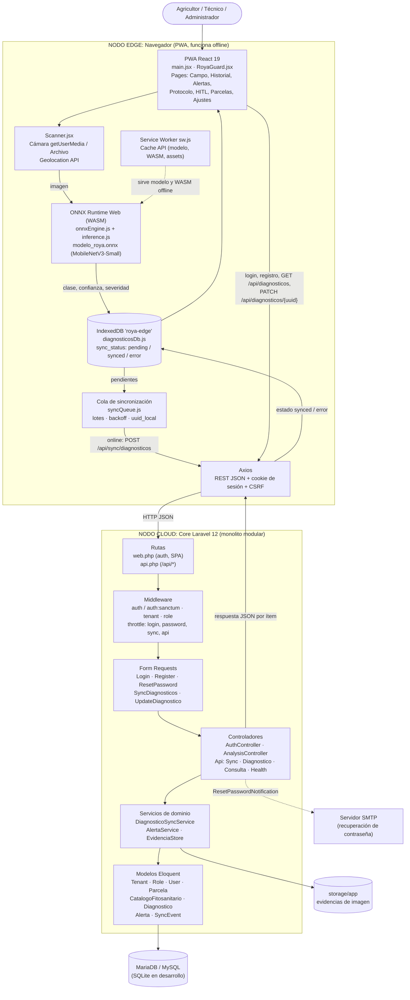
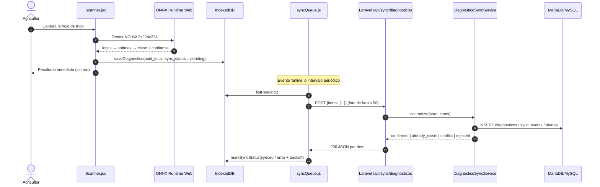
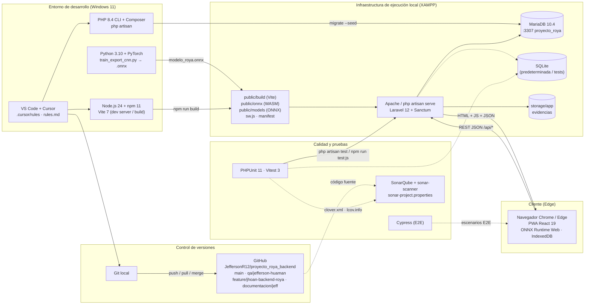

# 3. Arquitectura de software

## 3.1 Tipo de arquitectura identificada

El sistema RoyaGuard implementa una **arquitectura híbrida Edge-Cloud desacoplada, de tipo *offline-first***, compuesta por dos bloques que se despliegan y operan de forma independiente:

1. **Nodo Edge (navegador del agricultor o técnico):** una *Progressive Web App* (PWA) construida con React 19 que ejecuta la inferencia del modelo CNN **dentro del propio navegador** mediante ONNX Runtime Web (WebAssembly) y persiste cada diagnóstico en **IndexedDB** antes de cualquier comunicación con el servidor. Un *Service Worker* (`public/sw.js`) precarga el runtime WASM, el modelo y el manifiesto para que la aplicación funcione sin conexión en campo.
2. **Nodo Cloud (Core):** un **monolito modular Laravel 12** que expone una API REST JSON protegida con Laravel Sanctum, organizada en capas (rutas → middleware → *Form Requests* → controladores → servicios de dominio → modelos Eloquent) y que persiste en una base de datos relacional (MariaDB/MySQL; SQLite como alternativa de desarrollo).

Ambos nodos se comunican exclusivamente por HTTP/JSON a través de una **cola de sincronización** (`resources/js/lib/syncQueue.js`) que envía lotes de diagnósticos al endpoint `POST /api/sync/diagnosticos` cuando hay conectividad, con reintentos de *backoff* exponencial e idempotencia garantizada por el identificador `uuid_local`.

**¿Por qué no es un monolito clásico?** En un monolito clásico el servidor procesa la lógica central y el cliente solo presenta vistas. En RoyaGuard la funcionalidad crítica del negocio —**clasificar la hoja de trigo como sana, roya amarilla, otra enfermedad o no concluyente**— se ejecuta en el cliente, sin servidor. El backend no realiza inferencia: recibe resultados ya calculados, los valida, los consolida por organización (*tenant*) y genera alertas. El cliente tiene además su propia base de datos (IndexedDB) y su propio ciclo de vida offline.

**¿Por qué no son microservicios?** No existen servicios desplegados de forma independiente, con base de datos propia, que se comuniquen entre sí por red. El backend es una única aplicación Laravel con un único esquema de datos; su modularidad es **interna** (servicios `DiagnosticoSyncService`, `AlertaService`, `EvidenciaStore`; middleware `EnsureRole` y `EnsureTenantIsActive`; trait `BelongsToTenant`). La documentación de planificación (`Docs/08_Iteracion_04_Microservicio_Edge.md`) contempla un microservicio FastAPI para inferencia, pero **ese servicio no fue implementado**: la inferencia se trasladó al navegador con ONNX Runtime Web, lo que eliminó la necesidad de un servidor de IA y su dependencia de conectividad. Por fidelidad a la implementación real, **FastAPI no forma parte de la arquitectura documentada**.

**Justificación respecto al problema:** las parcelas de trigo de la Comunidad Campesina de Aramachay (Jauja, Junín) tienen cobertura móvil intermitente. Una arquitectura que dependa del servidor para diagnosticar haría imposible la detección temprana de la roya amarilla en el momento de la inspección. El enfoque Edge-Cloud permite diagnosticar en el surco y consolidar la información en la nube cuando el dispositivo recupera señal.

## 3.2 Capas y componentes principales

| Capa / componente | Tecnología | Ubicación en el código | Responsabilidad |
|---|---|---|---|
| Frontend (PWA) | React 19 + Vite 7 + TailwindCSS 4 | `resources/js/main.jsx`, `resources/js/RoyaGuard.jsx`, `resources/js/pages/`, `resources/js/components/` | Interfaz de usuario, navegación por modos (campo, historial, alertas, protocolo, HITL, parcelas, ajustes), captura de imágenes y orquestación de la sincronización. |
| Inferencia Edge | ONNX Runtime Web 1.21 (backend WASM) | `resources/js/lib/onnxEngine.js`, `resources/js/lib/inference.js`, `public/onnx/`, `public/models/modelo_roya.onnx` | Preprocesa la imagen a tensor NCHW normalizado (ImageNet), ejecuta el modelo CNN (MobileNetV3-Small), aplica *softmax* y umbral de confianza. |
| Persistencia Edge | IndexedDB (base `roya-edge`) | `resources/js/lib/diagnosticosDb.js` | Guarda cada diagnóstico con su `uuid_local`, miniatura, coordenadas y estado de sincronización (`pending`, `synced`, `error`). |
| Capa offline | Service Worker + Cache API + Web App Manifest | `public/sw.js`, `public/manifest.webmanifest`, `resources/js/lib/pwa.js` | Precarga y sirve desde caché el modelo, el runtime WASM y los recursos estáticos. |
| Sincronización | Cola con *backoff* exponencial | `resources/js/lib/syncQueue.js`, `resources/js/lib/cloudDiagnosticos.js` | Envía los pendientes en lotes al reconectarse (evento `online`) y periódicamente; fusiona los registros locales con los de la nube. |
| Comunicación | Axios 1.x, REST JSON, cookie de sesión y token CSRF | `resources/js/bootstrap.js`, `resources/views/app.blade.php` (URLs inyectadas) | Transporte HTTP entre la PWA y el Core en el mismo origen. |
| Backend Core (API REST) | Laravel 12 + Sanctum 4 | `routes/web.php`, `routes/api.php`, `app/Http/Controllers/` | Autenticación, recepción de la sincronización, consulta y revisión de diagnósticos, alertas. |
| Seguridad transversal | Middleware y *rate limiting* | `app/Http/Middleware/EnsureRole.php`, `EnsureTenantIsActive.php`, `app/Providers/AppServiceProvider.php` | Control por rol (agricultor, técnico, administrador), aislamiento por *tenant*, límites de peticiones (login, password, sync 30/min, api 120/min). |
| Validación | *Form Requests* | `app/Http/Requests/` | Reglas de entrada (correo Gmail, teléfono peruano, lote de sync de 1 a 50 ítems, clases permitidas). |
| Servicios de dominio | Clases PHP | `app/Services/DiagnosticoSyncService.php`, `AlertaService.php`, `EvidenciaStore.php` | Sincronización idempotente, generación de alertas por umbral y almacenamiento de evidencias como archivo. |
| Persistencia Cloud | Eloquent ORM + MariaDB 10.4 (XAMPP) / SQLite | `app/Models/`, `database/migrations/`, `config/database.php` | Modelo relacional multi-tenant. |
| Almacenamiento de evidencias | Laravel Filesystem (disco `local`) | `storage/app/` mediante `EvidenciaStore` | Imágenes de los diagnósticos como archivo (máximo 2 MB), no como base64 en la BD. |

## 3.3 Módulos funcionales y responsabilidades

| Módulo | Responsabilidad | Evidencia en el código | Estado |
|---|---|---|---|
| Autenticación | Inicio de sesión, registro y cierre de sesión con sesión de Laravel. Valida correo Gmail y teléfono peruano, y limita intentos. | `AuthController` (`login`, `register`, `logout`); `pages/Login.jsx`, `pages/Register.jsx`; `LoginRequest`, `RegisterRequest`; `app/Support/AuthRules.php` | Implementado |
| Recuperación de contraseña | Envía un enlace firmado por correo y permite restablecer la contraseña con el token. | `AuthController@sendResetLink`, `@resetPassword`; `app/Notifications/ResetPasswordNotification.php`; `pages/ForgotPassword.jsx`, `pages/ResetPassword.jsx` | Implementado |
| Escáner / Análisis | Captura por cámara (`getUserMedia`) o archivo, inferencia ONNX local, georreferenciación opcional y guardado en IndexedDB. | `components/Scanner.jsx`, `lib/onnxEngine.js`, `lib/inference.js`, `lib/diagnosticosDb.js` | Implementado |
| Vista de campo (panel) | Resumen operativo: total de capturas, casos de roya, sanas, otras enfermedades, no concluyentes y parcelas recientes. | `pages/CampoPage.jsx`; `summarizeDiagnosticos()` en `lib/inference.js` | Implementado (indicadores calculados en el cliente) |
| Historial | Lista de diagnósticos locales y de la nube con filtros por clase y búsqueda. | `components/History.jsx`; `GET /api/diagnosticos` (paginado en el servidor) | Implementado |
| Sincronización Edge-Cloud | Envío por lotes, idempotencia por `uuid_local`, reintentos y registro de eventos. | `lib/syncQueue.js`; `SyncController`; `DiagnosticoSyncService`; tabla `sync_events` | Implementado |
| Validación humana (HITL) | El técnico o administrador confirma o corrige la clase predicha (`hitl_status`, `etiqueta_humana`). | `pages/HitlPage.jsx`; `PATCH /api/diagnosticos/{uuid}` con `role:tecnico,administrador` | Implementado |
| Alertas | Avisos por casos de roya sobre el umbral. En la nube, `AlertaService` crea registros en `alertas` al sincronizar o al revisar; en la PWA se derivan de los diagnósticos para operar offline. | `app/Services/AlertaService.php`; `pages/AlertsPage.jsx`; `lib/alertas.js`; `GET /api/alertas` | Implementado (la PWA aún no consume `/api/alertas`) |
| Catálogo fitosanitario y protocolo | Fichas de enfermedad (agente causal, síntomas, recomendaciones, umbral) y protocolo de acción según el resultado. | Tabla `catalogo_fitosanitario` + `CatalogoFitosanitarioSeeder`; `lib/catalogo.js`; `pages/ProtocolPage.jsx`; `components/AgentePanel.jsx` | Implementado (la PWA usa una copia local del catálogo) |
| Parcelas | Agrupa los diagnósticos por lote o parcela. | Tabla `parcelas`; `pages/ParcelasPage.jsx`; `lib/parcelasStore.js` | Implementado |
| Multi-tenant y roles | Aislamiento de datos por organización; roles agricultor, técnico y administrador. | Tablas `tenants`, `roles`; trait `BelongsToTenant`; `RoleSeeder`; `lib/roles.js` | Implementado |
| Gestión de usuarios (CRUD administrativo) | — | No existen rutas ni controlador de administración de usuarios. El alta es por autorregistro y el rol se asigna en la BD. | No implementado |
| Reportes | — | Se implementa en la Actividad 5 de este informe. | Pendiente |

## 3.4 Comunicación entre componentes

**Flujo A: diagnóstico en campo (con o sin conexión).**

1. El usuario abre el escáner (`Scanner.jsx`) y captura la hoja con la cámara o selecciona un archivo.
2. `onnxEngine.js` carga el runtime WASM desde `/onnx/` y el modelo desde `/models/modelo_roya.onnx` (servidos por el *Service Worker* si no hay red).
3. La imagen se convierte en tensor y se ejecuta `InferenceSession.run()` en el navegador. `inference.js` aplica *softmax* y el umbral, y produce la clase, la confianza, la severidad y los *scores*.
4. `createDiagnosticoLocal()` genera el registro con `uuid_local` y lo guarda en IndexedDB con `sync_status = pending`. **El resultado se muestra al usuario sin ninguna petición al servidor.**

**Flujo B: sincronización (cuando hay conectividad).**

5. `RoyaGuard.jsx` dispara `syncPendientes()` al recibir el evento `online` del navegador y también de forma periódica.
6. `syncQueue.js` toma los pendientes cuyo reintento ya venció y los envía con Axios en lotes a `POST /api/sync/diagnosticos`, usando la cookie de sesión y el token CSRF.
7. En Laravel, la petición atraviesa `auth:sanctum`, `tenant` y `throttle:sync`, y luego `SyncDiagnosticosRequest`, que valida el lote.
8. `DiagnosticoSyncService` procesa cada ítem de forma **idempotente** y devuelve uno de cuatro estados: `confirmed` (creado), `already_exists` (reenvío idéntico), `conflict` (mismo `uuid_local` con datos distintos) o `rejected` (parcela no autorizada o evidencia inválida). `EvidenciaStore` guarda la imagen como archivo, `AlertaService` genera una alerta si se supera el umbral y se registra un `sync_event`.
9. La respuesta devuelve el resultado por ítem, y la PWA actualiza el estado en IndexedDB (`synced`, o `error` con un nuevo reintento programado por *backoff*).

**Flujo C: consulta y revisión (online).**

10. La PWA consulta `GET /api/diagnosticos` y fusiona los registros de la nube con los locales (`cloudDiagnosticos.js`).
11. El técnico revisa en `HitlPage.jsx` y envía `PATCH /api/diagnosticos/{uuid}`, que actualiza `hitl_status` y `etiqueta_humana` y reevalúa la alerta.

**Flujo D: autenticación.** Las páginas de autenticación hacen `POST` a `/login`, `/register`, `/forgot-password` y `/reset-password` (rutas web con middleware `guest` y *rate limiting*). Laravel responde en JSON y la sesión queda guardada en la tabla `sessions`.

## 3.5 Gestión e interacción con la base de datos

- **Motor:** el archivo `config/database.php` define `sqlite` como conexión por defecto (también en `.env.example`), lo que permite levantar el proyecto sin servidor de BD. El entorno de trabajo real (`.env`) usa la conexión `mysql` contra **MariaDB 10.4.32** incluido en XAMPP (`127.0.0.1:3307`, base `proyecto_roya`). Las pruebas automáticas de PHPUnit usan SQLite en memoria.
- **Esquema versionado:** el esquema se gestiona exclusivamente con **migraciones de Laravel** (`database/migrations/`, 15 archivos) y datos iniciales con *seeders* (`RoleSeeder`, `CatalogoFitosanitarioSeeder`). El nodo Edge tiene un esquema de referencia en `database/edge/schema.sqlite.sql`.
- **Acceso a datos:** se hace solo a través de Eloquent ORM. El trait `BelongsToTenant` y el *scope* `visiblePara($user)` restringen cada consulta a la organización y al rol del usuario.

| Tabla | Propósito | Relaciones principales |
|---|---|---|
| `tenants` | Organización o comunidad (multi-tenant) | 1:N users, parcelas, diagnosticos |
| `roles` | Agricultor, técnico, administrador | 1:N users (`rol_id`) |
| `users` | Usuarios con teléfono, organización y último acceso | N:1 tenant, role; 1:N parcelas, diagnosticos |
| `parcelas` | Lotes de cultivo (trigo) con coordenadas y área | N:1 tenant, user; 1:N diagnosticos |
| `catalogo_fitosanitario` | Enfermedades, recomendaciones y `umbral_alerta` | 1:N diagnosticos |
| `diagnosticos` | Resultado de cada inspección: `clase`, `confianza`, `severidad`, `scores`, coordenadas, `imagen_path`, `modelo_version`, `captured_at`, `synced_at`, `sync_status`, `hitl_status`, `etiqueta_humana`, *soft delete* | N:1 tenant, user, parcela, catálogo; 1:N alertas |
| `alertas` | Avisos generados por umbral, con estado `leida` | N:1 diagnostico, user, tenant |
| `sync_events` | Trazabilidad de la sincronización (estado, intentos, último error) | N:1 tenant |
| `analyses` | Tabla de la primera iteración (imagen en base64); reemplazada por `diagnosticos` | N:1 user |
| `password_reset_tokens` | Tokens de recuperación de contraseña | — |
| `sessions` | Sesiones de usuario (`SESSION_DRIVER=database`) | — |
| `personal_access_tokens` | Tokens Bearer de Sanctum para clientes no web | polimórfica |
| `cache`, `cache_locks`, `jobs`, `job_batches`, `failed_jobs` | Infraestructura de Laravel (caché y colas en BD) | — |

## 3.6 Integración con APIs externas

El sistema **no integra APIs de terceros para su funcionalidad principal**, y esto es una decisión de diseño, no una omisión. La detección de la roya amarilla debe funcionar en parcelas sin cobertura de datos. Por eso la inferencia se ejecuta localmente con un modelo propio entrenado y exportado a ONNX (`scripts/train_export_cnn.py`), en lugar de depender de servicios de visión en la nube que requieren conexión, generan costos por petición y obligan a enviar a terceros las imágenes de los cultivos de la comunidad. Tampoco se usan mapas, clima ni pasarelas externas, porque ningún requisito funcional del MVP los necesita.

Las únicas integraciones con servicios o interfaces externas al código del proyecto son las siguientes:

| API / servicio | Funcionalidad | Información intercambiada | Justificación |
|---|---|---|---|
| Servidor SMTP (configurable; Gmail SMTP en `.env.example`) | Envío del correo de recuperación de contraseña (`ResetPasswordNotification`) | Correo destino y enlace con token firmado y caducable | Necesario para que el usuario recupere el acceso sin intervención del administrador. En desarrollo se usa `MAIL_MAILER=log`, que escribe el correo en `storage/logs/laravel.log`. |
| Geolocation API del navegador | Georreferenciar la captura (`Scanner.jsx`) | Latitud y longitud del dispositivo, con permiso del usuario | Permite ubicar los focos de roya por parcela. Es una API local del dispositivo, no requiere red. |
| MediaDevices API (`getUserMedia`) | Acceso a la cámara para la captura | Flujo de video local (no sale del dispositivo) | Permite capturar la hoja directamente en campo. |
| IndexedDB, Cache API y Service Worker | Persistencia y funcionamiento offline | Datos locales del propio dispositivo | Son la base del enfoque *offline-first*. |

## 3.7 Diagrama de arquitectura de software



**Diagrama complementario: secuencia de diagnóstico offline y sincronización**



---

# 4. Arquitectura tecnológica

## 4.1 Tecnologías utilizadas y justificación

Las versiones corresponden a lo instalado y verificado en el entorno de trabajo (`composer.json`, `package.json`, `node_modules/*/package.json`, `php -v`, `php artisan --version`).

| Categoría | Tecnología (versión) | Evidencia | Justificación de la elección |
|---|---|---|---|
| Frontend | React 19.3, Vite 7.3, TailwindCSS 4.3, Framer Motion 14.7 | `package.json`, `vite.config.js` | React permite componer una SPA por modos con estado compartido (diagnósticos locales y de la nube). Vite ofrece HMR rápido y se integra con Laravel mediante `laravel-vite-plugin`. Tailwind acelera una interfaz *mobile-first* consistente para uso en campo. |
| Inferencia Edge | ONNX Runtime Web 1.21 (WASM) | `package.json`, `resources/js/lib/onnxEngine.js`, `public/onnx/` | Ejecuta el modelo CNN dentro del navegador, sin servidor ni red. ONNX es un formato estándar exportable desde PyTorch, y el backend WASM funciona en móviles de gama media. |
| PWA / offline | Service Worker, Cache API, IndexedDB, Web App Manifest | `public/sw.js`, `public/manifest.webmanifest`, `resources/js/lib/diagnosticosDb.js` | Son estándares nativos del navegador: no requieren tienda de apps ni instalación nativa y permiten operar sin cobertura. |
| Comunicación | Axios 1.x, REST JSON | `resources/js/bootstrap.js`, `routes/api.php` | Axios gestiona automáticamente el token CSRF (XSRF) de Laravel. REST JSON es simple de probar, depurar y automatizar con Cypress. |
| Backend | PHP 8.4.24 | `php -v` | Es la versión estable soportada por Laravel 12 y viene incluida en XAMPP. |
| Framework | Laravel 12.69 (`laravel/framework ^12.0`) + Sanctum 4 | `composer.json`, `php artisan --version` | Aporta migraciones, Eloquent, validación con *Form Requests*, *rate limiting*, notificaciones de correo y autenticación SPA por cookie (Sanctum) con poco código propio, lo que reduce defectos. |
| Base de datos | MariaDB 10.4.32 (XAMPP) en el entorno de trabajo; SQLite como predeterminada y para pruebas | `config/database.php`, `.env.example`, `.env`, `mysql --version` | MariaDB es compatible con MySQL y está disponible localmente con XAMPP. SQLite permite clonar y ejecutar el proyecto sin servidor de BD y correr PHPUnit en memoria. Las migraciones mantienen el esquema portable entre ambos motores. |
| Entrenamiento del modelo | Python 3.10, PyTorch ≥ 2.5, torchvision, ONNX | `scripts/requirements-ml.txt`, `scripts/train_export_cnn.py` | PyTorch permite el *transfer learning* sobre MobileNetV3-Small y la exportación directa a ONNX que consume la PWA. |
| Entorno de desarrollo | Visual Studio Code + Cursor (asistente IA) | Carpeta `.cursor/rules`, `rules/rules.md` | VS Code con extensiones para PHP y React. Cursor aplica reglas del proyecto (`rules.md`) para mantener la consistencia del código. |
| Control de versiones | Git 2.55 + GitHub | Repositorio `JeffersonR12/proyecto_roya_backend` | Historial trazable, trabajo por ramas por integrante o rol y revisión por *merge* antes de llegar a `main`. |
| Servidor / infraestructura | XAMPP (Apache + MariaDB) y el servidor integrado `php artisan serve`, más Node.js 24 para la compilación | Entorno local | Infraestructura sin costo y suficiente para el MVP académico. No se usa Docker para ejecutar la aplicación. |
| Pruebas unitarias e integración | PHPUnit 11.5 (unos 60 tests); Vitest 3.2 (unos 107 tests) | `phpunit.xml`, `vitest.config.js`, `tests/`, `resources/js/lib/*.test.js` | Ya están presentes. Cubren autenticación, sincronización, multi-tenant, inferencia, cola de sincronización y alertas. |
| Automatización E2E | Cypress | A integrar en la Actividad 3 | Ejecuta escenarios en un navegador real sobre la aplicación en ejecución, que es lo que pide la rúbrica. |
| Análisis de calidad | SonarQube Community | `sonar-project.properties` (ya presente); servidor a integrar en la Actividad 4 | Mide *bugs*, vulnerabilidades, *code smells*, duplicación, deuda técnica y cobertura de PHP y JavaScript en un único panel. |

## 4.2 Diagrama de arquitectura tecnológica

Los elementos con línea discontinua corresponden a las herramientas de calidad que se integran en las Actividades 3 y 4 de este informe.



## 4.3 Entorno de trabajo y despliegue

### 4.3.1 Entorno de desarrollo

Se trabaja en Windows 11 con **XAMPP**, que provee Apache, PHP 8.4 y MariaDB 10.4 (puerto 3307), además de **Node.js 24** con npm para compilar el frontend, **Composer** para las dependencias PHP y **Python 3.10** con PyTorch para entrenar y exportar el modelo. El editor es **Visual Studio Code** con el asistente **Cursor**, que aplica las reglas del proyecto definidas en `.cursor/rules` y `rules/rules.md`.

### 4.3.2 Administración del código fuente

El código se versiona con Git y se aloja en GitHub (`https://github.com/JeffersonR12/proyecto_roya_backend`). Se usa un flujo por ramas:

| Rama | Propósito |
|---|---|
| `main` | Versión integrada y estable del proyecto. |
| `qa/jefferson-huaman` | Pruebas y control de calidad; se integra a `main` mediante *merge* (por ejemplo, el commit `e115410 Merge branch 'qa/jefferson-huaman' into main`). |
| `feature/jhoan-backend-roya` | Desarrollo del backend, la API REST con Sanctum y la sincronización Edge-Cloud. |
| `documentacion/jeff` | Documentación técnica del proyecto. |

Los artefactos generados y pesados (`vendor/`, `node_modules/`, `public/build/`, el runtime WASM y el modelo `.onnx`) están excluidos en `.gitignore` y se regeneran con los comandos de instalación.

### 4.3.3 Procedimiento para ejecutar el sistema

```bash
# 1. Dependencias
composer install
npm install                      # postinstall copia ONNX Runtime Web a public/onnx

# 2. Configuración
cp .env.example .env             # por defecto SQLite; para MariaDB: DB_CONNECTION=mysql, DB_PORT=3307
php artisan key:generate
php artisan migrate --seed       # crea tablas, roles y catálogo fitosanitario

# 3. Modelo de IA (no versionado)
# Copiar el modelo exportado a: public/models/modelo_roya.onnx
# (se genera con: python scripts/train_export_cnn.py)

# 4. Ejecución en desarrollo (dos terminales)
php artisan serve                # http://127.0.0.1:8000
npm run dev                      # Vite con HMR

# 5. Compilación para entrega
npm run build                    # genera public/build

# 6. Pruebas
php artisan test                 # PHPUnit
npm run test:js                  # Vitest
```

### 4.3.4 Infraestructura de despliegue

El sistema se despliega en una **infraestructura local** basada en XAMPP: Apache sirve la aplicación Laravel (o `php artisan serve` durante el desarrollo), MariaDB almacena los datos y `storage/app` guarda las evidencias de imagen. Los recursos de la PWA (compilación de Vite, runtime WASM, modelo ONNX y *Service Worker*) se publican desde `public/`. Una vez que el navegador del usuario carga la PWA, el *Service Worker* guarda en caché el modelo y el runtime, y desde ese momento el escáner funciona sin conexión.

Actualmente no hay un despliegue en un servidor público ni contenedores Docker para ejecutar la aplicación. Para producción, la misma estructura es trasladable a cualquier *hosting* con PHP 8.2 o superior y MySQL o MariaDB. **Requisito:** el dominio debe usar HTTPS, porque la cámara, la geolocalización y el *Service Worker* solo funcionan en contextos seguros o en `localhost`.

### 4.3.5 Procedimiento para publicar versiones

1. Desarrollar en una rama de trabajo (`feature/*`) con commits descriptivos.
2. Ejecutar las pruebas locales (`php artisan test`, `npm run test:js` y, tras la Actividad 3, Cypress) y el análisis de SonarQube.
3. Hacer `git push` de la rama a GitHub.
4. Integrar en la rama de QA (`qa/jefferson-huaman`) para validar.
5. Hacer *merge* a `main` una vez aprobada la validación.
6. En el servidor de destino: `git pull`, `composer install --no-dev --optimize-autoloader`, `npm ci && npm run build`, `php artisan migrate --force` y `php artisan config:cache route:cache view:cache`.
7. Cambiar el nombre de caché del *Service Worker* (`CACHE = 'roya-edge-vN'` en `public/sw.js`) cuando cambie el modelo, para forzar su actualización en los dispositivos.

---

# Anexos: evidencias a capturar para las Actividades 1 y 2

| N.º | Evidencia | Cómo obtenerla | Sustenta |
|---|---|---|---|
| A1 | Diagramas de arquitectura de software y de secuencia exportados como imagen | Pegar los bloques Mermaid en https://mermaid.live y exportar a PNG o SVG | 3.7 |
| A2 | Diagrama de arquitectura tecnológica exportado | Igual que A1 | 4.2 |
| A3 | Listado de rutas reales | `php artisan route:list --except-vendor` (captura de la terminal) | 3.3, 3.4 |
| A4 | Estructura de capas del backend | Captura del explorador de VS Code con `app/Http/Controllers`, `app/Services`, `app/Models` y `app/Http/Middleware` desplegados | 3.2 |
| A5 | Estado de las migraciones | `php artisan migrate:status` | 3.5 |
| A6 | Tablas reales en la BD | phpMyAdmin (XAMPP), base `proyecto_roya`, con la estructura de `diagnosticos` | 3.5 |
| A7 | Inferencia offline | DevTools → pestaña *Network* en **Offline** → realizar un escaneo → captura del resultado | 3.1, 3.4 |
| A8 | Persistencia Edge | DevTools → *Application* → IndexedDB → `roya-edge` con un registro `pending` | 3.2, 3.4 |
| A9 | *Service Worker* y caché | DevTools → *Application* → *Service Workers* y *Cache Storage* (`roya-edge-v1`) | 3.2 |
| A10 | Sincronización | Volver a *Online* → DevTools → *Network* → petición `POST /api/sync/diagnosticos` con su respuesta JSON, y la fila nueva en `diagnosticos` en phpMyAdmin | 3.4 |
| A11 | Seguridad por rol | Respuesta 403 al hacer `PATCH /api/diagnosticos/{uuid}` con un usuario agricultor (o el test `TenantDiagnosticoTest`) | 3.2 |
| A12 | Correo de recuperación | Solicitar la recuperación y mostrar el enlace en `storage/logs/laravel.log` (`MAIL_MAILER=log`) | 3.6 |
| A13 | Versiones del entorno | `php -v`, `php artisan --version`, `node -v`, `npm -v`, `git --version`, `C:\xampp\mysql\bin\mysql --version` | 4.1 |
| A14 | Dependencias declaradas | Captura de `composer.json` y `package.json` | 4.1 |
| A15 | Ramas del repositorio | `git branch -a` y captura de la página de ramas en GitHub | 4.3.2 |
| A16 | Historial de integración | `git log --oneline --graph -15` | 4.3.2, 4.3.5 |
| A17 | Sistema en ejecución | Terminales con `php artisan serve` y `npm run dev` activas, más el navegador en la vista de campo | 4.3.3 |
| A18 | Pruebas existentes en verde | `php artisan test` y `npm run test:js` | 4.1 |
