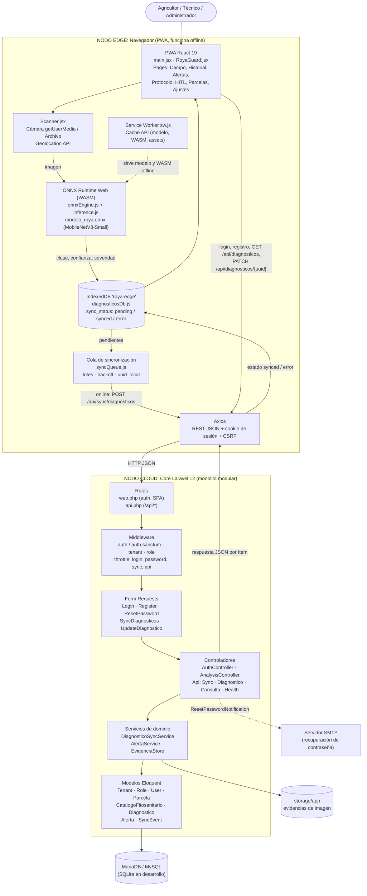
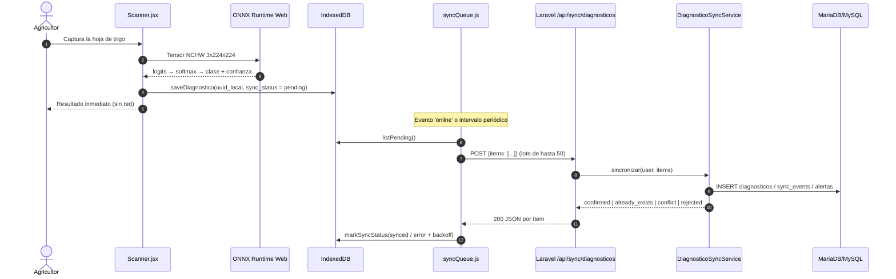
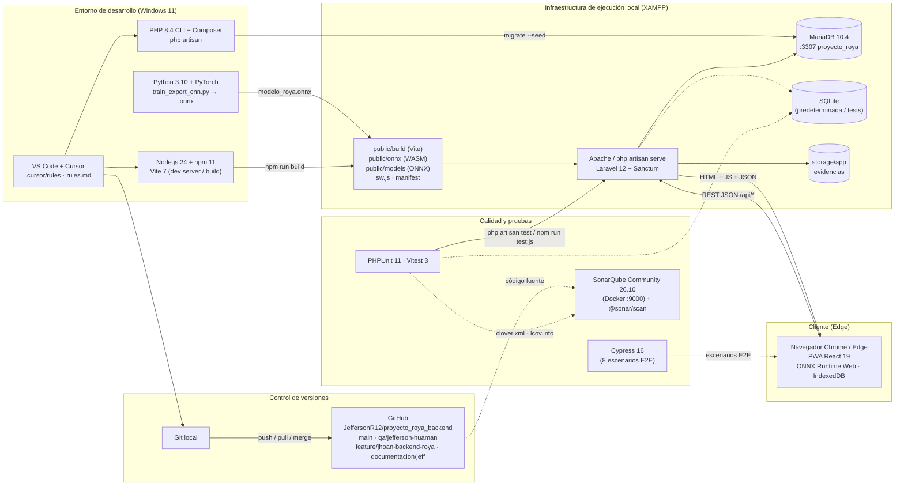

<div align="center">

**UNIVERSIDAD CONTINENTAL**

**Facultad de Ingeniería**

**Escuela Académico Profesional de Ingeniería de Sistemas e Informática**

&nbsp;

# Sistema Web para la Detección Temprana de Roya Amarilla en Cultivos de Trigo mediante Tecnología Edge Computing en el Valle del Mantaro

### RiwiScan: Comunidad Campesina de Aramachay (Jauja, Junín)

&nbsp;

**Informe de práctica individual**

**Asignatura:** Pruebas y Calidad de Software

&nbsp;

**Autor:** Sosa Porras Jhoan José (Código: 71127716)

**Docente:** ______________________________________

&nbsp;

**Huancayo, noviembre de 2026**

</div>

<div style="page-break-after: always;"></div>

## Índice

*(En Word: Referencias → Tabla de contenido, para generar el índice automático con números de página; y Referencias → Insertar tabla de ilustraciones, para el índice de figuras.)*

1. Introducción
2. Descripción general del proyecto
3. Arquitectura de software
4. Arquitectura tecnológica
5. Integración y automatización de pruebas con Cypress
6. Integración y análisis de calidad con SonarQube
7. Implementación del módulo de reportes
8. Análisis del impacto funcional del software
9. Conclusiones
10. Referencias bibliográficas
11. Anexos y evidencias
12. Guía de capturas de pantalla

<div style="page-break-after: always;"></div>

# 1. Introducción

Este informe documenta la práctica individual de **Pruebas y Calidad de Software** realizada sobre **RiwiScan**, un sistema Edge-Cloud para la detección temprana de la Roya Amarilla (*Puccinia striiformis* f. sp. *tritici*) en cultivos de trigo. La práctica tuvo seis objetivos:

1. Documentar la arquitectura de software **tal como está implementada**.
2. Documentar la arquitectura tecnológica y justificar cada tecnología.
3. Integrar Cypress y ejecutar escenarios automatizados sobre funcionalidades reales.
4. Integrar SonarQube, analizar sus métricas y aplicar mejoras.
5. Implementar un módulo de reportes con indicadores obtenidos de registros reales de la base de datos.
6. Analizar el impacto funcional del software sobre el problema que aborda.

Como criterio transversal, cada afirmación del informe se respalda con evidencia verificable: rutas del código fuente, comandos reproducibles, resultados de ejecución y capturas. Cuando una cifra proviene de datos sintéticos o de un modelo de prueba, se indica de forma explícita.

**Resultados principales de la práctica:**

| Ámbito | Resultado verificado |
|---|---|
| Pruebas E2E (Cypress 16.2) | 8 escenarios, 14 casos, **14/14 aprobados** |
| Pruebas unitarias e integración | PHPUnit **81/81** (316 aserciones); Vitest **141/141** |
| SonarQube (Community Build 26.10) | Issues de **4 → 1** (falso positivo justificado); cobertura de **35,6 % → 40,7 %**; confiabilidad **C → A**; deuda técnica **15 → 0 min** |
| Defectos funcionales | **DEF-01** y **DEF-02** detectados por Cypress y corregidos (el escáner no ejecutaba la CNN en modo desarrollo) |
| Módulo de reportes | 3 indicadores principales y 4 complementarios calculados en vivo, exportación CSV, filtros por fecha y origen de datos, 11 pruebas de API y 1 escenario E2E |

# 2. Descripción general del proyecto

## 2.1 Contexto y problema

La Roya Amarilla del trigo es una enfermedad fúngica de rápida dispersión. Su control depende de detectarla temprano: si no se detecta en sus fases iniciales, puede causar pérdidas de hasta el 70 % del rendimiento (Chen, 2005). En la Comunidad Campesina de Aramachay (Jauja, Junín), en el Valle del Mantaro, el análisis del MVP identificó tres condiciones que retrasan el diagnóstico:

- **Pocos especialistas.** Pocos especialistas fitosanitarios atienden las parcelas, y la inspección depende de su visita.
- **Conectividad limitada.** La cobertura en campo es intermitente, así que una solución que necesite internet para diagnosticar no sirve en el surco.
- **Sin registros consolidados.** No hay un historial de focos y severidad por parcela que permita ver la evolución de la enfermedad.

## 2.2 Solución propuesta

RiwiScan es una aplicación web progresiva (PWA) con arquitectura **Edge-Cloud *offline-first***:

- **En el dispositivo (Edge).** El agricultor fotografía la hoja de trigo. Una red neuronal convolucional (MobileNetV3-Small, formato ONNX) la clasifica **dentro del navegador** como *sana*, *roya amarilla* u *otra enfermedad*. Si la confianza es menor a 75 %, el resultado es *no concluyente*. El diagnóstico se guarda en IndexedDB, sin necesidad de conexión.
- **En la nube (Cloud).** Cuando el dispositivo recupera señal, una cola de sincronización envía los diagnósticos a un backend Laravel. El backend los consolida por organización, genera alertas cuando se supera el umbral y permite la validación humana (*Human-in-the-Loop*, HITL) por parte de técnicos.

## 2.3 Usuarios y funcionalidades implementadas

| Rol | Funcionalidades disponibles |
|---|---|
| Agricultor | Registro e inicio de sesión, recuperación de contraseña, escaneo con cámara o archivo, inferencia local, historial propio, alertas, protocolo de acción, parcelas y reportes de sus propios diagnósticos |
| Técnico | Todo lo anterior sobre su organización (*tenant*), más la **revisión técnica HITL** (validar o corregir diagnósticos) |
| Administrador | Igual que el técnico; además puede dar de baja diagnósticos desde la API |

## 2.4 Alcance de esta versión y limitaciones declaradas

- **Modelo de IA.** En esta versión el sistema usa un **modelo placeholder** con la misma arquitectura y el mismo contrato que el modelo de producción (MobileNetV3-Small, entrada 1×3×224×224, 3 logits), con la capa de clasificación en cero. Toda predicción resulta "no concluyente", de modo que nunca se emite un falso positivo de roya. Este modelo valida de extremo a extremo el pipeline Edge: carga, preprocesamiento, umbral, persistencia y sincronización. El modelo entrenado (`scripts/train_export_cnn.py`) se incorpora sin cambios en el código.
- **Datos.** Los registros de campo existentes son pocos (pruebas de desarrollo). Para ilustrar el módulo de reportes se generaron **40 diagnósticos sintéticos**, marcados como tales (`modelo_version = demo-seeder-v1`), que el sistema **nunca mezcla** con los datos de campo sin indicarlo.
- **Gestión de usuarios.** No existe un CRUD administrativo de usuarios: el alta es por autorregistro y el rol se asigna en la base de datos.

<div style="page-break-after: always;"></div>

# 3. Arquitectura de software

## 3.1 Tipo de arquitectura identificada

El sistema RiwiScan (componente raíz de la PWA: `RoyaGuard.jsx`) implementa una **arquitectura híbrida Edge-Cloud desacoplada, de tipo *offline-first***, compuesta por dos bloques que se despliegan y operan de forma independiente:

1. **Nodo Edge (navegador del agricultor o técnico):** una *Progressive Web App* (PWA) construida con React 19 que ejecuta la inferencia del modelo CNN **dentro del propio navegador** mediante ONNX Runtime Web (WebAssembly) y persiste cada diagnóstico en **IndexedDB** antes de cualquier comunicación con el servidor. Un *Service Worker* (`public/sw.js`) precarga el runtime WASM, el modelo y el manifiesto para que la aplicación funcione sin conexión en campo.
2. **Nodo Cloud (Core):** un **monolito modular Laravel 12** que expone una API REST JSON protegida con Laravel Sanctum, organizada en capas (rutas → middleware → *Form Requests* → controladores → servicios de dominio → modelos Eloquent) y que persiste en una base de datos relacional (MariaDB/MySQL; SQLite como alternativa de desarrollo).

Ambos nodos se comunican exclusivamente por HTTP/JSON a través de una **cola de sincronización** (`resources/js/lib/syncQueue.js`) que envía lotes de diagnósticos al endpoint `POST /api/sync/diagnosticos` cuando hay conectividad, con reintentos de *backoff* exponencial e idempotencia garantizada por el identificador `uuid_local`.

**¿Por qué no es un monolito clásico?** En un monolito clásico el servidor procesa la lógica central y el cliente solo presenta vistas. En RoyaGuard la funcionalidad crítica del negocio —**clasificar la hoja de trigo como sana, roya amarilla, otra enfermedad o no concluyente**— se ejecuta en el cliente, sin servidor. El backend no realiza inferencia: recibe resultados ya calculados, los valida, los consolida por organización (*tenant*) y genera alertas. El cliente tiene además su propia base de datos (IndexedDB) y su propio ciclo de vida offline.

**¿Por qué no son microservicios?** No existen servicios desplegados de forma independiente, con base de datos propia, que se comuniquen entre sí por red. El backend es una única aplicación Laravel con un único esquema de datos; su modularidad es **interna** (servicios `DiagnosticoSyncService`, `AlertaService`, `EvidenciaStore`; middleware `EnsureRole` y `EnsureTenantIsActive`; trait `BelongsToTenant`). La documentación de planificación (`Docs/08_Iteracion_04_Microservicio_Edge.md`) contempla un microservicio FastAPI para inferencia, pero **ese servicio no fue implementado**: la inferencia se trasladó al navegador con ONNX Runtime Web, lo que eliminó la necesidad de un servidor de IA y su dependencia de conectividad. Por fidelidad a la implementación real, **FastAPI no forma parte de la arquitectura documentada**.

**Justificación respecto al problema:** las parcelas de trigo de la Comunidad Campesina de Aramachay (Jauja, Junín) tienen cobertura móvil intermitente. Una arquitectura que dependa del servidor para diagnosticar haría imposible la detección temprana de la roya amarilla en el momento de la inspección. El enfoque Edge-Cloud permite diagnosticar en el surco y consolidar la información en la nube cuando el dispositivo recupera señal.

## 3.2 Capas y componentes principales

| Capa / componente | Tecnología | Ubicación en el código | Responsabilidad |
|---|---|---|---|
| Frontend (PWA) | React 19 + Vite 7 + TailwindCSS 4 | `resources/js/main.jsx`, `resources/js/RoyaGuard.jsx`, `resources/js/pages/`, `resources/js/components/` | Interfaz de usuario, navegación por modos (campo, historial, alertas, protocolo, HITL, parcelas, ajustes), captura de imágenes y orquestación de la sincronización. |
| Inferencia Edge | ONNX Runtime Web 1.21 (backend WASM) | `resources/js/lib/onnxEngine.js`, `resources/js/lib/inference.js`, `public/onnx/`, `public/models/modelo_roya.onnx` | Preprocesa la imagen a tensor NCHW normalizado (ImageNet), ejecuta el modelo CNN (MobileNetV3-Small), aplica *softmax* y umbral de confianza. |
| Persistencia Edge | IndexedDB (base `roya-edge`) | `resources/js/lib/diagnosticosDb.js` | Guarda cada diagnóstico con su `uuid_local`, miniatura, coordenadas y estado de sincronización (`pending`, `synced`, `error`). |
| Capa offline | Service Worker + Cache API + Web App Manifest | `public/sw.js`, `public/manifest.webmanifest`, `resources/js/lib/pwa.js` | Precarga y sirve desde caché el modelo, el runtime WASM y los recursos estáticos. |
| Sincronización | Cola con *backoff* exponencial | `resources/js/lib/syncQueue.js`, `resources/js/lib/cloudDiagnosticos.js` | Envía los pendientes en lotes al reconectarse (evento `online`) y periódicamente; fusiona los registros locales con los de la nube. |
| Comunicación | Axios 1.x, REST JSON, cookie de sesión y token CSRF | `resources/js/bootstrap.js`, `resources/views/app.blade.php` (URLs inyectadas) | Transporte HTTP entre la PWA y el Core en el mismo origen. |
| Backend Core (API REST) | Laravel 12 + Sanctum 4 | `routes/web.php`, `routes/api.php`, `app/Http/Controllers/` | Autenticación, recepción de la sincronización, consulta y revisión de diagnósticos, alertas. |
| Seguridad transversal | Middleware y *rate limiting* | `app/Http/Middleware/EnsureRole.php`, `EnsureTenantIsActive.php`, `app/Providers/AppServiceProvider.php` | Control por rol (agricultor, técnico, administrador), aislamiento por *tenant*, límites de peticiones (login, password, sync 30/min, api 120/min). |
| Validación | *Form Requests* | `app/Http/Requests/` | Reglas de entrada (correo Gmail, teléfono peruano, lote de sync de 1 a 50 ítems, clases permitidas). |
| Servicios de dominio | Clases PHP | `app/Services/DiagnosticoSyncService.php`, `AlertaService.php`, `EvidenciaStore.php` | Sincronización idempotente, generación de alertas por umbral y almacenamiento de evidencias como archivo. |
| Persistencia Cloud | Eloquent ORM + MariaDB 10.4 (XAMPP) / SQLite | `app/Models/`, `database/migrations/`, `config/database.php` | Modelo relacional multi-tenant. |
| Almacenamiento de evidencias | Laravel Filesystem (disco `local`) | `storage/app/` mediante `EvidenciaStore` | Imágenes de los diagnósticos como archivo (máximo 2 MB), no como base64 en la BD. |

## 3.3 Módulos funcionales y responsabilidades

| Módulo | Responsabilidad | Evidencia en el código | Estado |
|---|---|---|---|
| Autenticación | Inicio de sesión, registro y cierre de sesión con sesión de Laravel. Valida correo Gmail y teléfono peruano, y limita intentos. | `AuthController` (`login`, `register`, `logout`); `pages/Login.jsx`, `pages/Register.jsx`; `LoginRequest`, `RegisterRequest`; `app/Support/AuthRules.php` | Implementado |
| Recuperación de contraseña | Envía un enlace firmado por correo y permite restablecer la contraseña con el token. | `AuthController@sendResetLink`, `@resetPassword`; `app/Notifications/ResetPasswordNotification.php`; `pages/ForgotPassword.jsx`, `pages/ResetPassword.jsx` | Implementado |
| Escáner / Análisis | Captura por cámara (`getUserMedia`) o archivo, inferencia ONNX local, georreferenciación opcional y guardado en IndexedDB. | `components/Scanner.jsx`, `lib/onnxEngine.js`, `lib/inference.js`, `lib/diagnosticosDb.js` | Implementado |
| Vista de campo (panel) | Resumen operativo: total de capturas, casos de roya, sanas, otras enfermedades, no concluyentes y parcelas recientes. | `pages/CampoPage.jsx`; `summarizeDiagnosticos()` en `lib/inference.js` | Implementado (indicadores calculados en el cliente) |
| Historial | Lista de diagnósticos locales y de la nube con filtros por clase y búsqueda. | `components/History.jsx`; `GET /api/diagnosticos` (paginado en el servidor) | Implementado |
| Sincronización Edge-Cloud | Envío por lotes, idempotencia por `uuid_local`, reintentos y registro de eventos. | `lib/syncQueue.js`; `SyncController`; `DiagnosticoSyncService`; tabla `sync_events` | Implementado |
| Validación humana (HITL) | El técnico o administrador confirma o corrige la clase predicha (`hitl_status`, `etiqueta_humana`). | `pages/HitlPage.jsx`; `PATCH /api/diagnosticos/{uuid}` con `role:tecnico,administrador` | Implementado |
| Alertas | Avisos por casos de roya sobre el umbral. En la nube, `AlertaService` crea registros en `alertas` al sincronizar o al revisar; en la PWA se derivan de los diagnósticos para operar offline. | `app/Services/AlertaService.php`; `pages/AlertsPage.jsx`; `lib/alertas.js`; `GET /api/alertas` | Implementado (la PWA aún no consume `/api/alertas`) |
| Catálogo fitosanitario y protocolo | Fichas de enfermedad (agente causal, síntomas, recomendaciones, umbral) y protocolo de acción según el resultado. | Tabla `catalogo_fitosanitario` + `CatalogoFitosanitarioSeeder`; `lib/catalogo.js`; `pages/ProtocolPage.jsx`; `components/AgentePanel.jsx` | Implementado (la PWA usa una copia local del catálogo) |
| Parcelas | Agrupa los diagnósticos por lote o parcela. | Tabla `parcelas`; `pages/ParcelasPage.jsx`; `lib/parcelasStore.js` | Implementado |
| Multi-tenant y roles | Aislamiento de datos por organización; roles agricultor, técnico y administrador. | Tablas `tenants`, `roles`; trait `BelongsToTenant`; `RoleSeeder`; `lib/roles.js` | Implementado |
| Gestión de usuarios (CRUD administrativo) | — | No existen rutas ni controlador de administración de usuarios. El alta es por autorregistro y el rol se asigna en la BD. | No implementado |
| Reportes | Indicadores de vigilancia (diagnósticos por clase, incidencia de roya, confianza promedio), serie mensual, control de calidad de datos y exportación CSV | `Api/ReportController`, `app/Services/ReporteService.php`, `pages/ReportsPage.jsx`; `GET /api/reports/summary` y `/export` (sección 7) | Implementado |

## 3.4 Comunicación entre componentes

**Flujo A: diagnóstico en campo (con o sin conexión).**

1. El usuario abre el escáner (`Scanner.jsx`) y captura la hoja con la cámara o selecciona un archivo.
2. `onnxEngine.js` carga el runtime WASM desde `/onnx/` y el modelo desde `/models/modelo_roya.onnx` (servidos por el *Service Worker* si no hay red).
3. La imagen se convierte en tensor y se ejecuta `InferenceSession.run()` en el navegador. `inference.js` aplica *softmax* y el umbral, y produce la clase, la confianza, la severidad y los *scores*.
4. `createDiagnosticoLocal()` genera el registro con `uuid_local` y lo guarda en IndexedDB con `sync_status = pending`. **El resultado se muestra al usuario sin ninguna petición al servidor.**

**Flujo B: sincronización (cuando hay conectividad).**

5. `RoyaGuard.jsx` dispara `syncPendientes()` al recibir el evento `online` del navegador y también de forma periódica.
6. `syncQueue.js` toma los pendientes cuyo reintento ya venció y los envía con Axios en lotes a `POST /api/sync/diagnosticos`, usando la cookie de sesión y el token CSRF.
7. En Laravel, la petición atraviesa `auth:sanctum`, `tenant` y `throttle:sync`, y luego `SyncDiagnosticosRequest`, que valida el lote.
8. `DiagnosticoSyncService` procesa cada ítem de forma **idempotente** y devuelve uno de cuatro estados: `confirmed` (creado), `already_exists` (reenvío idéntico), `conflict` (mismo `uuid_local` con datos distintos) o `rejected` (parcela no autorizada o evidencia inválida). `EvidenciaStore` guarda la imagen como archivo, `AlertaService` genera una alerta si se supera el umbral y se registra un `sync_event`.
9. La respuesta devuelve el resultado por ítem, y la PWA actualiza el estado en IndexedDB (`synced`, o `error` con un nuevo reintento programado por *backoff*).

**Flujo C: consulta y revisión (online).**

10. La PWA consulta `GET /api/diagnosticos` y fusiona los registros de la nube con los locales (`cloudDiagnosticos.js`).
11. El técnico revisa en `HitlPage.jsx` y envía `PATCH /api/diagnosticos/{uuid}`, que actualiza `hitl_status` y `etiqueta_humana` y reevalúa la alerta.

**Flujo D: autenticación.** Las páginas de autenticación hacen `POST` a `/login`, `/register`, `/forgot-password` y `/reset-password` (rutas web con middleware `guest` y *rate limiting*). Laravel responde en JSON y la sesión queda guardada en la tabla `sessions`.

## 3.5 Gestión e interacción con la base de datos

- **Motor:** el archivo `config/database.php` define `sqlite` como conexión por defecto (también en `.env.example`), lo que permite levantar el proyecto sin servidor de BD. El entorno de trabajo real (`.env`) usa la conexión `mysql` contra **MariaDB 10.4.32** incluido en XAMPP (`127.0.0.1:3307`, base `proyecto_roya`). Las pruebas automáticas de PHPUnit usan SQLite en memoria.
- **Esquema versionado:** el esquema se gestiona exclusivamente con **migraciones de Laravel** (`database/migrations/`, 15 archivos) y datos iniciales con *seeders* (`RoleSeeder`, `CatalogoFitosanitarioSeeder`). El nodo Edge tiene un esquema de referencia en `database/edge/schema.sqlite.sql`.
- **Acceso a datos:** se hace solo a través de Eloquent ORM. El trait `BelongsToTenant` y el *scope* `visiblePara($user)` restringen cada consulta a la organización y al rol del usuario.

| Tabla | Propósito | Relaciones principales |
|---|---|---|
| `tenants` | Organización o comunidad (multi-tenant) | 1:N users, parcelas, diagnosticos |
| `roles` | Agricultor, técnico, administrador | 1:N users (`rol_id`) |
| `users` | Usuarios con teléfono, organización y último acceso | N:1 tenant, role; 1:N parcelas, diagnosticos |
| `parcelas` | Lotes de cultivo (trigo) con coordenadas y área | N:1 tenant, user; 1:N diagnosticos |
| `catalogo_fitosanitario` | Enfermedades, recomendaciones y `umbral_alerta` | 1:N diagnosticos |
| `diagnosticos` | Resultado de cada inspección: `clase`, `confianza`, `severidad`, `scores`, coordenadas, `imagen_path`, `modelo_version`, `captured_at`, `synced_at`, `sync_status`, `hitl_status`, `etiqueta_humana`, *soft delete* | N:1 tenant, user, parcela, catálogo; 1:N alertas |
| `alertas` | Avisos generados por umbral, con estado `leida` | N:1 diagnostico, user, tenant |
| `sync_events` | Trazabilidad de la sincronización (estado, intentos, último error) | N:1 tenant |
| `analyses` | Tabla de la primera iteración (imagen en base64); reemplazada por `diagnosticos` | N:1 user |
| `password_reset_tokens` | Tokens de recuperación de contraseña | — |
| `sessions` | Sesiones de usuario (`SESSION_DRIVER=database`) | — |
| `personal_access_tokens` | Tokens Bearer de Sanctum para clientes no web | polimórfica |
| `cache`, `cache_locks`, `jobs`, `job_batches`, `failed_jobs` | Infraestructura de Laravel (caché y colas en BD) | — |

## 3.6 Integración con APIs externas

El sistema **no integra APIs de terceros para su funcionalidad principal**, y esto es una decisión de diseño, no una omisión. La detección de la roya amarilla debe funcionar en parcelas sin cobertura de datos. Por eso la inferencia se ejecuta localmente con un modelo propio entrenado y exportado a ONNX (`scripts/train_export_cnn.py`), en lugar de depender de servicios de visión en la nube que requieren conexión, generan costos por petición y obligan a enviar a terceros las imágenes de los cultivos de la comunidad. Tampoco se usan mapas, clima ni pasarelas externas, porque ningún requisito funcional del MVP los necesita.

Las únicas integraciones con servicios o interfaces externas al código del proyecto son las siguientes:

| API / servicio | Funcionalidad | Información intercambiada | Justificación |
|---|---|---|---|
| Servidor SMTP (configurable; Gmail SMTP en `.env.example`) | Envío del correo de recuperación de contraseña (`ResetPasswordNotification`) | Correo destino y enlace con token firmado y caducable | Necesario para que el usuario recupere el acceso sin intervención del administrador. En desarrollo se usa `MAIL_MAILER=log`, que escribe el correo en `storage/logs/laravel.log`. |
| Geolocation API del navegador | Georreferenciar la captura (`Scanner.jsx`) | Latitud y longitud del dispositivo, con permiso del usuario | Permite ubicar los focos de roya por parcela. Es una API local del dispositivo, no requiere red. |
| MediaDevices API (`getUserMedia`) | Acceso a la cámara para la captura | Flujo de video local (no sale del dispositivo) | Permite capturar la hoja directamente en campo. |
| IndexedDB, Cache API y Service Worker | Persistencia y funcionamiento offline | Datos locales del propio dispositivo | Son la base del enfoque *offline-first*. |

## 3.7 Diagrama de arquitectura de software



El código Mermaid anterior genera el diagrama de componentes de RiwiScan. La Figura 01 lo presenta renderizado: el nodo Edge (PWA React, ONNX Runtime Web, IndexedDB, Service Worker y cola de sincronización) y el nodo Cloud (rutas, middleware, controladores, servicios y modelos de Laravel 12), unidos por la API REST.

[AQUÍ VA LA IMAGEN: mermaid.live: pegar el primer bloque `mermaid` de la sección 3.7 → Actions → PNG]

**Figura 01.** Diagrama de arquitectura de software de RiwiScan con los nodos Edge y Cloud. Elaboración propia.

**Diagrama complementario: secuencia de diagnóstico offline y sincronización**



La secuencia temporal del diagnóstico sin conexión y de su sincronización posterior se muestra en la Figura 02, desde la captura de la hoja hasta la confirmación del registro en MariaDB.

[AQUÍ VA LA IMAGEN: mermaid.live: pegar el bloque `sequenceDiagram` de la sección 3.7 → PNG]

**Figura 02.** Diagrama de secuencia del diagnóstico offline y la sincronización diferida. Elaboración propia.

## 3.8 Evidencias de la arquitectura de software

Para comprobar que la arquitectura documentada coincide con la implementada, la Figura 03 lista las rutas que Laravel tiene registradas, con su método HTTP, su controlador y su middleware.

[AQUÍ VA LA IMAGEN: Terminal: `php artisan route:list --except-vendor`]

**Figura 03.** Rutas web y API registradas en Laravel (php artisan route:list). Elaboración propia.

La organización en capas del backend (controladores, middleware, servicios de dominio y modelos) puede verse en la estructura de carpetas del proyecto, que muestra la Figura 04.

[AQUÍ VA LA IMAGEN: VS Code → Explorador con `app/Http/Controllers`, `app/Http/Middleware`, `app/Services` y `app/Models` desplegados]

**Figura 04.** Estructura de capas del backend Laravel en el explorador de VS Code. Elaboración propia.

La tabla central del modelo de datos es `diagnosticos`. La Figura 05 presenta su estructura real en la base de datos: clase, confianza, severidad, fechas de captura y sincronización, y campos de revisión HITL.

[AQUÍ VA LA IMAGEN: phpMyAdmin (http://localhost/phpmyadmin) → base `proyecto_roya` → tabla `diagnosticos` → pestaña Estructura]

**Figura 05.** Estructura de la tabla diagnosticos en MariaDB (phpMyAdmin). Elaboración propia.

El principio *offline-first* se verifica desconectando el navegador. En la Figura 06, con la red en modo Offline, el escáner analiza una hoja y muestra el resultado sin ninguna petición al servidor.

[AQUÍ VA LA IMAGEN: Chrome → DevTools (F12) → Network → marcar Offline → abrir el escáner y subir una foto → capturar el resultado y el indicador "Sin conexión"]

**Figura 06.** Inferencia de la CNN en el navegador con la red desconectada (DevTools en modo Offline). Elaboración propia.

El diagnóstico generado sin conexión queda persistido en el dispositivo. La Figura 07 muestra el registro en IndexedDB, con su identificador `uuid_local` y su estado de sincronización.

[AQUÍ VA LA IMAGEN: Chrome → DevTools → Application → IndexedDB → `roya-edge` → `diagnosticos` (registro recién creado)]

**Figura 07.** Diagnóstico almacenado en IndexedDB (base roya-edge) a la espera de sincronización. Elaboración propia.

Para que el escáner funcione sin red, el Service Worker guarda en caché el modelo y el runtime WASM. La Figura 08 muestra el Service Worker activo y el contenido de la caché `roya-edge-v1`.

[AQUÍ VA LA IMAGEN: Chrome → DevTools → Application → Service Workers (activo) y Cache Storage → `roya-edge-v1` (incluye `modelo_roya.onnx`)]

**Figura 08.** Service Worker activo y caché con el modelo ONNX y el runtime WASM. Elaboración propia.

<div style="page-break-after: always;"></div>

# 4. Arquitectura tecnológica

## 4.1 Tecnologías utilizadas y justificación

Las versiones corresponden a lo instalado y verificado en el entorno de trabajo (`composer.json`, `package.json`, `node_modules/*/package.json`, `php -v`, `php artisan --version`).

| Categoría | Tecnología (versión) | Evidencia | Justificación de la elección |
|---|---|---|---|
| Frontend | React 19.3, Vite 7.3, TailwindCSS 4.3, Framer Motion 14.7, Recharts 3.10 (gráficos del módulo de reportes) | `package.json`, `vite.config.js` | React permite componer una SPA por modos con estado compartido (diagnósticos locales y de la nube). Vite ofrece HMR rápido y se integra con Laravel mediante `laravel-vite-plugin`. Tailwind acelera una interfaz *mobile-first* consistente para uso en campo. |
| Inferencia Edge | ONNX Runtime Web 1.21 (WASM) | `package.json`, `resources/js/lib/onnxEngine.js`, `public/onnx/` | Ejecuta el modelo CNN dentro del navegador, sin servidor ni red. ONNX es un formato estándar exportable desde PyTorch, y el backend WASM funciona en móviles de gama media. |
| PWA / offline | Service Worker, Cache API, IndexedDB, Web App Manifest | `public/sw.js`, `public/manifest.webmanifest`, `resources/js/lib/diagnosticosDb.js` | Son estándares nativos del navegador: no requieren tienda de apps ni instalación nativa y permiten operar sin cobertura. |
| Comunicación | Axios 1.x, REST JSON | `resources/js/bootstrap.js`, `routes/api.php` | Axios gestiona automáticamente el token CSRF (XSRF) de Laravel. REST JSON es simple de probar, depurar y automatizar con Cypress. |
| Backend | PHP 8.4.24 | `php -v` | Es la versión estable soportada por Laravel 12 y viene incluida en XAMPP. |
| Framework | Laravel 12.69 (`laravel/framework ^12.0`) + Sanctum 4 | `composer.json`, `php artisan --version` | Aporta migraciones, Eloquent, validación con *Form Requests*, *rate limiting*, notificaciones de correo y autenticación SPA por cookie (Sanctum) con poco código propio, lo que reduce defectos. |
| Base de datos | MariaDB 10.4.32 (XAMPP) en el entorno de trabajo; SQLite como predeterminada y para pruebas | `config/database.php`, `.env.example`, `.env`, `mysql --version` | MariaDB es compatible con MySQL y está disponible localmente con XAMPP. SQLite permite clonar y ejecutar el proyecto sin servidor de BD y correr PHPUnit en memoria. Las migraciones mantienen el esquema portable entre ambos motores. |
| Entrenamiento del modelo | Python 3.10, PyTorch ≥ 2.5, torchvision, ONNX | `scripts/requirements-ml.txt`, `scripts/train_export_cnn.py` | PyTorch permite el *transfer learning* sobre MobileNetV3-Small y la exportación directa a ONNX que consume la PWA. |
| Entorno de desarrollo | Visual Studio Code + Cursor (asistente IA) | Carpeta `.cursor/rules`, `rules/rules.md` | VS Code con extensiones para PHP y React. Cursor aplica reglas del proyecto (`rules.md`) para mantener la consistencia del código. |
| Control de versiones | Git 2.55 + GitHub | Repositorio `JeffersonR12/proyecto_roya_backend` | Historial trazable, trabajo por ramas por integrante o rol y revisión por *merge* antes de llegar a `main`. |
| Servidor / infraestructura | XAMPP (Apache + MariaDB) y el servidor integrado `php artisan serve`, más Node.js 24 para la compilación | Entorno local | Infraestructura sin costo y suficiente para el MVP académico. No se usa Docker para ejecutar la aplicación; Docker Desktop solo aloja el servidor de análisis SonarQube. |
| Pruebas unitarias e integración | PHPUnit 11.5 (81 pruebas, 316 aserciones); Vitest 3.2 (141 pruebas) | `phpunit.xml`, `vitest.config.js`, `tests/`, `resources/js/lib/*.test.js` | Ya están presentes. Cubren autenticación, sincronización, multi-tenant, inferencia, cola de sincronización y alertas. |
| Automatización E2E | Cypress 16.2 + cypress-mochawesome-reporter 5.0 | `cypress.config.js`, `cypress/e2e/` (8 escenarios, sección 5) | Ejecuta escenarios en un navegador real sobre la aplicación en ejecución, que es lo que pide la rúbrica. |
| Análisis de calidad | SonarQube Community Build 26.10 (Docker) + `@sonar/scan` 5.1; cobertura con PCOV 1.0.12 y `@vitest/coverage-v8` | `sonar-project.properties` (sección 6) | Mide *bugs*, vulnerabilidades, *code smells*, duplicación, deuda técnica y cobertura de PHP y JavaScript en un único panel. |

## 4.2 Diagrama de arquitectura tecnológica

Las líneas discontinuas indican flujos de verificación (pruebas y análisis de calidad), que no forman parte de la ejecución de la aplicación.



La Figura 09 muestra renderizado el diagrama anterior, con el entorno tecnológico completo: herramientas de desarrollo, control de versiones, infraestructura local de ejecución, cliente Edge y herramientas de calidad.

[AQUÍ VA LA IMAGEN: mermaid.live: pegar el bloque `mermaid` de la sección 4.2 → PNG]

**Figura 09.** Diagrama de arquitectura tecnológica del proyecto. Elaboración propia.

## 4.3 Entorno de trabajo y despliegue

### 4.3.1 Entorno de desarrollo

Se trabaja en Windows 11 con **XAMPP**, que provee Apache, PHP 8.4 y MariaDB 10.4 (puerto 3307), además de **Node.js 24** con npm para compilar el frontend, **Composer** para las dependencias PHP y **Python 3.10** con PyTorch para entrenar y exportar el modelo. El editor es **Visual Studio Code** con el asistente **Cursor**, que aplica las reglas del proyecto definidas en `.cursor/rules` y `rules/rules.md`.

### 4.3.2 Administración del código fuente

El código se versiona con Git y se aloja en GitHub (`https://github.com/JeffersonR12/proyecto_roya_backend`). Se usa un flujo por ramas:

| Rama | Propósito |
|---|---|
| `main` | Versión integrada y estable del proyecto. |
| `qa/jefferson-huaman` | Pruebas y control de calidad; se integra a `main` mediante *merge* (por ejemplo, el commit `e115410 Merge branch 'qa/jefferson-huaman' into main`). |
| `feature/jhoan-backend-roya` | Desarrollo del backend, la API REST con Sanctum y la sincronización Edge-Cloud. |
| `documentacion/jeff` | Documentación técnica del proyecto. |

Los artefactos generados y pesados (`vendor/`, `node_modules/`, `public/build/`, el runtime WASM y el modelo `.onnx`) están excluidos en `.gitignore` y se regeneran con los comandos de instalación.

### 4.3.3 Procedimiento para ejecutar el sistema

```bash
# 1. Dependencias
composer install
npm install                      # postinstall copia ONNX Runtime Web a public/onnx

# 2. Configuración
cp .env.example .env             # por defecto SQLite; para MariaDB: DB_CONNECTION=mysql, DB_PORT=3307
php artisan key:generate
php artisan migrate --seed       # crea tablas, roles y catálogo fitosanitario

# 3. Modelo de IA (no versionado)
# Copiar el modelo exportado a: public/models/modelo_roya.onnx
# (se genera con: python scripts/train_export_cnn.py)
# Placeholder de validación: python scripts/export_mobilenet_placeholder_onnx.py

# 4. Ejecución en desarrollo (dos terminales)
php artisan serve                # http://127.0.0.1:8000
npm run dev                      # Vite con HMR

# 5. Compilación para entrega
npm run build                    # genera public/build

# 6. Pruebas
php artisan test                 # PHPUnit
npm run test:js                  # Vitest
```

### 4.3.4 Infraestructura de despliegue

El sistema se despliega en una **infraestructura local** basada en XAMPP: Apache sirve la aplicación Laravel (o `php artisan serve` durante el desarrollo), MariaDB almacena los datos y `storage/app` guarda las evidencias de imagen. Los recursos de la PWA (compilación de Vite, runtime WASM, modelo ONNX y *Service Worker*) se publican desde `public/`. Una vez que el navegador del usuario carga la PWA, el *Service Worker* guarda en caché el modelo y el runtime, y desde ese momento el escáner funciona sin conexión.

Actualmente no hay un despliegue en un servidor público ni contenedores Docker para ejecutar la aplicación; Docker Desktop se usa únicamente para el servidor SonarQube (contenedor `sonarqube`). Para producción, la misma estructura es trasladable a cualquier *hosting* con PHP 8.2 o superior y MySQL o MariaDB. **Requisito:** el dominio debe usar HTTPS, porque la cámara, la geolocalización y el *Service Worker* solo funcionan en contextos seguros o en `localhost`.

### 4.3.5 Procedimiento para publicar versiones

1. Desarrollar en una rama de trabajo (`feature/*`) con commits descriptivos.
2. Ejecutar las pruebas locales (`php artisan test`, `npm run test:js` y `npm run test:e2e`) y el análisis de SonarQube.
3. Hacer `git push` de la rama a GitHub.
4. Integrar en la rama de QA (`qa/jefferson-huaman`) para validar.
5. Hacer *merge* a `main` una vez aprobada la validación.
6. En el servidor de destino: `git pull`, `composer install --no-dev --optimize-autoloader`, `npm ci && npm run build`, `php artisan migrate --force` y `php artisan config:cache route:cache view:cache`.
7. Cambiar el nombre de caché del *Service Worker* (`CACHE = 'roya-edge-vN'` en `public/sw.js`) cuando cambie el modelo, para forzar su actualización en los dispositivos.

## 4.4 Evidencias de la arquitectura tecnológica

Las versiones de la tabla de la sección 4.1 se verificaron directamente en el entorno de desarrollo, como muestra la Figura 10.

[AQUÍ VA LA IMAGEN: Terminal: `php -v; php artisan --version; node -v; npm -v; git --version; C:\xampp\mysql\bin\mysql --version`]

**Figura 10.** Versiones de PHP, Laravel, Node.js, npm, Git y MariaDB del entorno de desarrollo. Elaboración propia.

La administración del código fuente con ramas por responsabilidad (desarrollo, QA y documentación) se evidencia en la Figura 11.

[AQUÍ VA LA IMAGEN: Terminal: `git branch -a`, y GitHub → repositorio → Branches]

**Figura 11.** Ramas del repositorio en Git y GitHub. Elaboración propia.

Siguiendo el procedimiento de la sección 4.3.3, el sistema se ejecuta en el entorno local, como muestra la Figura 12.

[AQUÍ VA LA IMAGEN: Terminal con `php artisan serve --port=8090` en ejecución + navegador en http://127.0.0.1:8090 (vista Campo)]

**Figura 12.** Servidor Laravel en ejecución y aplicación abierta en el navegador. Elaboración propia.

El servidor de análisis de calidad se ejecuta como contenedor Docker, separado de la aplicación. La Figura 13 muestra el contenedor `sonarqube` en ejecución en el puerto 9000.

[AQUÍ VA LA IMAGEN: Docker Desktop → Containers: `sonarqube` en estado Running, puerto 9000]

**Figura 13.** Contenedor SonarQube Community Build en Docker Desktop. Elaboración propia.

<div style="page-break-after: always;"></div>

# 5. Integración y automatización de pruebas con Cypress

Las pruebas *end-to-end* (E2E) validan el sistema RiwiScan tal como lo usa una persona: un navegador real abre la PWA servida por Laravel, interactúa con la interfaz React, envía peticiones a la API y verifica las respuestas, el contenido de la pantalla y los datos guardados en el dispositivo (IndexedDB). No se usan *mocks* del backend: todas las pruebas se ejecutan sobre la aplicación en funcionamiento (`php artisan serve --port=8090`) y su base de datos MariaDB.

El proceso de pruebas siguió el ciclo de ISO/IEC/IEEE 29119 (planificar, diseñar, ejecutar y reportar): los escenarios se diseñaron a partir de las funcionalidades reales (sección 5.2), se automatizaron (5.3), se ejecutaron en varias iteraciones (5.4) y sus resultados se reportaron con evidencias (5.5).

## 5.1 Configuración de Cypress

**Herramientas instaladas** (`package.json`, `devDependencies`):

| Paquete | Versión | Propósito |
|---|---|---|
| `cypress` | 16.2.1 | Framework E2E. Ejecuta las pruebas en Electron 146 (*headless*) o en Chrome. |
| `cypress-mochawesome-reporter` | 5.0.0 | Genera un reporte HTML con gráficos, capturas embebidas y videos. |

**Instalación (PowerShell):**

```powershell
Set-Location C:\xampp\htdocs\proyecto_roya_backend-main
npm install --save-dev cypress cypress-mochawesome-reporter
npx cypress verify
```

**Scripts agregados a `package.json`:**

```json
"test:e2e": "cypress run",
"test:e2e:open": "cypress open"
```

**Archivo `cypress.config.js`:**

```js
import { createRequire } from 'node:module';
import { defineConfig } from 'cypress';

// package.json usa "type": "module"; el plugin del reporter se publica en CommonJS.
const require = createRequire(import.meta.url);

export default defineConfig({
    e2e: {
        // Laravel servido con: php artisan serve --port=8090
        baseUrl: 'http://127.0.0.1:8090',
        specPattern: 'cypress/e2e/**/*.cy.js',
        supportFile: 'cypress/support/e2e.js',
        setupNodeEvents(on, config) {
            require('cypress-mochawesome-reporter/plugin')(on);
            return config;
        },
    },
    viewportWidth: 1280,
    viewportHeight: 720,
    video: true,
    screenshotOnRunFailure: true,
    videosFolder: 'cypress/videos',
    screenshotsFolder: 'cypress/screenshots',
    defaultCommandTimeout: 10000,
    // La primera inferencia descarga el modelo ONNX (~6 MB) y el runtime WASM.
    pageLoadTimeout: 60000,
    retries: { runMode: 0, openMode: 0 },
    reporter: 'cypress-mochawesome-reporter',
    reporterOptions: {
        reportDir: 'cypress/reports',
        reportPageTitle: 'RiwiScan - Pruebas E2E con Cypress',
        reportTitle: 'RiwiScan - Deteccion temprana de Roya Amarilla',
        charts: true,
        embeddedScreenshots: true,
        inlineAssets: true,
        saveAllAttempts: false,
    },
});
```

**Estructura creada.** No se modificó ningún controlador, modelo, ruta ni componente React.

```
cypress.config.js
cypress/
├── e2e/
│   ├── E2E-01_login_valido.cy.js
│   ├── E2E-02_login_invalido.cy.js
│   ├── E2E-03_registro_validacion.cy.js
│   ├── E2E-04_recuperar_password.cy.js
│   ├── E2E-05_navegacion_modulos.cy.js
│   ├── E2E-06_escaneo_onnx.cy.js
│   ├── E2E-07_control_acceso_rol.cy.js
│   └── E2E-08_reportes.cy.js
├── fixtures/
│   ├── hoja_trigo.jpg        (fotografía real de hoja de trigo, copiada de public/imagenes/trigo-hoja.jpg)
│   └── usuarios.json         (cuentas del DatabaseSeeder)
└── support/
    ├── e2e.js                (registro del reporter y capturas tipo viewport)
    └── commands.js           (comandos propios: loginAs, visitApp, leerDiagnosticosLocales, apiRequest)
```

Las carpetas de salida (`cypress/videos`, `cypress/screenshots`, `cypress/reports`) se agregaron a `.gitignore`.

**Decisiones de diseño:**

- **Selectores reales.** Se usan los `id` y textos de los componentes (`#login-email`, `#register-phone`, el botón "Acceder a mis parcelas", `nav[aria-label="Navegación principal"]`, `#historial-title`), leídos de `Login.jsx`, `Register.jsx`, `Sidebar.jsx`, `PageHeader.jsx` y `Scanner.jsx`.
- **Datos de prueba.** Se usan las cuentas de `database/seeders/DatabaseSeeder.php` (tenant `el-roble`), aisladas del tenant real del proyecto.
- **Respeto del *rate limiting*.** La ruta `POST /login` tiene `throttle:login` (5 intentos por minuto por IP). El comando `cy.loginAs()` usa `cy.session(..., { cacheAcrossSpecs: true })`, así que la suite completa hace solo 4 inicios de sesión.
- **Determinismo.** `cy.visitApp()` desactiva el onboarding, fija el idioma en español y simula la denegación de la geolocalización, de modo que el escáner guarda `latitud = null`.
- **Verificación en varias capas.** Además de la interfaz, se comprueban el código HTTP y el cuerpo JSON (`cy.intercept`), la API protegida por Sanctum (`cy.apiRequest`) y el contenido de IndexedDB (`cy.leerDiagnosticosLocales`).

## 5.2 Escenarios diseñados

Datos de prueba comunes: técnico `tecnico@gmail.com` / `password`; agricultor `agricultor@gmail.com` / `password`; imagen `cypress/fixtures/hoja_trigo.jpg` (378 KB). Ejecución final del 10/11/2026 sobre el build de producción (`npm run build`). E2E-08 requiere además los datos de demostración (`php artisan db:seed --class=DiagnosticoDemoSeeder`).

| ID | Funcionalidad | Objetivo | Datos de prueba | Procedimiento | Resultado esperado | Resultado obtenido | Estado |
|---|---|---|---|---|---|---|---|
| E2E-01 | Inicio de sesión | Verificar que un usuario válido accede a la PWA y que la sesión autoriza la API REST | `tecnico@gmail.com` / `password` | 1. Abrir `/login`. 2. Ingresar correo y contraseña. 3. Pulsar "Acceder a mis parcelas". 4. Consultar `GET /api/sync/status`. | `POST /login` responde 200; redirige a `/`; se muestra "Hola, Luis" y el menú; la API responde 200 con `success: true`. | `POST /login` 200, redirección a `/`, saludo y menú visibles, `/api/sync/status` 200 con `success: true`. | Aprobado |
| E2E-02 | Inicio de sesión inválido | Verificar el rechazo de credenciales incorrectas (servidor) y de un correo con formato inválido (cliente) | a) `tecnico@gmail.com` / `ClaveIncorrecta123`. b) `tecnico@hotmail.com` / `password`. | a) Enviar credenciales erróneas. b) Enviar un correo que no es Gmail. | a) 422 con `errors.credentials` = "Las credenciales no son validas.", alerta visible, sin sesión (`GET /` → 302). b) Alerta "El correo debe tener el formato usuario@gmail.com.", campo marcado como inválido y ningún `POST /login`. | a) 422, alerta con el mensaje exacto, se mantiene en `/login`, `GET /` → 302. b) Alerta mostrada, `aria-invalid="true"`, 0 peticiones al servidor. | Aprobado |
| E2E-03 | Registro con validación | Verificar las reglas de registro del cliente (`authAlerts.js`) y del servidor (`RegisterRequest`) | Formulario completo con celular `987654321` y rol agricultor, variando: a) `@yahoo.com`, b) contraseña `abc123`, c) correo ya existente `tecnico@gmail.com` | Llenar el formulario y pulsar "Registrarme" en cada variante. | a) "El correo debe tener el formato usuario@gmail.com." sin petición. b) "La contraseña debe tener al menos 8 caracteres." sin petición. c) 422 con "Este correo ya esta registrado.". No se crea ningún usuario. | a) y b) mensajes exactos sin `POST /register`. c) 422 con `errors.email[0]` correcto; se mantiene en `/register`. | Aprobado |
| E2E-04 | Recuperación de contraseña | Verificar la solicitud del enlace de restablecimiento | a) `tecnico@gmail.com`. b) `tecnico@outlook.com`. | a) Desde `/login`, pulsar "¿Olvidaste tu contraseña?", ingresar el correo y pulsar "Enviar instrucciones". b) Enviar un correo con formato inválido. | a) Navega a `/forgot-password`; responde 200 con el mensaje neutro "Si el correo existe, te enviaremos instrucciones para restablecer la contraseña."; el correo se registra en `storage/logs/laravel.log`. b) Error de formato sin petición. | a) 200, `success: true`, mensaje exacto visible; correo con enlace `/reset-password/{token}` registrado en `laravel.log`. b) Error mostrado, 0 peticiones. | Aprobado |
| E2E-05 | Navegación entre módulos | Verificar que el menú cambia de módulo y marca el activo | Sesión de técnico | Pulsar en el menú: Historial → Alertas → Protocolo → Campo. | Cada módulo muestra su título ("Historial", "Alertas", "Protocolo de mitigación", "Hola, Luis") y su botón queda con `aria-current="page"`. | Los 4 módulos cargan con su título correcto y el estado activo cambia en cada paso. | Aprobado |
| E2E-06 | Escaneo con inferencia ONNX local | Verificar el flujo Edge completo: imagen → ONNX Runtime Web → umbral → IndexedDB | `hoja_trigo.jpg`; modelo placeholder MobileNetV3-Small (salida [0,0,0]) | 1. Pulsar "Seguir sin lote". 2. Subir la imagen con `selectFile`. 3. Esperar el resultado. 4. Leer IndexedDB `roya-edge`. | Se muestra "No pudimos ver bien la hoja" (clase no concluyente), **sin** el mensaje de respaldo "El análisis no está disponible"; IndexedDB tiene +1 registro con `clase = no_concluyente`, `confianza = 33.33`, *scores* de 3 clases, `modelo_version = roya-mobilenetv3-small-v1`, `hitl_status = pending` y un UUID v4. | Resultado mostrado y guardado; registro nuevo en IndexedDB con los valores esperados. La cola lo sincronizó (`sync_status = confirmed`) y apareció en MariaDB (`diagnosticos.id = 7`). | Aprobado (en la ejecución 1 detectó el defecto DEF-01) |
| E2E-07 | Control de acceso por rol | Verificar que la revisión técnica (HITL) solo está disponible para técnico y administrador | `agricultor@gmail.com` y `tecnico@gmail.com` | a) Con el agricultor: revisar el menú e intentar `PATCH /api/diagnosticos/{uuid}`. b) Con el técnico: abrir "Revisión técnica". | a) El menú no muestra "Revisión técnica"; la API responde 403 con "No tienes permiso para esta accion.". b) El técnico ve y abre "Revisión técnica". | a) Opción ausente; 403 con el mensaje exacto (middleware `EnsureRole`). b) Opción visible y activa; `PATCH` responde 404 (supera `EnsureRole`, no 403). | Aprobado |
| E2E-08 | Módulo de reportes | Verificar que la vista muestra los indicadores que calcula la API sobre la BD, los gráficos, la validación de filtros y la exportación | Sesión de técnico; 40 diagnósticos de demostración (tenant el-roble) | a) Abrir `/reports` (origen campo), cambiar el origen a "Demostración". b) Ingresar un rango de fechas invertido. c) Pedir `GET /api/reports/export?origen=demo`. | a) `GET /api/reports/summary` con 200 y `origen=campo` y luego `origen=demo`; total 40; las tarjetas muestran los valores de la API; 4 barras y 2 líneas. b) Mensaje "La fecha final no puede ser anterior a la inicial." c) CSV con cabecera y 40 filas. | a) Tarjetas con 40, 25 % y 84,2 % idénticas a la respuesta de la API; aviso de datos sintéticos; 4 barras y 2 series. b) Mensaje y `aria-invalid`. c) CSV de 41 líneas (`text/csv`). | Aprobado |

## 5.3 Implementación

### `cypress/support/commands.js`

```js
// Comandos reutilizables de las pruebas E2E de RiwiScan.
// Las claves y el esquema replican el código real:
//   - resources/js/RoyaGuard.jsx      -> ONBOARDING_KEY = 'riwiscan-onboarding-v1'
//   - resources/js/lib/fieldFlow.js   -> LANG_KEY = 'riwiscan-lang'
//   - resources/js/lib/diagnosticosDb.js -> base 'roya-edge' v1, store 'diagnosticos'

const IDB_NAME = 'roya-edge';
const IDB_VERSION = 1;
const IDB_STORE = 'diagnosticos';

/**
 * Inicia sesión por la interfaz real (/login) y cachea la sesión.
 * cacheAcrossSpecs evita repetir POST /login: la ruta tiene throttle:login (5 por minuto por IP).
 */
Cypress.Commands.add('loginAs', (perfil = 'tecnico') => {
    cy.fixture('usuarios').then((usuarios) => {
        const { email, password } = usuarios[perfil];

        cy.session(
            ['login', perfil],
            () => {
                cy.visit('/login');
                cy.get('#login-email').type(email);
                cy.get('#login-password').type(password, { log: false });
                cy.contains('button', 'Acceder a mis parcelas').click();
                cy.location('pathname', { timeout: 15000 }).should('eq', '/');
            },
            {
                validate() {
                    cy.request({ url: '/', followRedirect: false }).its('status').should('eq', 200);
                },
                cacheAcrossSpecs: true,
            },
        );
    });
});

/**
 * Abre la PWA autenticada sin el onboarding, en español y con la geolocalización
 * denegada de forma determinista (el escáner guarda latitud/longitud = null).
 */
Cypress.Commands.add('visitApp', (path = '/') => {
    cy.visit(path, {
        onBeforeLoad(win) {
            win.localStorage.setItem('riwiscan-onboarding-v1', 'done');
            win.localStorage.setItem('riwiscan-lang', 'es');
            cy.stub(win.navigator.geolocation, 'getCurrentPosition').callsFake((_ok, fail) =>
                fail({ code: 1, message: 'Geolocalización desactivada en la prueba' }),
            );
        },
    });
    cy.get('nav[aria-label="Navegación principal"]').should('exist');
});

/** Lee todos los diagnósticos guardados por la PWA en IndexedDB. */
Cypress.Commands.add('leerDiagnosticosLocales', () =>
    cy.window({ log: false }).then(
        (win) =>
            new Cypress.Promise((resolve, reject) => {
                const request = win.indexedDB.open(IDB_NAME, IDB_VERSION);

                // Mismo esquema que diagnosticosDb.js, por si la prueba abre la base antes que la app.
                request.onupgradeneeded = () => {
                    const db = request.result;
                    if (!db.objectStoreNames.contains(IDB_STORE)) {
                        const store = db.createObjectStore(IDB_STORE, { keyPath: 'uuid_local' });
                        store.createIndex('sync_status', 'sync_status', { unique: false });
                        store.createIndex('captured_at', 'captured_at', { unique: false });
                    }
                };
                request.onerror = () => reject(request.error);
                request.onsuccess = () => {
                    const db = request.result;
                    const getAll = db.transaction(IDB_STORE, 'readonly').objectStore(IDB_STORE).getAll();
                    getAll.onsuccess = () => {
                        db.close();
                        resolve(getAll.result);
                    };
                    getAll.onerror = () => reject(getAll.error);
                };
            }),
    ),
);

/**
 * Petición a /api/* con la sesión del navegador. Sanctum solo trata la petición como
 * "stateful" si trae Referer del mismo host, y exige el token CSRF en métodos de escritura.
 */
Cypress.Commands.add('apiRequest', (method, url, body) =>
    cy.getCookie('XSRF-TOKEN').then((cookie) =>
        cy.request({
            method,
            url,
            body,
            failOnStatusCode: false,
            headers: {
                Accept: 'application/json',
                Referer: `${Cypress.config('baseUrl')}/`,
                'X-Requested-With': 'XMLHttpRequest',
                ...(cookie ? { 'X-XSRF-TOKEN': decodeURIComponent(cookie.value) } : {}),
            },
        }),
    ),
);
```

### `cypress/support/e2e.js`

```js
import 'cypress-mochawesome-reporter/register';
import './commands';

// Capturas del área visible (1280x720): la captura de página completa compone varias
// imágenes y en Electron headless puede superar el tiempo límite.
Cypress.Screenshot.defaults({ capture: 'viewport' });
```

### `cypress/fixtures/usuarios.json`

```json
{
    "_fuente": "database/seeders/DatabaseSeeder.php (tenant el-roble). Contraseña sembrada: 'password'.",
    "admin": { "email": "admin@gmail.com", "password": "password", "nombre": "Ana" },
    "tecnico": { "email": "tecnico@gmail.com", "password": "password", "nombre": "Luis" },
    "agricultor": { "email": "agricultor@gmail.com", "password": "password", "nombre": "Maria" }
}
```

### E2E-01 · `cypress/e2e/E2E-01_login_valido.cy.js`

```js
// E2E-01 · Inicio de sesión válido
// Funcionalidad real: resources/js/pages/Login.jsx -> POST /login (AuthController@login)

describe('E2E-01 · Inicio de sesión válido', () => {
    it('autentica al técnico sembrado, redirige a Campo y habilita la API protegida', () => {
        cy.fixture('usuarios').then(({ tecnico }) => {
            cy.intercept('POST', '/login').as('login');

            cy.visit('/login', {
                onBeforeLoad(win) {
                    win.localStorage.setItem('riwiscan-onboarding-v1', 'done');
                },
            });
            cy.contains('h1', 'Entra a tus parcelas').should('be.visible');

            cy.get('#login-email').type(tecnico.email);
            cy.get('#login-password').type(tecnico.password, { log: false });
            cy.contains('button', 'Acceder a mis parcelas').click();

            cy.wait('@login').then(({ response }) => {
                expect(response.statusCode).to.eq(200);
                expect(response.body.success).to.eq(true);
            });

            cy.location('pathname').should('eq', '/');
            cy.contains('h1', `Hola, ${tecnico.nombre}`).should('be.visible');
            cy.get('nav[aria-label="Navegación principal"]').should('be.visible');

            // La sesión también autoriza la API REST (auth:sanctum + tenant).
            cy.apiRequest('GET', '/api/sync/status').then((res) => {
                expect(res.status).to.eq(200);
                expect(res.body.success).to.eq(true);
            });

            cy.screenshot('E2E-01-login-valido');
        });
    });
});
```

### E2E-02 · `cypress/e2e/E2E-02_login_invalido.cy.js`

```js
// E2E-02 · Inicio de sesión inválido
// Funcionalidad real: Login.jsx + lib/authAlerts.js (validación cliente) y AuthController@login (servidor)

describe('E2E-02 · Inicio de sesión inválido', () => {
    beforeEach(() => {
        cy.visit('/login');
    });

    it('rechaza una contraseña incorrecta con el mensaje del servidor y no crea sesión', () => {
        cy.intercept('POST', '/login').as('login');

        cy.get('#login-email').type('tecnico@gmail.com');
        cy.get('#login-password').type('ClaveIncorrecta123', { log: false });
        cy.contains('button', 'Acceder a mis parcelas').click();

        cy.wait('@login').then(({ response }) => {
            expect(response.statusCode).to.eq(422);
            expect(response.body.errors.credentials[0]).to.eq('Las credenciales no son validas.');
        });

        cy.get('[role="alert"]').should('be.visible').and('contain', 'Las credenciales no son validas.');
        cy.location('pathname').should('eq', '/login');
        // Sin sesión, la ruta protegida redirige al login.
        cy.request({ url: '/', followRedirect: false }).its('status').should('eq', 302);

        cy.screenshot('E2E-02-credenciales-invalidas');
    });

    it('bloquea en el cliente un correo que no es Gmail, sin llamar al servidor', () => {
        cy.intercept('POST', '/login', cy.spy().as('postLogin'));

        cy.get('#login-email').type('tecnico@hotmail.com');
        cy.get('#login-password').type('password', { log: false });
        cy.contains('button', 'Acceder a mis parcelas').click();

        cy.get('[role="alert"]').should('contain', 'El correo debe tener el formato usuario@gmail.com.');
        cy.get('#login-email').should('have.attr', 'aria-invalid', 'true');
        cy.get('@postLogin').should('not.have.been.called');

        cy.screenshot('E2E-02-correo-no-gmail');
    });
});
```

### E2E-03 · `cypress/e2e/E2E-03_registro_validacion.cy.js`

```js
// E2E-03 · Registro con validación
// Funcionalidad real: pages/Register.jsx + lib/authAlerts.js (cliente) y RegisterRequest (servidor)
// Ningún caso crea usuarios: todos terminan en un rechazo de validación.

const llenarFormulario = (datos) => {
    const form = {
        nombre: 'Prueba Cypress',
        email: 'prueba.cypress@gmail.com',
        celular: '987654321',
        organizacion: 'Comunidad Campesina de Aramachay',
        password: 'Password123',
        confirmacion: 'Password123',
        terminos: true,
        ...datos,
    };

    cy.get('#register-name').type(form.nombre);
    cy.get('#register-email').type(form.email);
    cy.get('#register-phone').type(form.celular);
    cy.get('#register-org').type(form.organizacion);
    cy.get('#register-role').select('agricultor');
    cy.get('#register-password').type(form.password, { log: false });
    cy.get('#register-password-confirm').type(form.confirmacion, { log: false });
    if (form.terminos) {
        cy.get('#register-terms').check();
    }
    cy.contains('button', 'Registrarme').click();
};

describe('E2E-03 · Registro con validación', () => {
    beforeEach(() => {
        cy.visit('/register');
        cy.contains('h1', 'Crear acceso de campo').should('be.visible');
    });

    it('rechaza un correo que no es Gmail antes de enviar al servidor', () => {
        cy.intercept('POST', '/register', cy.spy().as('postRegister'));

        llenarFormulario({ email: 'prueba.cypress@yahoo.com' });

        cy.get('[role="alert"]').should('contain', 'El correo debe tener el formato usuario@gmail.com.');
        cy.get('@postRegister').should('not.have.been.called');
        cy.screenshot('E2E-03-correo-invalido');
    });

    it('rechaza una contraseña débil (menos de 8 caracteres)', () => {
        cy.intercept('POST', '/register', cy.spy().as('postRegister'));

        llenarFormulario({ password: 'abc123', confirmacion: 'abc123' });

        cy.get('[role="alert"]').should('contain', 'La contraseña debe tener al menos 8 caracteres.');
        cy.get('@postRegister').should('not.have.been.called');
        cy.screenshot('E2E-03-password-debil');
    });

    it('el servidor rechaza un correo ya registrado (regla unique de RegisterRequest)', () => {
        cy.intercept('POST', '/register').as('register');

        llenarFormulario({ email: 'tecnico@gmail.com' });

        cy.wait('@register').then(({ response }) => {
            expect(response.statusCode).to.eq(422);
            expect(response.body.errors.email[0]).to.eq('Este correo ya esta registrado.');
        });
        cy.get('[role="alert"]').should('contain', 'Este correo ya esta registrado.');
        cy.location('pathname').should('eq', '/register');
        cy.screenshot('E2E-03-correo-duplicado');
    });
});
```

### E2E-04 · `cypress/e2e/E2E-04_recuperar_password.cy.js`

```js
// E2E-04 · Recuperación de contraseña
// Funcionalidad real: pages/ForgotPassword.jsx -> POST /forgot-password (AuthController@sendResetLink)
// Con MAIL_MAILER=log el correo con el enlace queda en storage/logs/laravel.log.

const MENSAJE_OK = 'Si el correo existe, te enviaremos instrucciones para restablecer la contraseña.';

describe('E2E-04 · Recuperación de contraseña', () => {
    it('desde el login solicita el enlace para un usuario existente y muestra la confirmación', () => {
        cy.intercept('POST', '/forgot-password').as('forgot');

        cy.visit('/login');
        cy.contains('a', '¿Olvidaste tu contraseña?').click();
        cy.location('pathname').should('eq', '/forgot-password');
        cy.contains('h1', 'Recuperar acceso').should('be.visible');

        cy.get('input[placeholder="usuario@gmail.com"]').type('tecnico@gmail.com');
        cy.contains('button', 'Enviar instrucciones').click();

        cy.wait('@forgot').then(({ response }) => {
            expect(response.statusCode).to.eq(200);
            expect(response.body.success).to.eq(true);
            expect(response.body.message).to.eq(MENSAJE_OK);
        });
        cy.get('[role="alert"]').should('be.visible').and('contain', MENSAJE_OK);

        cy.screenshot('E2E-04-enlace-enviado');
    });

    it('valida el formato del correo en el cliente sin llamar al servidor', () => {
        cy.intercept('POST', '/forgot-password', cy.spy().as('postForgot'));

        cy.visit('/forgot-password');
        cy.get('input[placeholder="usuario@gmail.com"]').type('tecnico@outlook.com');
        cy.contains('button', 'Enviar instrucciones').click();

        cy.get('[role="alert"]').should('contain', 'El correo debe tener el formato usuario@gmail.com.');
        cy.get('@postForgot').should('not.have.been.called');
        cy.screenshot('E2E-04-correo-invalido');
    });
});
```

### E2E-05 · `cypress/e2e/E2E-05_navegacion_modulos.cy.js`

```js
// E2E-05 · Navegación entre módulos
// Funcionalidad real: RoyaGuard.jsx (modo activo) + components/Sidebar.jsx + PageHeader.jsx

const menu = () => cy.get('nav[aria-label="Navegación principal"]');

const irA = (modulo) => {
    menu().contains('button', modulo).click();
    menu().contains('button', modulo).should('have.attr', 'aria-current', 'page');
};

describe('E2E-05 · Navegación entre módulos', () => {
    beforeEach(() => {
        cy.loginAs('tecnico');
        cy.visitApp('/');
    });

    it('recorre Campo → Historial → Alertas → Protocolo → Campo', () => {
        cy.contains('h1', 'Hola, Luis').should('be.visible');
        menu().contains('button', 'Campo').should('have.attr', 'aria-current', 'page');

        irA('Historial');
        cy.get('#historial-title').should('have.text', 'Historial');
        cy.screenshot('E2E-05-historial');

        irA('Alertas');
        cy.contains('h1', 'Alertas').should('be.visible');
        cy.screenshot('E2E-05-alertas');

        irA('Protocolo');
        cy.get('#protocolo-title').should('have.text', 'Protocolo de mitigación');
        cy.screenshot('E2E-05-protocolo');

        irA('Campo');
        cy.contains('h1', 'Hola, Luis').should('be.visible');
        cy.location('pathname').should('eq', '/');
    });
});
```

### E2E-06 · `cypress/e2e/E2E-06_escaneo_onnx.cy.js`

```js
// E2E-06 · Escaneo de hoja con inferencia ONNX local
// Funcionalidad real: components/Scanner.jsx -> lib/onnxEngine.js (ONNX Runtime Web, WASM)
//   -> lib/inference.js (softmax + umbral 75 %) -> lib/diagnosticosDb.js (IndexedDB 'roya-edge')
// Con el modelo placeholder (scripts/export_mobilenet_placeholder_onnx.py) los logits son [0,0,0]:
// confianza 33.33 % < 75 % -> clase 'no_concluyente' -> la UI pide repetir la foto.

const UUID_V4 = /^[0-9a-f]{8}-[0-9a-f]{4}-4[0-9a-f]{3}-[89ab][0-9a-f]{3}-[0-9a-f]{12}$/i;

describe('E2E-06 · Escaneo de hoja con inferencia ONNX local', () => {
    beforeEach(() => {
        cy.loginAs('tecnico');
        cy.visitApp('/');
    });

    it('analiza hoja_trigo.jpg en el navegador, muestra "No concluyente" y la guarda en IndexedDB', () => {
        cy.leerDiagnosticosLocales().then((antes) => {
            // Paso 1 del asistente: lote.
            cy.contains('button', 'Seguir sin lote').click();
            // Paso 2: foto.
            cy.contains('h2', 'Toma la foto').should('be.visible');
            cy.get('input[type="file"]').selectFile('cypress/fixtures/hoja_trigo.jpg', { force: true });

            // Paso 3: resultado de la inferencia local.
            cy.get('.field-result', { timeout: 60000 })
                .should('be.visible')
                .and('contain', 'No pudimos ver bien la hoja')
                // Este texto solo aparece si ONNX Runtime falló (runtime 'placeholder-uniform').
                .and('not.contain', 'El análisis no está disponible en este equipo');
            cy.contains('Guardado en el teléfono').should('be.visible');
            cy.screenshot('E2E-06-resultado-no-concluyente');

            cy.leerDiagnosticosLocales().then((despues) => {
                expect(despues.length, 'diagnósticos en IndexedDB').to.eq(antes.length + 1);

                const previos = new Set(antes.map((row) => row.uuid_local));
                const nuevo = despues.find((row) => !previos.has(row.uuid_local));

                expect(nuevo.uuid_local).to.match(UUID_V4);
                expect(nuevo.clase).to.eq('no_concluyente');
                expect(Number(nuevo.confianza)).to.be.closeTo(33.33, 0.01);
                expect(nuevo.scores).to.have.all.keys('sana', 'roya_amarilla', 'otra_enfermedad');
                // Si ONNX Runtime no hubiera cargado el modelo, onnxEngine.js agrega '+sin-pesos'.
                expect(nuevo.modelo_version).to.eq('roya-mobilenetv3-small-v1');
                expect(nuevo.hitl_status).to.eq('pending');
                expect(nuevo.latitud).to.eq(null);
                expect(nuevo.imagen_thumb).to.match(/^data:image\//);
                // La cola (lib/syncQueue.js) puede sincronizar en segundo plano si hay conexión:
                // pending -> sending -> confirmed. 'error' indicaría un fallo de sincronización.
                expect(['pending', 'sending', 'confirmed']).to.include(nuevo.sync_status);

                cy.log(`uuid_local=${nuevo.uuid_local} sync_status=${nuevo.sync_status}`);
            });
        });
    });
});
```

### E2E-07 · `cypress/e2e/E2E-07_control_acceso_rol.cy.js`

```js
// E2E-07 · Control de acceso por rol (HITL solo para técnico/administrador)
// Funcionalidad real: Sidebar.jsx (staff), routes/api.php -> PATCH /api/diagnosticos/{uuid}
//   con middleware role:tecnico,administrador (app/Http/Middleware/EnsureRole.php)

const menu = () => cy.get('nav[aria-label="Navegación principal"]');
const UUID_CUALQUIERA = '00000000-0000-4000-8000-000000000000';

describe('E2E-07 · Control de acceso por rol', () => {
    it('el agricultor no ve "Revisión técnica" y la API le responde 403', () => {
        cy.loginAs('agricultor');
        cy.visitApp('/');

        cy.contains('h1', 'Hola, Maria').should('be.visible');
        menu().contains('button', 'Protocolo').should('be.visible');
        menu().should('not.contain', 'Revisión técnica');

        // El middleware de rol se evalúa antes de buscar el diagnóstico.
        cy.apiRequest('PATCH', `/api/diagnosticos/${UUID_CUALQUIERA}`, { hitl_status: 'validated' }).then((res) => {
            expect(res.status).to.eq(403);
            expect(res.body.message).to.eq('No tienes permiso para esta accion.');
        });

        cy.screenshot('E2E-07-agricultor-sin-hitl');
    });

    it('el técnico sí ve "Revisión técnica" y el middleware de rol lo deja pasar', () => {
        cy.loginAs('tecnico');
        cy.visitApp('/');

        menu().contains('button', 'Revisión técnica').should('be.visible').click();
        menu().contains('button', 'Revisión técnica').should('have.attr', 'aria-current', 'page');

        // Pasa EnsureRole (no 403) y llega al controlador: el uuid no existe, por eso 404.
        cy.apiRequest('PATCH', `/api/diagnosticos/${UUID_CUALQUIERA}`, { hitl_status: 'validated' }).then((res) => {
            expect(res.status).to.eq(404);
        });

        cy.screenshot('E2E-07-tecnico-con-hitl');
    });
});
```

### E2E-08 · `cypress/e2e/E2E-08_reportes.cy.js`

```js
// E2E-08 · Módulo de reportes (Actividad 5)
// Funcionalidad real: /reports -> pages/ReportsPage.jsx -> GET /api/reports/summary y /export
//   (Api\ReportController + App\Services\ReporteService sobre la tabla diagnosticos).
// Requiere: php artisan db:seed (cuentas) y php artisan db:seed --class=DiagnosticoDemoSeeder (40 demo).

const menu = () => cy.get('nav[aria-label="Navegación principal"]');

describe('E2E-08 · Módulo de reportes', () => {
    beforeEach(() => {
        cy.loginAs('tecnico');
    });

    it('muestra los indicadores que calcula la API y grafica los datos de demostración', () => {
        cy.intercept('GET', '/api/reports/summary*').as('summary');
        cy.visitApp('/reports');

        cy.get('#reportes-title').should('have.text', 'Reportes');
        menu().contains('button', 'Reportes').should('have.attr', 'aria-current', 'page');

        // Por defecto solo datos de campo.
        cy.wait('@summary').then(({ request, response }) => {
            expect(request.url).to.include('origen=campo');
            expect(response.statusCode).to.eq(200);
        });

        cy.get('#reporte-origen').select('demo');
        cy.wait('@summary').then(({ request, response }) => {
            expect(request.url).to.include('origen=demo');
            const { indicadores, serie_mensual: serie } = response.body.data;

            expect(indicadores.total_diagnosticos).to.eq(40);
            expect(Object.values(indicadores.por_clase).reduce((a, b) => a + b, 0)).to.eq(40);
            expect(indicadores.porcentaje_roya).to.be.within(0, 100);
            expect(serie).to.have.length.of.at.least(6);

            // Las tarjetas muestran exactamente lo que calculó el backend.
            cy.contains('Diagnósticos registrados').parent().should('contain', '40');
            cy.contains('Incidencia de Roya Amarilla').parent().should('contain', String(indicadores.porcentaje_roya));
            cy.contains('Confianza promedio del modelo').parent().should('contain', String(indicadores.confianza_promedio));
        });

        cy.contains('Incluye datos sintéticos de demostración').should('be.visible');
        cy.get('.recharts-bar-rectangle').should('have.length', 4);
        cy.get('.recharts-line-curve').should('have.length', 2);
        cy.screenshot('E2E-08-reportes-demo');
        cy.get('#grafico-clases').scrollIntoView({ offset: { top: -24, left: 0 } });
        cy.screenshot('E2E-08-graficos');
    });

    it('valida el rango de fechas y exporta el CSV filtrado', () => {
        cy.visitApp('/reports');

        cy.get('#reporte-desde').type('2026-11-10');
        cy.get('#reporte-hasta').type('2026-11-01');
        cy.get('[role="alert"]').should('contain', 'La fecha final no puede ser anterior a la inicial.');
        cy.get('#reporte-hasta').should('have.attr', 'aria-invalid', 'true');
        cy.screenshot('E2E-08-rango-invalido');

        cy.apiRequest('GET', '/api/reports/export?origen=demo').then((res) => {
            expect(res.status).to.eq(200);
            expect(res.headers['content-type']).to.include('text/csv');
            const lineas = res.body.trim().split('\n');
            expect(lineas[0]).to.include('uuid_local;fecha_captura;clase;confianza');
            expect(lineas).to.have.length(41); // cabecera + 40 diagnósticos demo
        });
    });
});
```

## 5.4 Ejecución y resultados

### Procedimiento de ejecución

```powershell
# 0. (Una sola vez) Cuentas de prueba del seeder: tenant 'el-roble', contraseña 'password'
php artisan db:seed

# 1. Compilar el frontend. Las pruebas se ejecutan sobre el build de producción (ver DEF-01).
npm run build
#    Si "npm run dev" está abierto, detenerlo con Ctrl+C: Vite elimina public/hot al cerrarse.

# 2. Servidor (MySQL de XAMPP encendido)
php artisan serve --port=8090

# 3. En otra terminal: ejecutar la suite completa en modo headless
npm run test:e2e
#    Alternativas: npm run test:e2e:open (modo interactivo) | npx cypress run --browser chrome

# 4. Abrir el reporte HTML
Start-Process .\cypress\reports\index.html
```

### Historial de ejecuciones

Las ejecuciones 1 a 3 son del 09/11/2026 y la 4 del 10/11/2026, con Cypress 16.2.1 y Electron 146 *headless*.

| Ejecución | Entorno | Casos | Aprobados | Fallidos | Causa de los fallos | Acción |
|---|---|---|---|---|---|---|
| 1 | `npm run dev` (Vite en :5173) | 12 | 11 | 1 (E2E-06) | **Defecto real DEF-01**: ONNX Runtime no encontró su WASM y la app pasó a su modo de respaldo. | Diagnóstico de la causa raíz; pruebas sobre el build de producción. |
| 2 | `npm run build` | 12 | 10 | 2 | E2E-06: la aserción no consideraba el estado real `confirmed` de la cola (error del diseño de la prueba). E2E-07: la captura `fullPage` superó 30 s. | Se corrigió la aserción según `syncQueue.js` y se configuraron capturas `viewport`. |
| 3 | `npm run build` | 12 | 12 | 0 | — | — |
| **4 (final)** | `npm run build` | **14** | **14** | **0** | — | Se agregó E2E-08 (módulo de reportes). Tras corregir DEF-01 (sección 6.4.2), E2E-06 también se aprueba en `npm run dev`. |

### Resumen final

| Indicador | Valor |
|---|---|
| Escenarios (archivos `.cy.js`) | 8 |
| Casos de prueba ejecutados (`it`) | 14 |
| Aprobados | 14 |
| Fallidos | 0 |
| % de aprobación | **100 %** (ejecución final); 91,7 % en la ejecución 1, antes de aislar DEF-01 |
| Duración total | 47 s |
| Evidencias | 17 capturas PNG, 8 videos MP4, reporte HTML (`cypress/reports/index.html`) |
| Defectos encontrados | 2 en el producto (DEF-01 y DEF-02) y 3 observaciones de entorno |
| Regresión | PHPUnit 81/81 (316 aserciones) y Vitest 141/141 en verde (estado final del proyecto) |

### Defectos y observaciones encontrados

| ID | Severidad | Descripción | Evidencia | Recomendación |
|---|---|---|---|---|
| **DEF-01** | Alta | En modo desarrollo (`npm run dev`), `onnxEngine.js` define `wasmPaths = '/onnx/'` como ruta relativa. Como el módulo lo sirve Vite (`[::1]:5173`), ONNX Runtime pide `http://[::1]:5173/onnx/ort-wasm-simd-threaded.mjs`, que no existe (`Failed to fetch dynamically imported module`). **El escáner nunca ejecuta la CNN** y guarda un resultado uniforme. | Captura de la ejecución 1; en MariaDB, los diagnósticos `id 4` (06/11) e `id 5` tienen `modelo_version = roya-mobilenetv3-small-v1+sin-pesos`, mientras que los `id 6` y `7` (build) no. **Corregido** (sección 6.4.2): `wasmPaths` usa una URL absoluta al origen de la página. E2E-06 aprobado en modo `npm run dev`. |
| **DEF-02** | Media | `isModelMissing()` trata cualquier error que contenga "failed to fetch" o "not found" como "falta el modelo", así que un error de carga del runtime queda oculto y se presenta como un resultado válido "no concluyente". | Mismo caso que DEF-01: la app no registró ningún error en consola. **Corregido** (sección 6.4.2): los errores de carga del runtime se propagan y el escáner muestra un error en lugar de un resultado falso. |
| OBS-01 | Entorno | Si la variable `ELECTRON_RUN_AS_NODE=1` está activa (la definen los procesos lanzados por extensiones de VS Code), Cypress falla con `bad option: --smoke-test`. | Salida de `npx cypress verify`. | Ejecutar `Remove-Item Env:ELECTRON_RUN_AS_NODE` antes de `npm run test:e2e`, o usar una terminal normal. |
| OBS-02 | Diseño | `throttle:login` permite 5 `POST /login` por minuto por IP. | `AppServiceProvider.php` | La suite usa `cy.session` (4 inicios de sesión por ejecución). Esperar 60 s entre ejecuciones seguidas. |
| OBS-03 | Herramienta | Cypress 16 marca Electron como navegador obsoleto. | Aviso en la salida de `cypress run`. | Para la evidencia final, ejecutar `npx cypress run --browser chrome`. |

### Interpretación

La suite cubre los flujos críticos del sistema: acceso, registro, recuperación de contraseña, navegación, el **flujo Edge de diagnóstico** (inferencia local ONNX → umbral de confianza → persistencia offline → sincronización) la **seguridad por rol** del módulo HITL y el **módulo de reportes** (E2E-08). Las pruebas verifican tanto la interfaz como el contrato con el backend (códigos HTTP y mensajes exactos de los *Form Requests*), la API protegida por Sanctum y los datos persistidos en IndexedDB y MariaDB.

El hallazgo más relevante es **DEF-01**. Una prueba que solo verificara la interfaz habría dado el escaneo por bueno, porque la pantalla muestra un resultado y "Guardado en el teléfono". La aserción sobre la ausencia del mensaje de respaldo y sobre `modelo_version` reveló que, en modo desarrollo, la red neuronal no se ejecutaba. Para el problema de la roya amarilla esto es crítico: un diagnóstico que parece válido sin haber pasado por el modelo es justo el tipo de falso negativo silencioso que el sistema debe evitar.

## 5.5 Evidencias

La instalación de Cypress se verificó antes de escribir los escenarios. La Figura 14 confirma la versión instalada y que el binario funciona.

[AQUÍ VA LA IMAGEN: Terminal: `Remove-Item Env:ELECTRON_RUN_AS_NODE -ErrorAction SilentlyContinue; npx cypress verify; npx cypress --version`]

**Figura 14.** Verificación de la instalación de Cypress 16.2.1. Elaboración propia.

La configuración descrita en la sección 5.1 (URL base, resolución, video, capturas y reporte) y los scripts de ejecución se muestran en la Figura 15.

[AQUÍ VA LA IMAGEN: VS Code: `cypress.config.js` junto con los scripts `test:e2e` y `test:e2e:open` de `package.json`]

**Figura 15.** Archivo cypress.config.js y scripts de pruebas E2E en package.json. Elaboración propia.

El resultado de la ejecución final de la suite, con los 8 escenarios y los 14 casos aprobados, se presenta en la Figura 16.

[AQUÍ VA LA IMAGEN: Terminal: `npm run test:e2e` → tabla "Run Finished" con "All specs passed!"]

**Figura 16.** Ejecución final de la suite Cypress: 14 de 14 casos aprobados. Elaboración propia.

Además de la consola, Cypress genera un reporte HTML navegable con gráficos, capturas y videos por escenario. Se muestra en la Figura 17.

[AQUÍ VA LA IMAGEN: Navegador: abrir `cypress/reports/index.html`]

**Figura 17.** Reporte HTML de resultados generado con mochawesome. Elaboración propia.

El escenario E2E-06 recorre el flujo Edge completo. La Figura 18 muestra la captura automática del resultado de la inferencia ONNX sobre la imagen de hoja de trigo.

[AQUÍ VA LA IMAGEN: Ya generada: `cypress/screenshots/E2E-06_escaneo_onnx.cy.js/E2E-06-resultado-no-concluyente.png`]

**Figura 18.** E2E-06: resultado del escaneo con inferencia ONNX local. Elaboración propia.

El defecto DEF-01 quedó registrado en la base de datos. En la Figura 19, los diagnósticos guardados antes de la corrección llevan el sufijo `+sin-pesos` en `modelo_version` (la CNN no se ejecutó), y los posteriores no.

[AQUÍ VA LA IMAGEN: phpMyAdmin → SQL: `SELECT id, clase, confianza, modelo_version, created_at FROM diagnosticos ORDER BY id;` (ids 2 a 5 con `+sin-pesos`)]

**Figura 19.** Evidencia de DEF-01 en la tabla diagnosticos (modelo_version con +sin-pesos). Elaboración propia.

El control de acceso por rol verificado en E2E-07 se ve en la Figura 20: el agricultor no tiene la opción "Revisión técnica" en el menú.

[AQUÍ VA LA IMAGEN: Ya generada: `cypress/screenshots/E2E-07_control_acceso_rol.cy.js/E2E-07-agricultor-sin-hitl.png`]

**Figura 20.** E2E-07: menú del agricultor sin acceso a la revisión técnica. Elaboración propia.

El escenario E2E-04 solicita un enlace de recuperación de contraseña. Con `MAIL_MAILER=log`, el correo generado queda registrado en el log de Laravel, como muestra la Figura 21.

[AQUÍ VA LA IMAGEN: VS Code: `storage/logs/laravel.log` → buscar `reset-password/`]

**Figura 21.** E2E-04: correo de recuperación de contraseña registrado en laravel.log. Elaboración propia.

<div style="page-break-after: always;"></div>

# 6. Integración y análisis de calidad con SonarQube

Las métricas de SonarQube se interpretan según las características de calidad del producto de ISO/IEC 25010:2023: los *bugs* corresponden a la fiabilidad, las vulnerabilidades a la seguridad, y los *code smells* y la deuda técnica a la mantenibilidad.

## 6.1 Configuración

**Plataforma.** Se utilizó un servidor **SonarQube Community Build 26.10.0** instalado localmente como contenedor Docker (imagen `sonarqube:community`, contenedor `sonarqube`, puerto 9000). Los datos, extensiones y logs se guardan en volúmenes persistentes (`sonarqube_data`, `sonarqube_extensions`, `sonarqube_logs`). Se eligió la instalación local porque el código fuente y los resultados del análisis no salen del equipo de desarrollo y porque no se depende de servicios externos, lo que es coherente con la arquitectura *offline-first* del proyecto.

El análisis se ejecuta con el escáner oficial `@sonar/scan` (npm). Este escáner descarga su propio entorno Java 17, así que no depende del Java 8 instalado en el equipo.

**Proyecto.** Es un proyecto local con clave `proyecto-roya-backend`, la Quality Gate predeterminada **"Sonar way"**, código nuevo definido como **"Previous version"** y un token de análisis exclusivo del proyecto. Las métricas e *issues* se exportaron con la API REST del servidor (`/api/measures/component`, `/api/issues/search`, `/api/qualitygates/project_status`) usando un *User Token*, para conservar la línea base de cada fase.

**Archivo `sonar-project.properties`:**

```properties
sonar.host.url=http://localhost:9000
sonar.projectKey=proyecto-roya-backend
sonar.projectName=RiwiScan - Proyecto Roya Backend
sonar.projectVersion=2.0
sonar.sourceEncoding=UTF-8

sonar.sources=app,routes,config,database,resources,scripts,public/sw.js
sonar.exclusions=vendor/**,node_modules/**,storage/**,public/build/**,public/onnx/**,public/models/**,bootstrap/cache/**,coverage/**,cypress/**,**/*.test.js

sonar.tests=tests,resources/js,cypress
sonar.test.inclusions=tests/**/*.php,resources/js/**/*.test.js,cypress/e2e/**/*.cy.js,cypress/support/**/*.js
sonar.test.exclusions=cypress/videos/**,cypress/screenshots/**,cypress/reports/**,cypress/fixtures/**

sonar.python.version=3.10
sonar.coverage.exclusions=scripts/**,database/**,config/**,routes/**,resources/views/**

sonar.php.coverage.reportPaths=coverage/clover.xml
sonar.php.tests.reportPath=coverage/junit.xml
sonar.javascript.lcov.reportPaths=coverage/js/lcov.info
```

**Alcance del análisis:**

| Elemento | Incluido como | Justificación |
|---|---|---|
| `app/` (controladores, servicios, middleware, modelos) | Código fuente, con cobertura | Núcleo del backend Laravel |
| `resources/js/` (PWA React, motor ONNX, cola de sincronización) | Código fuente, con cobertura | Núcleo del nodo Edge |
| `public/sw.js` | Código fuente | Service Worker propio (modo offline) |
| `routes/`, `config/`, `database/`, `resources/views/` | Código fuente, sin cobertura | Archivos declarativos: se revisan para detectar *issues*, pero no tienen lógica que probar |
| `scripts/` (Python) | Código fuente, sin cobertura | Herramientas de entrenamiento y exportación de la CNN; se ejecutan fuera de línea |
| `tests/`, `*.test.js`, `cypress/` | Código de pruebas | PHPUnit, Vitest y Cypress |
| `vendor/`, `node_modules/`, `public/build`, `public/onnx`, `public/models` | Excluidos | Dependencias de terceros y artefactos generados o binarios |

Los componentes de interfaz (`.jsx`) **no se excluyeron de la cobertura**. Excluirlos habría elevado el porcentaje global de forma artificial. Su validación se explica en la sección 6.6.

**Cobertura.** SonarQube no ejecuta las pruebas, solo importa los reportes que ya existen:
- **PHP:** PHPUnit 11 con el *driver* **PCOV 1.0.12** (PHP 8.4 NTS x64) genera `coverage/clover.xml` y `coverage/junit.xml`.
- **JavaScript:** Vitest 3.2 con **@vitest/coverage-v8** genera `coverage/js/lcov.info`.

## 6.2 Ejecución

```powershell
Set-Location C:\xampp\htdocs\proyecto_roya_backend-main

# 0. Servidor SonarQube (Docker Desktop iniciado)
docker start sonarqube
Invoke-RestMethod http://localhost:9000/api/system/status      # esperar status = UP

# 1. Cobertura PHP
php vendor\bin\phpunit --coverage-clover coverage/clover.xml --log-junit coverage/junit.xml

# 2. Cobertura JavaScript
npm run test:js:coverage

# 3. Análisis (el token se pasa por variable de entorno, no queda en archivos)
$env:SONAR_TOKEN = "<token de análisis del proyecto>"
npx @sonar/scan
# Salida esperada: ANALYSIS SUCCESSFUL ... EXECUTION SUCCESS

# 4. Exportación de resultados para el informe (User Token)
$h = @{ Authorization = "Bearer <user token>" }
Invoke-RestMethod "http://localhost:9000/api/measures/component?component=proyecto-roya-backend&metricKeys=alert_status,bugs,vulnerabilities,code_smells,coverage,duplicated_lines_density,security_hotspots,reliability_rating,security_rating,sqale_rating,sqale_index,ncloc,lines_to_cover,uncovered_lines" -Headers $h
```

## 6.3 Fase 1: diagnóstico inicial (primer análisis, 10/11/2026)

### 6.3.1 Métricas

| Métrica | Resultado | Qué significa para RiwiScan |
|---|---|---|
| **Quality Gate** | **Passed (OK)** | La puerta "Sonar way" evalúa solo el **código nuevo**: cobertura ≥ 80 %, duplicación ≤ 3 % y 0 *issues* nuevos. En el primer análisis el período de código nuevo estaba vacío (cobertura nueva 0,0 % sobre 0 líneas, 0 *issues* nuevos), así que la puerta aprobó **por ausencia de código nuevo**, no por la calidad del código existente. Por eso la interpretación se basa en el código global (*Overall Code*). |
| **Bugs** (Reliability) | **1**, calificación **C** | Un error que puede producir un comportamiento incorrecto en ejecución: una promesa sin controlar en el Service Worker. Una sola incidencia de severidad media basta para bajar la confiabilidad a C. |
| **Vulnerabilities** (Security) | **1**, calificación **C** | Uso de un generador pseudoaleatorio en el script de entrenamiento. Requiere revisión de contexto (ver 6.3.2). |
| **Security Hotspots** | **0** | No hay código sensible pendiente de revisión manual. |
| **Code Smells** (Maintainability) | **2**, calificación **A**, deuda técnica **15 min** | Deuda de mantenimiento muy baja para unas 11 422 líneas de código. |
| **Coverage** | **35,6 %** (5942 líneas a cubrir, 4001 sin cubrir) | Proporción de líneas que ejecutan las pruebas automáticas. La cifra global oculta una distribución muy desigual por capas (ver 6.3.3). |
| **Duplicated Lines** | **1,6 %** | Duplicación baja, por debajo del umbral de 3 % de la Quality Gate. |
| Tamaño | **11 422** líneas de código (ncloc) | PHP, JavaScript/JSX y Python |

### 6.3.2 Issues detectados

| # | Archivo y línea | Regla | Tipo | Severidad | Descripción |
|---|---|---|---|---|---|
| 1 | `public/sw.js:66` | javascript:S9383 | **Bug** | Major (Reliability: media) | La promesa `caches.open(...).then(cache.put)` no se esperaba ni se controlaba con `.catch`. |
| 2 | `scripts/train_export_cnn.py:120` | python:S2245 | **Vulnerability** | Major (Security: media) | Uso de `random.Random(seed)`, un generador pseudoaleatorio no criptográfico. |
| 3 | `resources/js/components/Scanner.jsx:322` | javascript:S9379 | Code Smell | Major (Reliability: media) | El atributo `autoFocus` puede perjudicar la accesibilidad. |
| 4 | `cypress/e2e/E2E-07_control_acceso_rol.cy.js:26` | javascript:S2699 | Code Smell | **Blocker** | El caso de prueba no tiene una aserción que Sonar reconozca. |

### 6.3.3 Cobertura por capa (medida con los reportes locales)

| Capa | Cobertura | Lectura |
|---|---|---|
| PHP `app/` (backend completo) | 85,4 % | Buena. El único hueco relevante era `Api/ConsultaController.php` (0 %). |
| PHP `app/Services/` (sincronización, alertas, evidencias) | 95,7 % | Muy alta en la lógica de negocio crítica |
| JS `resources/js/lib/` (lógica Edge) | 74,1 % | Aceptable, pero `onnxEngine.js` (motor de inferencia) y `diagnosticosDb.js` (IndexedDB) estaban en **0 %** |
| JS componentes `.jsx` (interfaz) | 0 % (3373 líneas) | Sin pruebas unitarias de componentes. Es la causa principal del 35,6 % global. |

## 6.4 Fase 2: mejoras implementadas (segunda pasada)

### 6.4.1 Corrección de los issues

| # | Issue | Corrección aplicada | Justificación |
|---|---|---|---|
| 1 | Bug S9383, `public/sw.js` | El manejador *cache-first* se reescribió con funciones `async` (`cacheFirstResponse`, `saveInCache`). La escritura en caché se registra con `event.waitUntil(...)` y los errores de almacenamiento se capturan. | Además de cumplir la regla, corrige un riesgo real: sin `waitUntil` el navegador puede terminar el Service Worker antes de guardar el modelo ONNX (~6 MB), y entonces el escáner no funcionaría sin conexión en campo. También elimina las promesas anidadas (S9381). |
| 2 | Vulnerability S2245, `train_export_cnn.py` | Se revisó y se documentó en el código la justificación del uso, con un comentario y `# NOSONAR`. **No se reemplazó el generador.** En el segundo análisis el issue **sigue abierto** (línea 122): SonarQube no aplicó la supresión `NOSONAR` a esta regla de seguridad. | El generador solo baraja el *split* train/val/test con una semilla fija para que los experimentos sean reproducibles. No protege ningún secreto. Un generador criptográfico (`secrets`) no admite semilla y rompería la reproducibilidad del entrenamiento. Es un falso positivo por contexto, y la vía correcta para cerrarlo es marcarlo como *False Positive* en SonarQube con la justificación (ver 6.5, pregunta 4), no cambiar el código. |
| 3 | S9379, `Scanner.jsx` | Se reemplazó `autoFocus` por un `useRef` y un `useEffect` que llevan el foco al campo solo cuando el usuario pulsa "Nuevo lote". | El foco ya no cambia al cargar la vista (lo que molesta a los lectores de pantalla). Solo se mueve como respuesta a una acción explícita del usuario. |
| 4 | Blocker S2699, `E2E-07` | Se agregó una aserción `expect` sobre la API: el técnico supera el middleware `EnsureRole` (no recibe 403) y llega al controlador (404 para un UUID inexistente). | La prueba ahora verifica la autorización del técnico en el backend, no solo en la interfaz. |

### 6.4.2 Defectos funcionales corregidos (detectados con Cypress, sección 5)

| Defecto | Corrección en `resources/js/lib/onnxEngine.js` | Verificación |
|---|---|---|
| **DEF-01**: en modo desarrollo, ONNX Runtime buscaba su WASM en el servidor de Vite y la CNN nunca se ejecutaba | Nueva función `wasmBaseUrl()`: `wasmPaths` usa una URL absoluta al origen de la página (`new URL('/onnx/', location.origin)`) | Prueba unitaria de regresión. **E2E-06 ejecutado con `npm run dev`: aprobado.** El registro sincronizado (`diagnosticos.id = 9`) tiene `modelo_version = roya-mobilenetv3-small-v1`, sin el sufijo `+sin-pesos`. |
| **DEF-02**: un fallo del runtime se trataba como "falta el modelo" y se guardaba un resultado uniforme como válido | `isModelMissing()` descarta los errores de carga del runtime (`no available backend`, `dynamically imported module`, `WebAssembly`); esos errores se propagan y el escáner muestra "No pudimos revisar la foto". El respaldo por modelo ausente queda registrado con `console.warn`. | Prueba unitaria de regresión con el mensaje de error real que se capturó en el diagnóstico |

### 6.4.3 Aumento de la cobertura

Se escribieron **36 pruebas nuevas** (7 PHPUnit y 29 Vitest) dirigidas a la lógica de negocio sin cubrir:

| Archivo de prueba | Pruebas | Qué valida |
|---|---|---|
| `tests/Feature/ConsultaApiTest.php` | 7 | Catálogo activo y ordenado; parcelas y alertas aisladas por tenant y por rol; filtro `no_leidas`; un agricultor no puede marcar alertas ajenas (404) |
| `resources/js/lib/onnxEngine.test.js` | 14 | Tensor NCHW con normalización ImageNet, caché y reintento de la sesión, inferencia, umbral de 75 %, respaldo por modelo ausente, propagación de errores, latencia, DEF-01 y DEF-02 (ONNX Runtime simulado con `vi.mock`) |
| `resources/js/lib/diagnosticosDb.test.js` | 8 | IndexedDB (`fake-indexeddb`): validaciones, idempotencia por `uuid_local`, orden, cola de pendientes, actualización y estado de sincronización |
| `resources/js/lib/roles.test.js` | 3 | Rol por defecto de mínimo privilegio; solo técnico y administrador acceden a HITL |
| `resources/js/lib/pwa.test.js` | 4 | El Service Worker se registra solo en producción y su fallo no rompe la app |

**Resultados** (al cierre de la Fase 2: PHPUnit 70/70, Vitest 135/135, Cypress 12/12. Con el módulo de reportes de la sección 7, el estado final del proyecto es PHPUnit 81/81, Vitest 141/141 y Cypress 14/14):

| Capa | Fase 1 | Fase 2 | Variación |
|---|---|---|---|
| PHP `app/` | 85,4 % | **90,9 %** | +5,5 pp |
| PHP `app/Services/` | 95,7 % | **95,7 %** | ya era alta (sin cambios) |
| JS `resources/js/lib/` | 74,1 % | **87,1 %** | +13,0 pp |
| `onnxEngine.js` (motor de inferencia) | 0 % | **99,2 %** | +99,2 pp |
| `diagnosticosDb.js` (persistencia Edge) | 0 % | **93,8 %** | +93,8 pp |
| JS componentes `.jsx` | 0 % | 0 % | — (cubiertos con E2E, ver 6.6) |

**Segundo análisis de SonarQube (10/11/2026):**

| Métrica | Fase 1 | Fase 2 | Resultado |
|---|---|---|---|
| Quality Gate | Passed (sin código nuevo que evaluar) | **Failed**: cobertura del código nuevo 62,9 % < 80 % | Ver 6.5, pregunta 1 |
| Issues abiertos | 4 | **1** | −75 % |
| Bugs / Reliability | 1 / C | **0 / A** | Corregido |
| Vulnerabilities / Security | 1 / C | 1 / C | Falso positivo justificado (S2245) |
| Code Smells / Maintainability | 2 / A | **0 / A** | Corregido |
| Deuda técnica | 15 min | **0 min** | Eliminada |
| Coverage global | 35,6 % (1941 de 5942 líneas cubiertas) | **40,7 %** (2217 de 5930) | +5,1 pp; 276 líneas más cubiertas |
| Duplicated Lines | 1,6 % | 1,6 % | Sin cambios; 0,0 % en el código nuevo |
| Código nuevo | — | 629 líneas nuevas, 28 a cubrir; 0 issues nuevos | Las correcciones no introdujeron problemas |

## 6.5 Interpretación

**1. ¿Qué resultado obtuvo el proyecto en el Quality Gate?**
Los dos análisis dieron resultados opuestos, y ninguno debe leerse de forma literal.

- **Fase 1, Passed.** La puerta aprobó porque el período de código nuevo estaba vacío: "Sonar way" solo evalúa el código nuevo, y en un primer análisis no lo hay. Ese resultado no certificaba la calidad global; las calificaciones de *Overall Code* (confiabilidad C y seguridad C) mostraban problemas reales.
- **Fase 2, Failed.** Las correcciones sí constituyen código nuevo (629 líneas, 28 de ellas ejecutables y por tanto "a cubrir"). De las tres condiciones, dos se cumplen: **0 issues nuevos** y **0,0 % de duplicación**. Falla solo la tercera: **la cobertura del código nuevo es 62,9 % frente al 80 % exigido.** Las líneas nuevas cubiertas corresponden a `onnxEngine.js` (DEF-01 y DEF-02, con pruebas de regresión). Las que no están cubiertas pertenecen a `Scanner.jsx` (manejo del foco) y `public/sw.js` (Service Worker), dos componentes que no tienen pruebas unitarias: el primero se valida con Cypress (E2E-06) y el segundo se ejecuta en el contexto del navegador.

La guía de la práctica indica que no se exige una Quality Gate aprobada, sino interpretar por qué pasa o falla. En este caso el "Failed" no indica que la calidad empeoró: todas las métricas globales mejoraron o se mantuvieron. Indica que la puerta aplica sobre los archivos modificados el mismo umbral del 80 % que el proyecto todavía no alcanza en la capa de interfaz. La acción para que apruebe es concreta: pruebas de componentes para `Scanner.jsx` y una prueba del Service Worker (6.5, pregunta 6).

**2. ¿Qué problemas fueron identificados?**
En la Fase 1 SonarQube identificó **4 issues**: 1 bug (promesa no controlada en el Service Worker), 1 vulnerabilidad (generador pseudoaleatorio en el entrenamiento), 1 problema de accesibilidad (`autoFocus`) y 1 prueba sin aserción reconocible. Además, la cobertura global era de 35,6 %. Después de la segunda pasada **queda 1 issue** (−75 %): la vulnerabilidad S2245, que es un falso positivo justificado. Confiabilidad pasó de C a A y la deuda técnica de 15 min a 0. El análisis se complementó con los dos defectos funcionales que detectó Cypress (DEF-01 y DEF-02), que SonarQube no puede ver porque dependen de la configuración en tiempo de ejecución. Las dos herramientas se complementan: Sonar encuentra problemas estáticos y Cypress encuentra problemas de integración.

**3. ¿Qué componentes presentan mayores observaciones?**
La capa Edge del frontend. El único bug está en `public/sw.js`, que es el componente que permite trabajar sin conexión. Los componentes de interfaz (`Scanner.jsx`, `RoyaGuard.jsx`) concentran las 3373 líneas sin pruebas unitarias. Y el motor de inferencia `onnxEngine.js`, el núcleo funcional del sistema, no tenía ninguna prueba unitaria; justamente ahí estaban DEF-01 y DEF-02. El backend PHP tenía muy pocas observaciones (cobertura de 85,4 %, 0 issues).

**4. ¿Qué vulnerabilidades fueron detectadas?**
Una: `python:S2245`, en `scripts/train_export_cnn.py:120`, por el uso de `random.Random`. Tras revisar el contexto, se clasificó como **falso positivo**: el generador solo reparte las imágenes del dataset entre entrenamiento, validación y prueba con una semilla fija para que el experimento sea reproducible. No genera tokens, contraseñas ni secretos. Sustituirlo por un generador criptográfico habría sido una "corrección" contraproducente, porque impediría reproducir el entrenamiento. Se documentó la decisión en el código, pero SonarQube no aplicó la supresión `# NOSONAR` a esta regla de seguridad. Por eso el issue sigue abierto en la Fase 2 y la calificación de seguridad se mantiene en C. El cierre auditable es marcarlo en SonarQube como **False Positive** con la justificación (Issues → S2245 → *Change status*). Así la decisión queda registrada con autor y fecha, y la calificación de seguridad sube a A sin modificar un código que es correcto. No se detectaron vulnerabilidades en la autenticación, la API ni el manejo de sesiones, y no hubo *Security Hotspots*.

**5. ¿Cuál es el nivel de cobertura de código obtenido?**
Es de 35,6 % global en la Fase 1 y **40,7 % en la Fase 2**: 276 líneas más cubiertas y 62,9 % en el código nuevo. La cifra global debe leerse por capas. La lógica que decide el diagnóstico y protege los datos está muy cubierta: servicios PHP 95,7 %, backend 90,9 %, lógica Edge 87,1 %, motor de inferencia 99,2 %. La interfaz React (unas 3400 líneas) está en 0 % de cobertura unitaria y es la que reduce el promedio.

**6. ¿Qué mejoras deberían implementarse para elevar la calidad?**
Las mejoras de la Fase 2 ya se aplicaron (sección 6.4). Las acciones pendientes, por prioridad:

| Prioridad | Acción | Efecto esperado |
|---|---|---|
| 0 | Marcar S2245 como *False Positive* en SonarQube con la justificación documentada | Seguridad pasa de C a A; queda registrada la decisión de revisión |
| 1 | Medir la cobertura de las pruebas E2E: instrumentar el build con `vite-plugin-istanbul` y `@cypress/code-coverage`, y fusionar el resultado con el `lcov` de Vitest | La cobertura de la interfaz que hoy validan los 14 casos E2E pasaría a figurar en SonarQube |
| 2 | Pruebas de componentes con React Testing Library para `Scanner`, `Login` y `HitlPage` | Cobertura unitaria de la interfaz y acercamiento al 80 % que exige la Quality Gate en código nuevo |
| 3 | Eliminar el código muerto: `app.jsx`, `app.js`, `Header.jsx`, `Dashboard.jsx`, `scan.blade.php`, `welcome.blade.php`, y la ruta `POST /analysis` con la tabla `analyses`, ya sustituida por `diagnosticos` | Menos líneas sin cubrir y menos superficie de mantenimiento |
| 4 | Dividir `Scanner.jsx` (517 líneas) en selector de lote, visor de cámara y tarjeta de resultado, y extraer de `RoyaGuard.jsx` un hook `useSync` | Menor complejidad cognitiva; componentes más fáciles de probar |
| 5 | Unificar el rol del usuario en `rol_id` (eliminar la columna de texto `users.role`) | Una sola fuente de verdad para el control de acceso |
| 6 | Mostrar las cuentas de demostración de `Login.jsx` solo cuando `APP_ENV=local` | No exponer credenciales de prueba en producción |
| 7 | Integrar el análisis en GitHub Actions (PHPUnit, Vitest y `sonar-scanner` en cada *pull request*) | La Quality Gate actúa como control preventivo sobre el código nuevo |

## 6.6 Conclusión: cobertura por capas

La segunda pasada **redujo los issues de 4 a 1 (−75 %)**, llevó la confiabilidad de C a A, eliminó la deuda técnica (de 15 min a 0) y subió la cobertura global de **35,6 % a 40,7 %** sin introducir ningún issue nuevo. El issue restante es un falso positivo justificado.

La cobertura global se mantiene por debajo del umbral de 80 % porque **dos tercios de las líneas que Sonar puede cubrir pertenecen a componentes React** que no tienen pruebas unitarias. Se decidió **no excluirlos** de la medición. Hacerlo habría mostrado una cifra alta pero engañosa, contraria al propósito de la métrica.

La estrategia se defiende por capas, según el riesgo que representa cada una para el problema de la roya amarilla:

1. **Lógica que decide el diagnóstico y protege los datos (pruebas unitarias e integración).** Incluye el motor de inferencia (99,2 %), la persistencia offline (93,8 %), la cola de sincronización (92,5 %), los servicios de sincronización, alertas y evidencias del backend (95,7 %) y la API completa (90,9 %). Un error aquí produciría diagnósticos incorrectos, pérdida de capturas hechas sin conexión o fugas de datos entre comunidades. Por eso es donde se concentró el esfuerzo de pruebas.
2. **Interfaz (pruebas E2E).** Los 14 casos de Cypress recorren en un navegador real los flujos que usa el agricultor o el técnico: acceso, registro, recuperación, navegación, escaneo con inferencia local, control de acceso por rol y reportes. Esta capa se valida por su comportamiento observable, aunque esa ejecución todavía no se mide como cobertura de líneas (es la mejora de prioridad 1).

La evidencia de que la estrategia funciona es que las dos capas se complementaron. Cypress detectó DEF-01, un defecto que SonarQube y las pruebas unitarias no podían ver. Después, las pruebas unitarias nuevas fijaron la corrección como regresión verificable (`onnxEngine.js` pasó de 0 % a 99,2 %). Así, la calidad del componente más crítico del sistema queda demostrada con pruebas en las tres capas.

Por la misma razón, el Quality Gate fallido de la Fase 2 (62,9 % de cobertura en el código nuevo) es coherente con esta estrategia: las líneas nuevas de lógica están cubiertas, y las que faltan son de interfaz y del Service Worker. La puerta señala con precisión el siguiente paso (pruebas de componentes y medición de la cobertura E2E), en lugar de ocultarlo.

## 6.7 Evidencias

Antes de cada análisis se verificó que el servidor SonarQube estuviera disponible, como muestra la Figura 22.

[AQUÍ VA LA IMAGEN: Terminal: `docker ps` e `Invoke-RestMethod http://localhost:9000/api/system/status`]

**Figura 22.** Servidor SonarQube activo: contenedor en ejecución y estado UP. Elaboración propia.

SonarQube importa la cobertura desde reportes generados previamente. La Figura 23 muestra el driver PCOV cargado y la generación de los reportes de PHP y JavaScript.

[AQUÍ VA LA IMAGEN: Terminal: `php -m | Select-String pcov`, `php vendor\bin\phpunit --coverage-clover coverage/clover.xml --log-junit coverage/junit.xml` y `npm run test:js:coverage`]

**Figura 23.** Driver PCOV y generación de los reportes de cobertura (clover y lcov). Elaboración propia.

La ejecución del escáner y la publicación de resultados en el servidor local se confirman en la Figura 24.

[AQUÍ VA LA IMAGEN: Terminal: `npx @sonar/scan` terminando en `ANALYSIS SUCCESSFUL` y `EXECUTION SUCCESS`]

**Figura 24.** Ejecución exitosa del escáner de SonarQube (ANALYSIS SUCCESSFUL). Elaboración propia.

La evolución entre el diagnóstico inicial (Fase 1) y la segunda pasada (Fase 2) se puede ver en el historial del proyecto, en la Figura 25.

[AQUÍ VA LA IMAGEN: SonarQube (http://localhost:9000) → proyecto → Activity]

**Figura 25.** Historial de análisis del proyecto: evolución entre la Fase 1 y la Fase 2. Elaboración propia.

Los issues de la Fase 1 que se corrigieron en la segunda pasada figuran como resueltos en SonarQube, como muestra la Figura 26.

[AQUÍ VA LA IMAGEN: SonarQube → Issues → filtro de estado Fixed/Closed. Alternativa: `coverage/sonar-issues.json` abierto en VS Code]

**Figura 26.** Issues de la Fase 1 marcados como corregidos. Elaboración propia.

El estado global del código tras la segunda pasada se resume en la Figura 27: confiabilidad y mantenibilidad A, cobertura 40,7 % y duplicación 1,6 %.

[AQUÍ VA LA IMAGEN: SonarQube → Overview → pestaña Overall Code]

**Figura 27.** Panel general de SonarQube en la Fase 2 (Overall Code). Elaboración propia.

Como se interpretó en la sección 6.5, el Quality Gate de la Fase 2 falla solo por la cobertura del código nuevo. La Figura 28 muestra esa única condición incumplida.

[AQUÍ VA LA IMAGEN: SonarQube → Overview → pestaña New Code]

**Figura 28.** Quality Gate de la Fase 2: cobertura del código nuevo 62,9 % frente al 80 % exigido. Elaboración propia.

El único issue abierto es la regla S2245, que se justificó como falso positivo. Se muestra en la Figura 29.

[AQUÍ VA LA IMAGEN: SonarQube → Issues (abiertos) → S2245 en `scripts/train_export_cnn.py:122`]

**Figura 29.** Issue S2245 abierto en scripts/train_export_cnn.py (falso positivo justificado). Elaboración propia.

La estrategia de cobertura por capas puede verse en el detalle por archivo de la Figura 30, donde el motor de inferencia `onnxEngine.js` alcanza 99,2 %.

[AQUÍ VA LA IMAGEN: SonarQube → Measures → Coverage → vista de árbol de `resources/js/lib`]

**Figura 30.** Cobertura por archivo de la lógica Edge (resources/js/lib). Elaboración propia.

SonarQube informó advertencias del análisis. Su contenido se muestra en la Figura 31.

[AQUÍ VA LA IMAGEN: SonarQube → Overview → banner "The last analysis has warnings" → See details]

**Figura 31.** Advertencias reportadas por el último análisis de SonarQube. Elaboración propia.

<div style="page-break-after: always;"></div>

# 7. Implementación del módulo de reportes

## 7.1 Objetivo y criterios de diseño

El módulo de reportes convierte los diagnósticos registrados en la tabla `diagnosticos` en **indicadores de vigilancia de la Roya Amarilla** para el técnico y el agricultor. Se diseñó con cuatro criterios:

1. **Datos reales, calculados en vivo.** Ningún valor está escrito en el código. Cada indicador es una consulta sobre la base de datos en el momento de abrir el reporte, filtrada por organización (*tenant*) y por rol mediante el *scope* `Diagnostico::visiblePara()`: el agricultor solo ve sus diagnósticos; el técnico y el administrador ven los de su organización.
2. **Control de calidad de los datos.**
   - Los diagnósticos guardados sin ejecutar la red neuronal (`modelo_version` con el sufijo `+sin-pesos`, efecto del defecto DEF-01) **se excluyen** de los indicadores y se informan aparte.
   - Las sincronizaciones con fecha anterior a la captura no entran en la latencia.
3. **Separación entre datos de campo y datos de demostración.** Por defecto el reporte muestra **solo datos de campo**. Los 40 registros sintéticos del seeder (`modelo_version = demo-seeder-v1`) solo aparecen si se elige el origen "Demostración" o "Todos", y en ese caso la interfaz muestra un aviso permanente.
4. **Sin afectar el modo offline.** La vista de reportes se carga bajo demanda (`React.lazy`), así que el agricultor que solo usa el escáner no descarga la librería de gráficos.

## 7.2 Componentes implementados

| Capa | Archivo | Responsabilidad |
|---|---|---|
| Servicio de dominio | `app/Services/ReporteService.php` | Consulta filtrada, cálculo de indicadores, serie mensual sin huecos y control de calidad de datos |
| Validación | `app/Http/Requests/ReportFilterRequest.php` | Filtros `desde` y `hasta` (AAAA-MM-DD, `hasta ≥ desde`) y `origen` (`campo`, `demo` o `todos`) |
| Controlador | `app/Http/Controllers/Api/ReportController.php` | `summary` (JSON) y `export` (CSV en *streaming*) |
| Rutas | `routes/api.php`, `routes/web.php` | `GET /api/reports/summary` y `GET /api/reports/export` (protegidas por `auth:sanctum`, `tenant` y `throttle:api`); `GET /reports` (vista web, middleware `auth`) |
| Datos de demostración | `database/seeders/DiagnosticoDemoSeeder.php` | 40 diagnósticos sintéticos, deterministas, idempotentes y reversibles |
| Lógica de presentación | `resources/js/lib/reportes.js` | Filtros, formato es-PE, datos para los gráficos y nombre del CSV |
| Vista | `resources/js/pages/ReportsPage.jsx` | 3 tarjetas de indicadores, gráfico de barras por clase, gráfico de líneas mensual, filtros, tabla accesible, exportación |
| Navegación | `Sidebar.jsx`, `RoyaGuard.jsx`, `lib/nav.js` | Opción "Reportes" en el menú; la URL `/reports` abre directamente el módulo |
| Pruebas | `tests/Feature/ReportApiTest.php`, `resources/js/lib/reportes.test.js`, `cypress/e2e/E2E-08_reportes.cy.js` | 11 pruebas de API, 6 unitarias y 2 casos E2E |

## 7.3 Indicadores

**Indicadores principales**, mostrados en las 3 tarjetas:

| Indicador | Definición y cálculo | Relación con el problema |
|---|---|---|
| **Total de diagnósticos por clase** | `COUNT(*)` agrupado por `clase` (sana, roya amarilla, otra enfermedad, no concluyente) sobre los diagnósticos válidos del período | Volumen de vigilancia: cuántas hojas se inspeccionaron y con qué resultado |
| **Incidencia de Roya Amarilla (%)** | `casos de roya_amarilla / total de diagnósticos válidos × 100`. Si el total es 0 se muestra "—" en lugar de dividir entre cero | Indicador directo del avance de la enfermedad. Su aumento entre meses es la señal temprana que motiva una intervención |
| **Confianza promedio del modelo (%)** | `AVG(confianza)` de los diagnósticos válidos; se muestra junto al umbral de decisión (75 %) | Fiabilidad de los diagnósticos automáticos. Un promedio bajo indica fotos de mala calidad o un modelo que necesita reentrenarse |

**Indicadores complementarios** y **calidad de datos:**

| Indicador | Cálculo |
|---|---|
| Severidad media de roya | `AVG(severidad)` de los casos de roya (% de área foliar afectada) |
| Validados por el técnico / pendientes de revisión | Conteo de `hitl_status = validated` y `hitl_status = pending` |
| Mediana captura → nube (min) | Mediana de `synced_at − captured_at` de los registros sincronizados, sin contar fechas inconsistentes |
| Registros descartados | Diagnósticos sin modelo (`+sin-pesos`) y sincronizaciones con fecha anterior a la captura |
| Serie mensual | Total y casos de roya por mes (`YYYY-MM`), sin meses vacíos entre el primero y el último |

## 7.4 Endpoints

| Método | Ruta | Parámetros | Respuesta |
|---|---|---|---|
| GET | `/reports` | — | La SPA abierta en el módulo "Reportes" (requiere sesión) |
| GET | `/api/reports/summary` | `desde`, `hasta`, `origen` | JSON con `filtros`, `indicadores`, `complementarios`, `calidad_datos` y `serie_mensual` |
| GET | `/api/reports/export` | `desde`, `hasta`, `origen` | CSV (UTF-8 con BOM, separador `;`) con una fila por diagnóstico y la columna `valido` |

## 7.5 Código fuente

### 7.5.1 Servicio de indicadores: `app/Services/ReporteService.php`

```php
<?php

namespace App\Services;

use App\Models\Diagnostico;
use App\Models\User;
use Carbon\CarbonImmutable;
use Illuminate\Database\Eloquent\Builder;
use Illuminate\Support\Collection;

/**
 * Indicadores de vigilancia de Roya Amarilla calculados en vivo sobre la tabla diagnosticos.
 *
 * Calidad de datos:
 *  - Los diagnosticos guardados sin ejecutar la CNN (modelo_version "...+sin-pesos", ver DEF-01/02)
 *    no son validos: se excluyen de los indicadores y se informan aparte.
 *  - Los datos sinteticos de DiagnosticoDemoSeeder (modelo_version = MODELO_DEMO) solo se incluyen
 *    si se piden explicitamente (origen = demo | todos); por defecto se reportan datos de campo.
 *  - La latencia de sincronizacion ignora registros con synced_at anterior a captured_at.
 */
class ReporteService
{
    public const MODELO_DEMO = 'demo-seeder-v1';

    public const SUFIJO_SIN_MODELO = '+sin-pesos';

    public const ORIGENES = ['campo', 'demo', 'todos'];

    /** Diagnosticos visibles para el usuario (tenant + rol) con filtros de fecha y origen. */
    public function consulta(User $user, array $filtros): Builder
    {
        $query = Diagnostico::query()
            ->visiblePara($user)
            ->when($filtros['desde'] ?? null, fn (Builder $q, string $desde) => $q->where('captured_at', '>=', CarbonImmutable::parse($desde)->startOfDay()))
            ->when($filtros['hasta'] ?? null, fn (Builder $q, string $hasta) => $q->where('captured_at', '<=', CarbonImmutable::parse($hasta)->endOfDay()));

        return match ($filtros['origen'] ?? 'campo') {
            'demo' => $query->where('modelo_version', self::MODELO_DEMO),
            'todos' => $query,
            default => $query->where('modelo_version', '!=', self::MODELO_DEMO),
        };
    }

    public function resumen(User $user, array $filtros): array
    {
        $base = $this->consulta($user, $filtros);
        $validos = (clone $base)->where('modelo_version', 'not like', '%'.self::SUFIJO_SIN_MODELO);

        $porClase = $this->conteoPorClase($validos);
        $total = array_sum($porClase);
        $roya = $porClase['roya_amarilla'];

        $filas = (clone $validos)->get(['clase', 'confianza', 'severidad', 'hitl_status', 'captured_at', 'synced_at']);
        $latencias = $this->latenciasSincronizacion($filas);

        return [
            'filtros' => [
                'desde' => $filtros['desde'] ?? null,
                'hasta' => $filtros['hasta'] ?? null,
                'origen' => $filtros['origen'] ?? 'campo',
            ],
            'indicadores' => [
                'total_diagnosticos' => $total,
                'por_clase' => $porClase,
                'porcentaje_roya' => $total > 0 ? round($roya * 100 / $total, 1) : null,
                'confianza_promedio' => $this->promedio($filas->pluck('confianza')),
            ],
            'complementarios' => [
                'severidad_promedio_roya' => $this->promedio($filas->where('clase', 'roya_amarilla')->pluck('severidad')->filter(fn ($v) => $v !== null)),
                'hitl_validados' => $filas->where('hitl_status', 'validated')->count(),
                'hitl_pendientes' => $filas->where('hitl_status', 'pending')->count(),
                'latencia_sync_mediana_min' => $latencias['mediana_min'],
            ],
            'calidad_datos' => [
                'descartados_sin_modelo' => (clone $base)->where('modelo_version', 'like', '%'.self::SUFIJO_SIN_MODELO)->count(),
                'fechas_inconsistentes' => $latencias['inconsistentes'],
            ],
            'serie_mensual' => $this->serieMensual($filas),
        ];
    }

    /** @return array<string,int> conteo por cada clase de Diagnostico::CLASES (0 si no hay). */
    private function conteoPorClase(Builder $query): array
    {
        $conteo = (clone $query)
            ->selectRaw('clase, COUNT(*) as total')
            ->groupBy('clase')
            ->pluck('total', 'clase');

        return collect(Diagnostico::CLASES)
            ->mapWithKeys(fn (string $clase) => [$clase => (int) ($conteo[$clase] ?? 0)])
            ->all();
    }

    private function promedio(Collection $valores): ?float
    {
        return $valores->isEmpty() ? null : round((float) $valores->avg(), 1);
    }

    /** @return array{mediana_min: float|null, inconsistentes: int} */
    private function latenciasSincronizacion(Collection $filas): array
    {
        $sincronizadas = $filas->filter(fn ($fila) => $fila->synced_at !== null);
        $minutos = $sincronizadas
            ->map(fn ($fila) => $fila->captured_at->diffInSeconds($fila->synced_at, false) / 60)
            ->filter(fn (float $min) => $min >= 0)
            ->sort()
            ->values();

        $mediana = null;
        if ($minutos->isNotEmpty()) {
            $mitad = intdiv($minutos->count(), 2);
            $mediana = $minutos->count() % 2 === 1
                ? $minutos[$mitad]
                : ($minutos[$mitad - 1] + $minutos[$mitad]) / 2;
            $mediana = round($mediana, 1);
        }

        return [
            'mediana_min' => $mediana,
            'inconsistentes' => $sincronizadas->count() - $minutos->count(),
        ];
    }

    /** Total y casos de roya por mes (YYYY-MM), sin huecos entre el primer y el último mes. */
    private function serieMensual(Collection $filas): array
    {
        if ($filas->isEmpty()) {
            return [];
        }

        $porMes = $filas->groupBy(fn ($fila) => $fila->captured_at->format('Y-m'));
        $mes = CarbonImmutable::parse($porMes->keys()->min().'-01');
        $fin = CarbonImmutable::parse($porMes->keys()->max().'-01');
        $serie = [];

        while ($mes <= $fin) {
            $clave = $mes->format('Y-m');
            $delMes = $porMes->get($clave, collect());
            $total = $delMes->count();
            $roya = $delMes->where('clase', 'roya_amarilla')->count();

            $serie[] = [
                'mes' => $clave,
                'total' => $total,
                'roya_amarilla' => $roya,
                'porcentaje_roya' => $total > 0 ? round($roya * 100 / $total, 1) : null,
            ];
            $mes = $mes->addMonth();
        }

        return $serie;
    }
}
```

### 7.5.2 Controlador: `app/Http/Controllers/Api/ReportController.php`

```php
<?php

namespace App\Http\Controllers\Api;

use App\Http\Controllers\Controller;
use App\Http\Requests\ReportFilterRequest;
use App\Services\ReporteService;
use Illuminate\Http\JsonResponse;
use Symfony\Component\HttpFoundation\StreamedResponse;

/**
 * Modulo de reportes: indicadores de vigilancia de Roya Amarilla y exportacion CSV.
 * Los datos respetan tenant y rol (Diagnostico::visiblePara).
 */
class ReportController extends Controller
{
    private const COLUMNAS_CSV = [
        'uuid_local', 'fecha_captura', 'clase', 'confianza', 'severidad', 'hitl_status',
        'etiqueta_humana', 'parcela', 'modelo_version', 'sync_status', 'fecha_sincronizacion', 'valido',
    ];

    public function __construct(private readonly ReporteService $reportes) {}

    public function summary(ReportFilterRequest $request): JsonResponse
    {
        return response()->json([
            'success' => true,
            'data' => $this->reportes->resumen($request->user(), $request->validated()),
        ]);
    }

    public function export(ReportFilterRequest $request): StreamedResponse
    {
        $query = $this->reportes->consulta($request->user(), $request->validated())
            ->with('parcela:id,nombre')
            ->orderBy('captured_at');

        $archivo = 'reporte_diagnosticos_'.now()->format('Ymd_His').'.csv';

        return response()->streamDownload(function () use ($query): void {
            $salida = fopen('php://output', 'w');
            // BOM UTF-8 y ';' como separador: Excel en español abre el archivo sin asistente.
            fwrite($salida, "\xEF\xBB\xBF");
            fputcsv($salida, self::COLUMNAS_CSV, ';');

            foreach ($query->lazy(200) as $diagnostico) {
                fputcsv($salida, [
                    $diagnostico->uuid_local,
                    $diagnostico->captured_at?->format('Y-m-d H:i:s'),
                    $diagnostico->clase,
                    $diagnostico->confianza,
                    $diagnostico->severidad,
                    $diagnostico->hitl_status,
                    $diagnostico->etiqueta_humana,
                    $diagnostico->parcela?->nombre,
                    $diagnostico->modelo_version,
                    $diagnostico->sync_status,
                    $diagnostico->synced_at?->format('Y-m-d H:i:s'),
                    str_ends_with((string) $diagnostico->modelo_version, ReporteService::SUFIJO_SIN_MODELO) ? 'no' : 'si',
                ], ';');
            }

            fclose($salida);
        }, $archivo, ['Content-Type' => 'text/csv; charset=UTF-8']);
    }
}
```

### 7.5.3 Validación de filtros: `app/Http/Requests/ReportFilterRequest.php`

```php
<?php

namespace App\Http\Requests;

use App\Services\ReporteService;
use Illuminate\Foundation\Http\FormRequest;
use Illuminate\Validation\Rule;

class ReportFilterRequest extends FormRequest
{
    public function authorize(): bool
    {
        return $this->user() !== null;
    }

    /** @return array<string, mixed> */
    public function rules(): array
    {
        return [
            'desde' => ['nullable', 'date_format:Y-m-d'],
            'hasta' => ['nullable', 'date_format:Y-m-d', 'after_or_equal:desde'],
            'origen' => ['nullable', Rule::in(ReporteService::ORIGENES)],
        ];
    }

    /** @return array<string, string> */
    public function messages(): array
    {
        return [
            'desde.date_format' => 'La fecha inicial debe tener el formato AAAA-MM-DD.',
            'hasta.date_format' => 'La fecha final debe tener el formato AAAA-MM-DD.',
            'hasta.after_or_equal' => 'La fecha final no puede ser anterior a la inicial.',
            'origen.in' => 'El origen debe ser campo, demo o todos.',
        ];
    }
}
```

### 7.5.4 Rutas agregadas

```php
// routes/api.php (dentro del grupo auth:sanctum + tenant + throttle:api)
Route::get('/reports/summary', [ReportController::class, 'summary'])->name('api.reports.summary');
Route::get('/reports/export', [ReportController::class, 'export'])->name('api.reports.export');

// routes/web.php (dentro del grupo auth)
Route::get('/reports', [AnalysisController::class, 'index'])->name('reports');
```

### 7.5.5 Seeder de demostración: `database/seeders/DiagnosticoDemoSeeder.php`

```php
<?php

namespace Database\Seeders;

use App\Models\Alerta;
use App\Models\Diagnostico;
use App\Models\Parcela;
use App\Models\Tenant;
use App\Models\User;
use App\Services\ReporteService;
use Illuminate\Database\Seeder;
use Illuminate\Support\Carbon;
use Illuminate\Support\Facades\DB;
use RuntimeException;

/**
 * 40 diagnosticos SINTETICOS de demostracion (ultimos 6 meses) para ilustrar el modulo de reportes.
 *
 * - Se marcan con modelo_version = ReporteService::MODELO_DEMO: el reporte los excluye por defecto
 *   (origen=campo) y solo los muestra con origen=demo|todos. Nunca se mezclan con datos de campo.
 * - Deterministico (semilla fija) e idempotente: borra sus propios registros antes de crearlos.
 *
 * Uso (PowerShell):
 *   php artisan db:seed --class=DiagnosticoDemoSeeder                     # tenant el-roble
 *   $env:DEMO_TENANT_CODIGO="otro-tenant"; php artisan db:seed --class=DiagnosticoDemoSeeder
 *   $env:DEMO_SEED_REVERT="1"; php artisan db:seed --class=DiagnosticoDemoSeeder   # solo elimina
 */
class DiagnosticoDemoSeeder extends Seeder
{
    private const SEMILLA = 20261110;

    /** Capturas por mes (del más antiguo al actual) y probabilidad de roya: incidencia creciente. */
    private const CAPTURAS_POR_MES = [5, 6, 6, 7, 8, 8];

    private const PROB_ROYA_POR_MES = [0.10, 0.15, 0.20, 0.30, 0.40, 0.45];

    public function run(): void
    {
        $codigo = getenv('DEMO_TENANT_CODIGO') ?: 'el-roble';
        $tenant = Tenant::query()->where('codigo', $codigo)->first()
            ?? throw new RuntimeException("No existe el tenant '{$codigo}'. Ejecuta antes: php artisan db:seed");

        $eliminados = $this->eliminarDemo($tenant);

        if (getenv('DEMO_SEED_REVERT')) {
            $this->command?->info("Datos demo eliminados del tenant {$codigo}: {$eliminados}.");

            return;
        }

        $usuarios = User::query()->where('tenant_id', $tenant->id)->pluck('id')->all();
        if ($usuarios === []) {
            throw new RuntimeException("El tenant '{$codigo}' no tiene usuarios.");
        }
        $parcelas = Parcela::query()->where('tenant_id', $tenant->id)->pluck('id')->all();

        mt_srand(self::SEMILLA);
        $creados = 0;
        $hoy = Carbon::now();

        foreach (self::CAPTURAS_POR_MES as $indice => $cantidad) {
            $mes = $hoy->copy()->startOfMonth()->subMonths(count(self::CAPTURAS_POR_MES) - 1 - $indice);

            for ($i = 0; $i < $cantidad; $i++) {
                $this->crear($tenant->id, $usuarios, $parcelas, $mes, $indice, $hoy);
                $creados++;
            }
        }

        $this->command?->info("Tenant {$codigo}: {$eliminados} demo previos eliminados, {$creados} creados (".ReporteService::MODELO_DEMO.').');
    }

    private function eliminarDemo(Tenant $tenant): int
    {
        $ids = Diagnostico::withTrashed()
            ->where('tenant_id', $tenant->id)
            ->where('modelo_version', ReporteService::MODELO_DEMO)
            ->pluck('id');

        DB::transaction(function () use ($ids): void {
            Alerta::query()->whereIn('diagnostico_id', $ids)->delete();
            Diagnostico::withTrashed()->whereIn('id', $ids)->forceDelete();
        });

        return $ids->count();
    }

    private function crear(int $tenantId, array $usuarios, array $parcelas, Carbon $mes, int $indiceMes, Carbon $hoy): void
    {
        $clase = $this->clase(self::PROB_ROYA_POR_MES[$indiceMes]);
        $confianza = match ($clase) {
            'roya_amarilla' => $this->entre(76, 97),
            'sana' => $this->entre(80, 99),
            'otra_enfermedad' => $this->entre(75, 92),
            default => $this->entre(35, 74),
        };

        $ultimoDia = $mes->isSameMonth($hoy) ? max(1, $hoy->day - 1) : $mes->daysInMonth;
        $capturado = $mes->copy()->day(mt_rand(1, $ultimoDia))->setTime(mt_rand(7, 16), mt_rand(0, 59));
        $revisado = $clase !== 'sana' && $indiceMes <= 3 && mt_rand(1, 10) <= 8;

        Diagnostico::query()->create([
            'tenant_id' => $tenantId,
            'usuario_id' => $usuarios[array_rand($usuarios)],
            'parcela_id' => $parcelas === [] ? null : $parcelas[array_rand($parcelas)],
            'clase' => $clase,
            'confianza' => $confianza,
            // Severidad (% de area foliar afectada) creciente con el avance de la temporada.
            'severidad' => $clase === 'roya_amarilla' ? min(95, 5 + $indiceMes * 6 + $this->entre(0, 15)) : null,
            'scores' => $this->scores($clase, $confianza),
            'latitud' => -11.79 + $this->entre(-20, 20) / 1000,
            'longitud' => -75.50 + $this->entre(-20, 20) / 1000,
            'imagen_path' => null,
            'modelo_version' => ReporteService::MODELO_DEMO,
            'captured_at' => $capturado,
            // Campo sin señal: se sincroniza entre 5 minutos y 10 horas despues de la captura.
            'synced_at' => $capturado->copy()->addMinutes(mt_rand(5, 600)),
            'sync_status' => 'confirmed',
            'hitl_status' => $clase === 'sana' ? 'not_required' : ($revisado ? 'validated' : 'pending'),
            'etiqueta_humana' => $revisado ? $clase : null,
        ]);
    }

    private function clase(float $probRoya): string
    {
        $r = mt_rand() / mt_getrandmax();

        return match (true) {
            $r < $probRoya => 'roya_amarilla',
            $r < $probRoya + 0.12 => 'otra_enfermedad',
            $r < $probRoya + 0.25 => 'no_concluyente',
            default => 'sana',
        };
    }

    private function entre(int $min, int $max): float
    {
        return round($min + (mt_rand() / mt_getrandmax()) * ($max - $min), 2);
    }

    /** @return array<string,float> probabilidades coherentes con la clase y la confianza (suman 100). */
    private function scores(string $clase, float $confianza): array
    {
        $principal = $clase === 'no_concluyente' ? 'sana' : $clase;
        $resto = round((100 - $confianza) / 2, 2);

        return collect(['sana', 'roya_amarilla', 'otra_enfermedad'])
            ->mapWithKeys(fn (string $c) => [$c => $c === $principal ? $confianza : $resto])
            ->all();
    }
}
```

### 7.5.6 Lógica de presentación: `resources/js/lib/reportes.js`

```js
import { CLASE_LABELS } from './inference.js';

export const REPORTS_API = '/api/reports';

export const ORIGENES = [
    { id: 'campo', label: 'Datos de campo' },
    { id: 'demo', label: 'Demostración (seeder)' },
    { id: 'todos', label: 'Todos' },
];

const MES_FMT = new Intl.DateTimeFormat('es-PE', { month: 'short', year: 'numeric', timeZone: 'UTC' });

/** Parámetros de consulta: solo se envían los filtros con valor. */
export function buildParams({ desde = '', hasta = '', origen = 'campo' } = {}) {
    const params = { origen };
    if (desde) {
        params.desde = desde;
    }
    if (hasta) {
        params.hasta = hasta;
    }

    return params;
}

/** Mensaje de error del rango de fechas, o '' si es válido (AAAA-MM-DD se compara como texto). */
export function validarRango(desde, hasta) {
    if (desde && hasta && hasta < desde) {
        return 'La fecha final no puede ser anterior a la inicial.';
    }

    return '';
}

/** Barras por clase en el orden que define el backend (Diagnostico::CLASES). */
export function claseChartData(porClase = {}) {
    return Object.entries(porClase).map(([clase, total]) => ({
        clase,
        etiqueta: CLASE_LABELS[clase] || clase,
        total: Number(total) || 0,
    }));
}

/** '2026-06' -> 'jun 2026' */
export function mesLabel(mes) {
    const [anio, numero] = String(mes).split('-').map(Number);
    if (!anio || !numero) {
        return String(mes);
    }

    return MES_FMT.format(new Date(Date.UTC(anio, numero - 1, 1))).replace('.', '');
}

export function serieChartData(serie = []) {
    return serie.map((punto) => ({ ...punto, etiqueta: mesLabel(punto.mes) }));
}

export function formatPct(valor) {
    return valor === null || valor === undefined ? '—' : `${Number(valor).toLocaleString('es-PE', { maximumFractionDigits: 1 })} %`;
}

export function formatNumero(valor, sufijo = '') {
    return valor === null || valor === undefined
        ? '—'
        : `${Number(valor).toLocaleString('es-PE', { maximumFractionDigits: 1 })}${sufijo}`;
}

/** Nombre del archivo desde Content-Disposition (attachment; filename=...). */
export function filenameFromDisposition(header, fallback = 'reporte_diagnosticos.csv') {
    const match = /filename\*?=(?:UTF-8'')?"?([^";]+)"?/i.exec(header || '');

    return match ? decodeURIComponent(match[1]) : fallback;
}
```

### 7.5.7 Vista: `resources/js/pages/ReportsPage.jsx`

```jsx
import { useCallback, useEffect, useState } from 'react';
import axios from 'axios';
import {
    Bar,
    BarChart,
    CartesianGrid,
    LabelList,
    Legend,
    Line,
    LineChart,
    ResponsiveContainer,
    Tooltip,
    XAxis,
    YAxis,
} from 'recharts';
import PageHeader from '../components/PageHeader.jsx';
import {
    ORIGENES,
    REPORTS_API,
    buildParams,
    claseChartData,
    filenameFromDisposition,
    formatNumero,
    formatPct,
    serieChartData,
    validarRango,
} from '../lib/reportes.js';

// Paleta categórica validada (dataviz: slots 1-2, contraste >= 3:1 y separación CVD sobre #fff).
const SERIE = { total: '#2a78d6', roya: '#eb6834' };
const INK = { primary: '#0b0b0b', secondary: '#52514e', grid: '#e4e2dc' };
const AXIS_TICK = { fill: INK.secondary, fontSize: 12 };

// El texto de la leyenda va en tinta neutra; el color de la serie solo en el marcador.
function legendLabel(valor) {
    return <span style={{ color: INK.secondary }}>{valor}</span>;
}

function ChartTooltip({ active, payload, label }) {
    if (!active || !payload?.length) {
        return null;
    }

    return (
        <div className="rounded-xl border border-black/10 bg-white px-3 py-2 text-sm shadow-lg">
            <p className="font-bold text-navy">{label}</p>
            {payload.map((item) => (
                <p key={item.dataKey} className="flex items-center gap-2 text-navy/80">
                    <span className="inline-block h-2.5 w-2.5 rounded-full" style={{ background: item.color }} aria-hidden="true" />
                    {item.name}: <strong className="text-navy">{item.value}</strong>
                </p>
            ))}
        </div>
    );
}

function Kpi({ label, value, detail }) {
    return (
        <div className="rounded-3xl bg-white p-5 shadow-sm ring-1 ring-black/5">
            <p className="text-sm font-semibold text-navy/60">{label}</p>
            <p className="mt-1 text-4xl font-extrabold tracking-tight text-navy">{value}</p>
            {detail ? <p className="mt-1 text-sm text-navy/60">{detail}</p> : null}
        </div>
    );
}

export default function ReportsPage() {
    const [filtros, setFiltros] = useState({ desde: '', hasta: '', origen: 'campo' });
    const [data, setData] = useState(null);
    const [estado, setEstado] = useState('cargando');
    const [error, setError] = useState('');
    const [exportando, setExportando] = useState(false);
    const errorRango = validarRango(filtros.desde, filtros.hasta);

    const cargar = useCallback(async () => {
        if (errorRango) {
            return;
        }
        setEstado('cargando');
        setError('');
        try {
            const response = await axios.get(`${REPORTS_API}/summary`, { params: buildParams(filtros) });
            setData(response.data.data);
            setEstado('listo');
        } catch (err) {
            setError(err.response?.data?.message || 'No se pudo cargar el reporte. Revisa tu conexión.');
            setEstado('error');
        }
    }, [filtros, errorRango]);

    useEffect(() => {
        void cargar();
    }, [cargar]);

    const exportar = async () => {
        setExportando(true);
        try {
            const response = await axios.get(`${REPORTS_API}/export`, { params: buildParams(filtros), responseType: 'blob' });
            const url = URL.createObjectURL(response.data);
            const enlace = document.createElement('a');
            enlace.href = url;
            enlace.download = filenameFromDisposition(response.headers['content-disposition']);
            enlace.click();
            URL.revokeObjectURL(url);
        } catch {
            setError('No se pudo exportar el CSV.');
        } finally {
            setExportando(false);
        }
    };

    const actualizar = (campo) => (event) => setFiltros((actual) => ({ ...actual, [campo]: event.target.value }));
    const ind = data?.indicadores;
    const barras = claseChartData(ind?.por_clase);
    const serie = serieChartData(data?.serie_mensual);
    const sinDatos = estado === 'listo' && !ind?.total_diagnosticos;

    return (
        <div>
            <PageHeader mode="reportes" kicker="Vigilancia de Roya Amarilla" title="Reportes">
                <p className="mt-2 max-w-3xl text-navy/65">
                    Indicadores calculados en vivo sobre los diagnósticos registrados en la base de datos, según tu tenant y tu rol.
                </p>
            </PageHeader>

            <form
                className="mb-5 flex flex-wrap items-end gap-3 rounded-3xl bg-white p-4 shadow-sm ring-1 ring-black/5"
                aria-label="Filtros del reporte"
                onSubmit={(event) => event.preventDefault()}
            >
                <label className="grid gap-1 text-sm font-semibold text-navy/70" htmlFor="reporte-desde">
                    <span>Desde</span>
                    <input id="reporte-desde" type="date" value={filtros.desde} onChange={actualizar('desde')} className="rounded-xl border border-black/15 px-3 py-2 text-navy" />
                </label>
                <label className="grid gap-1 text-sm font-semibold text-navy/70" htmlFor="reporte-hasta">
                    <span>Hasta</span>
                    <input id="reporte-hasta" type="date" value={filtros.hasta} onChange={actualizar('hasta')} className="rounded-xl border border-black/15 px-3 py-2 text-navy" aria-invalid={Boolean(errorRango)} />
                </label>
                <label className="grid gap-1 text-sm font-semibold text-navy/70" htmlFor="reporte-origen">
                    <span>Origen de los datos</span>
                    <select id="reporte-origen" value={filtros.origen} onChange={actualizar('origen')} className="rounded-xl border border-black/15 px-3 py-2 text-navy">
                        {ORIGENES.map((origen) => (
                            <option key={origen.id} value={origen.id}>
                                {origen.label}
                            </option>
                        ))}
                    </select>
                </label>
                <button
                    type="button"
                    onClick={() => setFiltros({ desde: '', hasta: '', origen: filtros.origen })}
                    className="rounded-full px-4 py-2 text-sm font-bold text-teal hover:bg-teal/10"
                >
                    Limpiar fechas
                </button>
                <button
                    type="button"
                    onClick={exportar}
                    disabled={exportando || estado !== 'listo'}
                    className="ml-auto rounded-full bg-navy px-5 py-2.5 text-sm font-bold text-white disabled:opacity-50"
                >
                    {exportando ? 'Exportando…' : 'Exportar CSV'}
                </button>
                {errorRango ? (
                    <p className="w-full text-sm font-semibold text-rose-700" role="alert">
                        {errorRango}
                    </p>
                ) : null}
            </form>

            {filtros.origen !== 'campo' ? (
                <p className="mb-4 rounded-2xl bg-amber-50 px-4 py-3 text-sm font-semibold text-amber-900" role="note">
                    Incluye datos sintéticos de demostración (DiagnosticoDemoSeeder, modelo «demo-seeder-v1»). No representan capturas de campo.
                </p>
            ) : null}

            {estado === 'error' || error ? (
                <p className="mb-4 rounded-2xl bg-rose-50 px-4 py-3 text-sm font-semibold text-rose-700" role="alert">
                    {error}
                </p>
            ) : null}

            <section className="grid gap-4 md:grid-cols-3" aria-label="Indicadores principales" aria-busy={estado === 'cargando'}>
                <Kpi label="Diagnósticos registrados" value={formatNumero(ind?.total_diagnosticos)} detail="Válidos en el período filtrado" />
                <Kpi
                    label="Incidencia de Roya Amarilla"
                    value={formatPct(ind?.porcentaje_roya)}
                    detail={ind ? `${ind.por_clase?.roya_amarilla ?? 0} casos de roya` : null}
                />
                <Kpi label="Confianza promedio del modelo" value={formatPct(ind?.confianza_promedio)} detail="Umbral de decisión: 75 %" />
            </section>

            {sinDatos ? (
                <p className="mt-5 rounded-3xl bg-white p-6 text-navy/70 shadow-sm ring-1 ring-black/5">
                    No hay diagnósticos válidos para estos filtros. Prueba otro rango de fechas u otro origen de datos.
                </p>
            ) : null}

            {estado === 'listo' && !sinDatos ? (
                <div className="mt-5 grid gap-5 xl:grid-cols-2">
                    <section className="rounded-3xl bg-white p-5 shadow-sm ring-1 ring-black/5" aria-labelledby="grafico-clases">
                        <h2 id="grafico-clases" className="text-lg font-extrabold text-navy">
                            Diagnósticos por clase
                        </h2>
                        <div className="mt-3 h-72" role="img" aria-label={barras.map((b) => `${b.etiqueta}: ${b.total}`).join(', ')}>
                            <ResponsiveContainer width="100%" height="100%">
                                {/* Barras horizontales: los nombres de clase se leen completos en el eje. */}
                                <BarChart data={barras} layout="vertical" margin={{ top: 8, right: 40, left: 8, bottom: 0 }} barCategoryGap="24%">
                                    <CartesianGrid horizontal={false} stroke={INK.grid} />
                                    <XAxis type="number" allowDecimals={false} tick={AXIS_TICK} tickLine={false} axisLine={false} />
                                    <YAxis type="category" dataKey="etiqueta" width={118} interval={0} tick={AXIS_TICK} tickLine={false} axisLine={{ stroke: INK.grid }} />
                                    <Tooltip content={<ChartTooltip />} cursor={{ fill: 'rgba(42,120,214,0.08)' }} />
                                    <Bar dataKey="total" name="Diagnósticos" fill={SERIE.total} radius={[0, 4, 4, 0]} maxBarSize={40} isAnimationActive={false}>
                                        <LabelList dataKey="total" position="right" fill={INK.primary} fontSize={12} fontWeight={700} />
                                    </Bar>
                                </BarChart>
                            </ResponsiveContainer>
                        </div>
                    </section>

                    <section className="rounded-3xl bg-white p-5 shadow-sm ring-1 ring-black/5" aria-labelledby="grafico-evolucion">
                        <h2 id="grafico-evolucion" className="text-lg font-extrabold text-navy">
                            Evolución mensual
                        </h2>
                        <div className="mt-3 h-72" role="img" aria-label={serie.map((p) => `${p.etiqueta}: ${p.total} diagnósticos, ${p.roya_amarilla} con roya`).join('; ')}>
                            <ResponsiveContainer width="100%" height="100%">
                                <LineChart data={serie} margin={{ top: 16, right: 28, left: -12, bottom: 0 }}>
                                    <CartesianGrid vertical={false} stroke={INK.grid} />
                                    <XAxis dataKey="etiqueta" interval={0} tick={AXIS_TICK} tickLine={false} axisLine={{ stroke: INK.grid }} />
                                    <YAxis allowDecimals={false} tick={AXIS_TICK} tickLine={false} axisLine={false} />
                                    <Tooltip content={<ChartTooltip />} cursor={{ stroke: INK.secondary, strokeDasharray: '3 3' }} />
                                    <Legend
                                        verticalAlign="top"
                                        align="right"
                                        iconType="circle"
                                        wrapperStyle={{ fontSize: 12, paddingBottom: 8 }}
                                        formatter={legendLabel}
                                    />
                                    <Line type="linear" dataKey="total" name="Diagnósticos" stroke={SERIE.total} strokeWidth={2} dot={{ r: 4, strokeWidth: 2, fill: '#fff' }} activeDot={{ r: 6 }} isAnimationActive={false} />
                                    <Line type="linear" dataKey="roya_amarilla" name="Roya Amarilla" stroke={SERIE.roya} strokeWidth={2} dot={{ r: 4, strokeWidth: 2, fill: '#fff' }} activeDot={{ r: 6 }} isAnimationActive={false} />
                                </LineChart>
                            </ResponsiveContainer>
                        </div>
                    </section>

                    <details className="rounded-3xl bg-white p-5 shadow-sm ring-1 ring-black/5 xl:col-span-2">
                        <summary className="cursor-pointer font-bold text-navy">Ver los datos en tabla</summary>
                        <table className="mt-3 w-full text-left text-sm text-navy">
                            <thead className="text-navy/60">
                                <tr>
                                    <th className="py-1">Mes</th>
                                    <th className="py-1">Diagnósticos</th>
                                    <th className="py-1">Roya Amarilla</th>
                                    <th className="py-1">Incidencia</th>
                                </tr>
                            </thead>
                            <tbody>
                                {serie.map((p) => (
                                    <tr key={p.mes} className="border-t border-black/5">
                                        <td className="py-1">{p.etiqueta}</td>
                                        <td className="py-1">{p.total}</td>
                                        <td className="py-1">{p.roya_amarilla}</td>
                                        <td className="py-1">{formatPct(p.porcentaje_roya)}</td>
                                    </tr>
                                ))}
                            </tbody>
                        </table>
                    </details>
                </div>
            ) : null}

            {data ? (
                <section className="mt-5 grid gap-3 text-sm text-navy/70 md:grid-cols-2" aria-label="Indicadores complementarios y calidad de datos">
                    <p className="rounded-2xl bg-white px-4 py-3 ring-1 ring-black/5">
                        Severidad media de roya: <strong className="text-navy">{formatNumero(data.complementarios.severidad_promedio_roya, ' %')}</strong> · Validados por técnico:{' '}
                        <strong className="text-navy">{data.complementarios.hitl_validados}</strong> · Pendientes de revisión:{' '}
                        <strong className="text-navy">{data.complementarios.hitl_pendientes}</strong> · Mediana captura → nube:{' '}
                        <strong className="text-navy">{formatNumero(data.complementarios.latencia_sync_mediana_min, ' min')}</strong>
                    </p>
                    <p className="rounded-2xl bg-white px-4 py-3 ring-1 ring-black/5">
                        Calidad de datos: <strong className="text-navy">{data.calidad_datos.descartados_sin_modelo}</strong> registros excluidos por haberse guardado sin
                        ejecutar el modelo (DEF-01) · <strong className="text-navy">{data.calidad_datos.fechas_inconsistentes}</strong> con fecha de sincronización
                        anterior a la captura.
                    </p>
                </section>
            ) : null}
        </div>
    );
}
```

### 7.5.8 Integración en la navegación

```jsx
// resources/js/components/Sidebar.jsx (grupo "Seguimiento")
{ id: 'protocolo', label: 'Protocolo', icon: BookGlyph },
{ id: 'reportes', label: 'Reportes', icon: ChartGlyph },

// resources/js/lib/nav.js
reportes: 'Reportes',

// resources/js/RoyaGuard.jsx
const REPORTS_PATH = '/reports';
// Carga diferida: recharts solo se descarga al abrir Reportes (el escáner de campo no lo necesita).
const ReportsPage = lazy(() => import('./pages/ReportsPage.jsx'));

function initialMode() {
    return typeof window !== 'undefined' && window.location.pathname === REPORTS_PATH ? 'reportes' : 'campo';
}
// ...
const [mode, setMode] = useState(initialMode);
// ...
{mode === 'reportes' ? (
    <Suspense fallback={<p className="text-navy/60">Cargando reportes…</p>}>
        <ReportsPage />
    </Suspense>
) : null}
```

## 7.6 Instalación y ejecución

```powershell
# 1. Librería de gráficos (compatible con React 19)
npm install recharts

# 2. Cuentas de prueba (tenant el-roble) y datos sintéticos de demostración
php artisan db:seed
php artisan db:seed --class=DiagnosticoDemoSeeder
#    Revertir solo los datos demo:
$env:DEMO_SEED_REVERT="1"; php artisan db:seed --class=DiagnosticoDemoSeeder; Remove-Item Env:DEMO_SEED_REVERT

# 3. Compilar y ejecutar
npm run build
php artisan serve --port=8090
#    Abrir http://127.0.0.1:8090/reports con tecnico@gmail.com / password

# 4. Pruebas del módulo
php artisan test --filter=ReportApiTest
npx vitest run resources/js/lib/reportes.test.js
npx cypress run --spec cypress/e2e/E2E-08_reportes.cy.js
```

## 7.7 Diseño de la visualización

- **Forma.** Los tres indicadores principales son números destacados (tarjetas), no gráficos. La distribución por clase usa **barras horizontales**, para que los nombres de clase se lean completos en el eje. La evolución usa **líneas** con un solo eje, porque las dos series (diagnósticos y casos de roya) comparten la misma escala de conteo.
- **Color.** Se usan dos colores de una paleta categórica validada con un verificador de daltonismo: azul `#2a78d6` para "Diagnósticos" y naranja `#eb6834` para "Roya Amarilla". Resultado: separación ΔE 24,7 para protanopía, ΔE 33,6 en visión normal y contraste ≥ 3:1 sobre blanco. Los textos y la leyenda van en tinta neutra: el color identifica la serie, nunca el texto.
- **Accesibilidad.** Cada gráfico tiene una descripción textual (`role="img"` y `aria-label` con los valores). Hay una tabla alternativa ("Ver los datos en tabla"), la información sobre los valores aparece al pasar el cursor, y los filtros tienen etiquetas y mensajes de error asociados.
- **Honestidad de los datos.** Las animaciones se desactivaron para que una captura nunca muestre barras a medio dibujar. Las líneas son rectas entre meses porque los conteos mensuales son discretos y una curva sugeriría valores intermedios que no existen.

## 7.8 Resultados obtenidos

**Pruebas del módulo:** `ReportApiTest` **11/11** (50 aserciones), `reportes.test.js` **6/6** y **E2E-08 2/2**. Las pruebas de API verifican:
- el cálculo exacto de los tres indicadores;
- la exclusión de los diagnósticos sin modelo y de los datos de demostración;
- los filtros de fecha y la serie mensual sin huecos;
- la mediana de sincronización y la detección de fechas inconsistentes;
- el aislamiento por tenant y por rol;
- que no se divida entre cero con datos vacíos;
- la validación de filtros (422) y la autenticación obligatoria (401);
- el CSV;
- la ruta web.

**Indicadores calculados por el sistema el 10/11/2026:**

| Consulta | Total válidos | Por clase (S / RA / OE / NC) | Incidencia de roya | Confianza promedio | Calidad de datos |
|---|---|---|---|---|---|
| Tenant del autor (`cooperativa-eucalipto`), datos de campo | **0** | 0 / 0 / 0 / 0 | — | — | **3 descartados** por haberse guardado sin ejecutar el modelo (DEF-01) |
| Tenant de pruebas (`el-roble`), datos de campo | 7 | 0 / 0 / 0 / 7 | 0 % | 33,3 % | 1 descartado; mediana captura→nube: 0 min |
| Tenant de pruebas, **datos de demostración** (sintéticos) | 40 | 21 / 10 / 5 / 4 | **25 %** | **84,2 %** | 0 descartados; severidad media de roya 29,1 %; 5 validados y 14 pendientes de revisión; mediana captura→nube 310,5 min |

*S = Sana, RA = Roya Amarilla, OE = Otra enfermedad, NC = No concluyente.*

**Cómo leer estos resultados:**
- **Los datos de campo existentes son pruebas de desarrollo.** Todos resultan "no concluyente" con 33,3 % de confianza, que es exactamente lo que produce el modelo placeholder (sección 2.4).
- **El tenant del autor no tiene ningún diagnóstico válido.** El módulo detectó que sus 3 registros se guardaron sin ejecutar la red neuronal: es la huella de DEF-01 en los datos. Sin el control de calidad, esos registros habrían aparecido como diagnósticos reales con 33,3 % de confianza.
- **El conjunto de demostración ilustra el uso previsto:** la incidencia mensual de roya, la severidad media y la carga de revisión técnica. Sus valores **no son mediciones de campo**.

## 7.9 Evidencias del módulo de reportes

Los datos de demostración del módulo de reportes se generan con el seeder. La Figura 32 muestra su ejecución idempotente: elimina los registros demo previos y crea 40 nuevos.

[AQUÍ VA LA IMAGEN: Terminal: `php artisan db:seed --class=DiagnosticoDemoSeeder`]

**Figura 32.** Ejecución del seeder DiagnosticoDemoSeeder. Elaboración propia.

Las pruebas de la API de reportes verifican el cálculo de los indicadores, el control de calidad de datos y el aislamiento por rol. Su resultado aparece en la Figura 33.

[AQUÍ VA LA IMAGEN: Terminal: `php artisan test --filter=ReportApiTest`]

**Figura 33.** Pruebas de la API de reportes: 11 de 11 aprobadas. Elaboración propia.

Con el origen "Datos de campo", el módulo muestra únicamente registros reales y señala los que excluyó por calidad de datos, como se ve en la Figura 34.

[AQUÍ VA LA IMAGEN: Navegador: http://127.0.0.1:8090/reports con `tecnico@gmail.com`, origen "Datos de campo"; incluir el menú con "Reportes" y el bloque "Calidad de datos"]

**Figura 34.** Módulo de reportes con datos de campo y control de calidad de datos. Elaboración propia.

Con el origen "Demostración", las tres tarjetas muestran los indicadores calculados por la API sobre los 40 registros sintéticos, junto al aviso de que no son datos de campo (Figura 35).

[AQUÍ VA LA IMAGEN: Ya generada: `cypress/screenshots/E2E-08_reportes.cy.js/E2E-08-reportes-demo.png`]

**Figura 35.** Indicadores principales del módulo de reportes con datos de demostración. Elaboración propia.

La distribución de diagnósticos por clase y la evolución mensual de los casos de roya se presentan en los gráficos de la Figura 36.

[AQUÍ VA LA IMAGEN: Ya generada: `cypress/screenshots/E2E-08_reportes.cy.js/E2E-08-graficos.png`]

**Figura 36.** Gráfico de barras por clase y gráfico de evolución mensual. Elaboración propia.

Los filtros validan los datos antes de consultar la API. La Figura 37 muestra el mensaje que aparece al ingresar un rango de fechas invertido.

[AQUÍ VA LA IMAGEN: Ya generada: `cypress/screenshots/E2E-08_reportes.cy.js/E2E-08-rango-invalido.png`]

**Figura 37.** Validación del rango de fechas en los filtros del reporte. Elaboración propia.

Por último, el reporte puede exportarse para su análisis externo. La Figura 38 muestra el archivo CSV abierto en Excel, con una fila por diagnóstico y la columna de validez.

[AQUÍ VA LA IMAGEN: Navegador → Reportes, origen "Demostración" → botón "Exportar CSV" → abrir el archivo descargado en Excel]

**Figura 38.** Archivo CSV exportado desde el módulo de reportes, abierto en Excel. Elaboración propia.

<div style="page-break-after: always;"></div>

# 8. Análisis del impacto funcional del software

> **Nota de método.** Esta sección separa con rigor dos tipos de beneficio:
> - **Medido:** se verificó en este trabajo, con evidencia reproducible.
> - **Potencial:** depende de un piloto en campo que todavía no se ha realizado.
>
> El estado actual (AS-IS) se describe a partir del análisis del MVP del proyecto (*Docs/01_Analisis_del_MVP_mejorado.md*), no de una encuesta de campo.

## 8.1 ¿Qué problema busca solucionar el software?

RiwiScan busca solucionar la **detección tardía de la Roya Amarilla** (*Puccinia striiformis* f. sp. *tritici*) en las parcelas de trigo de la Comunidad Campesina de Aramachay (Jauja, Junín). Si la enfermedad no se detecta en sus fases iniciales, puede causar pérdidas de hasta el 70 % del rendimiento (Chen, 2005).

El diagnóstico oportuno es difícil por tres condiciones del contexto:
1. **Pocos especialistas.** La confirmación depende de la visita de un técnico.
2. **Conectividad casi nula en las parcelas.** Una herramienta que necesite internet no funciona en el surco.
3. **Sin registros consolidados.** No hay datos de focos y severidad por parcela que permitan ver la evolución de la enfermedad.

El software responde a las tres. Al **agricultor** le da un diagnóstico por imagen en el campo y sin conexión. Al **técnico** le da una visión consolidada, verificable y con alertas de lo que ocurre en todas las parcelas de su organización.

## 8.2 ¿Qué información permite visualizar el software para la toma de decisiones?

| Información | Dónde se visualiza | Para quién | Decisión que apoya |
|---|---|---|---|
| Resultado del diagnóstico de cada hoja: clase, nivel de seguridad y recomendación inmediata | Escáner (vista Campo) | Agricultor | Repetir la foto, vigilar la parcela o aplicar el protocolo |
| Protocolo de mitigación por clase: síntomas, agente causal, recomendaciones | Módulo Protocolo (catálogo fitosanitario) | Agricultor y técnico | Qué acción tomar ante un caso de roya |
| Historial de diagnósticos con su estado de sincronización (pendiente, enviado, confirmado) | Módulo Historial | Agricultor y técnico | Saber qué falta enviar y repetir capturas fallidas |
| Alertas de casos sobre el umbral | Módulo Alertas | Técnico | Qué parcelas visitar primero |
| Diagnósticos pendientes de validación humana | Módulo Revisión técnica (HITL) | Técnico | Confirmar o corregir la clase predicha por la CNN |
| Diagnósticos agrupados por parcela | Módulo Parcelas | Técnico | Identificar las parcelas con más focos |
| **Indicadores de vigilancia**: diagnósticos por clase, incidencia de roya, confianza promedio, severidad media, carga de revisión, tiempo captura→nube y evolución mensual, con filtros de fecha y exportación CSV | Módulo **Reportes** (sección 7) | Técnico y agricultor (cada uno sobre sus datos) | Detectar el aumento de incidencia entre meses, priorizar la revisión técnica y documentar la campaña |
| Calidad de los datos: registros excluidos por no haber ejecutado el modelo y sincronizaciones inconsistentes | Módulo Reportes | Técnico | Decidir si los indicadores son confiables antes de actuar |

Las capturas de las secciones 3.8 y 7.9 muestran esta información en la aplicación real (Figuras 06, 07 y 34 a 37).

## 8.3 ¿Qué indicadores permiten evaluar el impacto del software?

| Indicador | Fuente en el sistema | Meta del MVP | Estado |
|---|---|---|---|
| Incidencia mensual de Roya Amarilla (%) | Reporte, serie mensual | Tendencia por parcela y campaña | Implementado; necesita datos de campo |
| Severidad media de roya (% de área foliar) | Reporte, complementarios | Tendencia por campaña | Implementado; el placeholder no estima severidad |
| Confianza promedio del modelo | Reporte | ≥ 75 % (umbral de decisión) | Implementado; 33,3 % con el placeholder, como se esperaba |
| Exactitud del modelo | `scripts/train_export_cnn.py` (métricas de validación) | ≥ 90 % | **No medida**: falta el modelo entrenado |
| Operación offline | Cypress E2E-06 y DevTools en modo Offline | 100 % de la inferencia local | **Cumplida** |
| Sincronización sin duplicados | `SyncDiagnosticosApiTest`, `uuid_local` único | 100 % de entrega sin duplicados | **Cumplida** en pruebas |
| Tiempo captura → nube | Reporte, mediana de sincronización | Lo menor posible al recuperar la señal | 0 min con conexión (7 registros reales) |
| Carga de revisión técnica | Reporte (validados y pendientes) | Pendientes → 0 | Implementado |
| Días entre la aparición de síntomas y el primer diagnóstico de roya | Reporte por parcela frente a la bitácora de campo | Reducción respecto a la campaña de referencia | Requiere piloto |

## 8.4 ¿Cómo facilita el software la toma de decisiones?

El software facilita la toma de decisiones porque **cambia cuándo, dónde y con qué evidencia** se decide:

| Actividad | AS-IS (sin el sistema) | TO-BE (con RiwiScan) | Funcionalidad que lo habilita |
|---|---|---|---|
| Detección de síntomas | Inspección visual del agricultor; la confirmación depende de la visita de un especialista | Diagnóstico de la hoja en el momento, en el surco, con la cámara del teléfono | Escáner + CNN en el navegador (ONNX Runtime Web) |
| Dependencia de la conectividad | Consultar a un especialista a distancia requiere señal | Inferencia 100 % local; los datos se envían al recuperar la señal | Service Worker, IndexedDB, cola de sincronización |
| Validación experta | Presencial, durante la visita | Remota: el técnico valida o corrige los diagnósticos sincronizados (HITL) | Módulo "Revisión técnica", `PATCH /api/diagnosticos/{uuid}` |
| Aviso de un foco | El técnico se entera cuando se lo comunican | Alerta automática al sincronizar un caso que supera el umbral | `AlertaService`, módulo de alertas |
| Seguimiento de la campaña | Sin historial consolidado por parcela ni por mes | Incidencia mensual, severidad media, carga de revisión y exportación CSV | Módulo de reportes (sección 7) |

Hay tres mecanismos que evitan que una decisión se base en un dato falso:
1. **Umbral de 75 %.** Un resultado con menos confianza se declara "no concluyente" y no se afirma.
2. **Revisión humana obligatoria.** Todo resultado que no sea "sana" pasa a la revisión técnica HITL.
3. **Control de calidad en los reportes.** Los registros guardados sin ejecutar el modelo se excluyen y se informan.

Esta combinación de autonomía del agente Edge con escalamiento a revisión humana cuando la confianza baja corresponde a los niveles de autonomía que describen Otoum y Elkhalili (2026).

## 8.5 ¿Qué actividades o procesos se optimizan con el software?

| Proceso | Cómo se optimiza | Evidencia |
|---|---|---|
| Inspección fitosanitaria en campo | Se diagnostica en el surco, sin esperar la visita del técnico ni depender de la señal | E2E-06; Figura 06 (inferencia offline) |
| Registro de la evidencia | Se automatiza: UUID, fecha, coordenadas, parcela, imagen reducida y versión del modelo, sin escribir nada a mano | Tabla `diagnosticos`; Figura 07 (IndexedDB) |
| Consolidación de datos | Sincronización automática e idempotente al recuperar la señal, sin duplicados | `SyncDiagnosticosApiTest` (18 pruebas); mediana captura→nube de 0 min con conexión |
| Validación técnica | Pasa de presencial a remota y priorizada (pendientes de revisión, alertas) | Módulo HITL; E2E-07 |
| Seguimiento y reporte de la campaña | Los indicadores se calculan en vivo y se exportan a CSV, sin consolidar planillas a mano | Módulo de reportes; Figuras 34 a 38 |
| Control de calidad del propio software | Cada cambio se verifica con 236 pruebas automatizadas y análisis estático | Secciones 5 y 6 |

## 8.6 ¿Qué beneficios concretos aporta el software?

**Beneficios medidos** (evidencia en este informe):

| Beneficio | Evidencia | Resultado |
|---|---|---|
| El diagnóstico funciona de extremo a extremo y sin conexión | E2E-06 (Cypress); DevTools en modo Offline | Aprobado. El escenario completo (abrir el escáner, inferir y guardar) tarda 3 s en el entorno de pruebas |
| No se guardan diagnósticos falsos cuando el modelo no carga | DEF-01 y DEF-02 corregidos; pruebas de regresión en `onnxEngine.test.js`; E2E-06 en modo desarrollo | Antes de la corrección, el 100 % de los escaneos en modo desarrollo se guardaba sin ejecutar la red neuronal. Después, ninguno |
| El reporte detecta datos inválidos | Control de calidad del módulo de reportes | **4 registros** excluidos automáticamente (los 3 del tenant del autor y 1 del de pruebas). Sin ese control habrían aparecido como diagnósticos reales |
| Sincronización inmediata al haber conexión | Indicador "mediana captura → nube" | 0 min sobre 7 registros reales sincronizados |
| Aislamiento de datos entre comunidades y roles | E2E-07; `ConsultaApiTest`; `ReportApiTest` | El agricultor recibe 403 en la revisión técnica y no ve datos de otros usuarios ni de otros tenants |
| Calidad del código verificable | SonarQube Fase 1 → Fase 2 | Issues 4 → 1, confiabilidad C → A, deuda técnica 15 → 0 min, cobertura 35,6 % → 40,7 % |
| Regresiones detectadas automáticamente | 236 pruebas automatizadas (PHPUnit 81, Vitest 141, Cypress 14) | 100 % aprobadas |

**Beneficios potenciales** (requieren un piloto en campo para medirse):

| Beneficio esperado | Indicador para medirlo | Cómo medirlo |
|---|---|---|
| Detección más temprana de los focos | Días entre la aparición de síntomas y el primer diagnóstico de roya registrado | Comparar una campaña de referencia (AS-IS) con una campaña con RiwiScan en las mismas parcelas |
| Menor pérdida de rendimiento | Rendimiento (kg/ha) de las parcelas con detección temprana frente a las detectadas tarde | Registros de cosecha por parcela |
| Visitas técnicas mejor dirigidas | Proporción de visitas originadas por una alerta que confirman roya | Bitácora de visitas frente a las alertas del sistema |
| Más parcelas vigiladas por técnico | Parcelas con al menos un diagnóstico al mes por técnico | Reporte filtrado por mes |
| Uso más racional de fungicidas | Aplicaciones por parcela y campaña | Registro de aplicaciones frente a la incidencia del reporte |

Los valores del conjunto de **demostración** (incidencia 25 %, severidad media 29,1 %, mediana de sincronización 310,5 min) **no son beneficios medidos**. Solo ilustran cómo se verán estos indicadores con datos de una campaña real.

## 8.7 Limitaciones y condiciones para materializar el impacto

**Limitaciones actuales:**
1. **Modelo placeholder.** Mientras no se integre el modelo entrenado, el sistema no puede afirmar la presencia de roya: todo resultado es "no concluyente". El impacto en la detección depende de alcanzar la meta de exactitud (≥ 90 %).
2. **Pocos datos de campo.** Los registros reales actuales son pruebas de desarrollo; no hay todavía una línea base para cuantificar el beneficio agronómico.
3. **Infraestructura local.** El sistema opera en XAMPP. Durante la práctica, MariaDB sufrió corrupción de tablas por cierres bruscos (riesgo R-03 del plan de pruebas), que se reparó con respaldos.
4. **Cobertura de la interfaz.** Los componentes React se validan con pruebas E2E, pero no tienen pruebas unitarias (cobertura global 40,7 %).

**Condiciones para materializar el impacto:**
1. Integrar el modelo entrenado y publicar sus métricas (exactitud, F1 macro, matriz de confusión).
2. Hacer un piloto de una campaña en parcelas de Aramachay, con una línea base AS-IS, usando los indicadores de la sección 8.3 y el módulo de reportes como instrumento de medición.
3. Desplegar en un servidor con HTTPS (la cámara, la geolocalización y el Service Worker lo exigen) y con respaldos automáticos de la base de datos.
4. Medir la latencia de inferencia de forma aislada, persistiendo `latency_ms`, para verificar la meta de ≤ 3 s en los teléfonos de los agricultores.

# 9. Conclusiones

1. **La arquitectura documentada es la que está implementada.** RiwiScan es un sistema Edge-Cloud *offline-first*: una PWA React con inferencia ONNX en el navegador y persistencia en IndexedDB, conectada por una cola de sincronización idempotente a un monolito modular Laravel 12. El microservicio FastAPI y Docker de la planificación inicial no se incluyeron en los diagramas, porque no forman parte de la implementación.
2. **Las pruebas E2E aportaron un valor que el análisis estático no puede dar.** Cypress detectó DEF-01: en modo desarrollo la red neuronal nunca se ejecutaba, y DEF-02 hacía que la app guardara resultados falsos como válidos. Ni SonarQube ni las pruebas unitarias existentes podían verlo, porque dependía de la configuración en tiempo de ejecución.
3. **SonarQube sirvió como instrumento de mejora, no solo de medición.** La segunda pasada redujo los issues de 4 a 1, llevó la confiabilidad de C a A y eliminó la deuda técnica. El issue restante es un falso positivo justificado: cambiar el generador aleatorio habría roto la reproducibilidad del entrenamiento.
4. **El Quality Gate fallido de la Fase 2 se interpreta, no se oculta.** Falla solo porque la cobertura del código nuevo (62,9 %) no alcanza el 80 %, y señala con precisión la deuda pendiente: pruebas de componentes de la interfaz. Usar las *quality gates* como control sobre el código generado o asistido por agentes de IA es coherente con el enfoque SASE (Hassan et al., 2026).
5. **La cobertura se defiende por capas y sin manipular la métrica.** La lógica crítica está muy cubierta: motor de inferencia 99,2 %, persistencia offline 93,8 %, servicios del backend 95,7 %. No se excluyeron los componentes de interfaz para inflar la cifra global.
6. **El módulo de reportes usa datos reales con control de calidad.** Los indicadores se calculan en vivo por tenant y rol, separan los datos de campo de los de demostración, y excluyen y reportan los registros inválidos. Gracias a ese control se detectó que los diagnósticos del tenant del autor nunca habían pasado por el modelo.
7. **El impacto funcional está habilitado, pero falta medirlo en campo.** Ya están medidos la operación offline, la sincronización sin duplicados, el aislamiento de datos y la prevención de diagnósticos falsos. Los beneficios agronómicos (detección más temprana, menos pérdidas) siguen siendo potenciales hasta integrar el modelo entrenado y hacer un piloto en una campaña.
8. **La calidad depende también de la operación del entorno.** Los incidentes reales de la práctica muestran que la calidad de software incluye el entorno donde corre el sistema, no solo el código: la corrupción de MariaDB por cierres bruscos, el servidor SonarQube detenido y la variable `ELECTRON_RUN_AS_NODE` que impedía ejecutar Cypress. Las pruebas automatizadas actuaron como el "oráculo de observación" del ciclo de desarrollo asistido por IA (Yang et al., 2024).

# 10. Referencias bibliográficas

*(Formato ISO 690. Solo se incluyen las fuentes declaradas en la documentación del proyecto y la documentación oficial de las herramientas utilizadas.)*

1. CHEN, X. Epidemiology and control of stripe rust [*Puccinia striiformis* f. sp. *tritici*] on wheat. *Canadian Journal of Plant Pathology*, 2005, vol. 27, n.º 3, pp. 314-337.
2. HASSAN et al. Agentic Software Engineering with SASE: Artifacts, Quality Gates, and Governance in LLM-driven Development. *IEEE Transactions on Software Engineering*, 2026.
3. INTERNATIONAL ORGANIZATION FOR STANDARDIZATION. *ISO/IEC 25010:2023. Systems and software engineering — Systems and software Quality Requirements and Evaluation (SQuaRE) — Product quality model*. Ginebra: ISO, 2023.
4. INTERNATIONAL ORGANIZATION FOR STANDARDIZATION. *ISO/IEC/IEEE 29119. Software and systems engineering — Software testing (partes 1 a 5)*. Ginebra: ISO, 2021-2022.
5. [MUNIR, …]. [Título del trabajo]. [Revista o editorial], 2024. **(Completar con los datos de la fuente original: no figura en la documentación del repositorio.)**
6. OTOUM, N. y ELKHALILI, N. Methods and Techniques of Agentic Software Engineering: A Systematic Literature Review. *IEEE Access*, 2026, vol. 14, pp. 7443-7462. DOI 10.1109/ACCESS.2026.3652325.
7. YANG et al. *SWE-agent: Agent-Computer Interfaces Enable Software Engineering Agents to Resolve Real-World GitHub Issues* [en línea]. arXiv:2405.15793, 2024. [Consulta: 10 noviembre 2026]. Disponible en: https://arxiv.org/abs/2405.15793
8. CYPRESS.IO. *Cypress Documentation* [en línea]. [Consulta: 10 noviembre 2026]. Disponible en: https://docs.cypress.io
9. LARAVEL. *Laravel 12.x Documentation* [en línea]. [Consulta: 10 noviembre 2026]. Disponible en: https://laravel.com/docs/12.x
10. MICROSOFT. *ONNX Runtime Web Documentation* [en línea]. [Consulta: 10 noviembre 2026]. Disponible en: https://onnxruntime.ai/docs/tutorials/web/
11. SONARSOURCE. *SonarQube Community Build Documentation* [en línea]. [Consulta: 10 noviembre 2026]. Disponible en: https://docs.sonarsource.com/sonarqube-community-build/

# 11. Anexos y evidencias

## Anexo A: Lista de figuras

- Figura 01. Diagrama de arquitectura de software de RiwiScan con los nodos Edge y Cloud (sección 3.7).
- Figura 02. Diagrama de secuencia del diagnóstico offline y la sincronización diferida (sección 3.7).
- Figura 03. Rutas web y API registradas en Laravel (php artisan route:list) (sección 3.8).
- Figura 04. Estructura de capas del backend Laravel en el explorador de VS Code (sección 3.8).
- Figura 05. Estructura de la tabla diagnosticos en MariaDB (phpMyAdmin) (sección 3.8).
- Figura 06. Inferencia de la CNN en el navegador con la red desconectada (DevTools en modo Offline) (sección 3.8).
- Figura 07. Diagnóstico almacenado en IndexedDB (base roya-edge) a la espera de sincronización (sección 3.8).
- Figura 08. Service Worker activo y caché con el modelo ONNX y el runtime WASM (sección 3.8).
- Figura 09. Diagrama de arquitectura tecnológica del proyecto (sección 4.2).
- Figura 10. Versiones de PHP, Laravel, Node.js, npm, Git y MariaDB del entorno de desarrollo (sección 4.4).
- Figura 11. Ramas del repositorio en Git y GitHub (sección 4.4).
- Figura 12. Servidor Laravel en ejecución y aplicación abierta en el navegador (sección 4.4).
- Figura 13. Contenedor SonarQube Community Build en Docker Desktop (sección 4.4).
- Figura 14. Verificación de la instalación de Cypress 16.2.1 (sección 5.5).
- Figura 15. Archivo cypress.config.js y scripts de pruebas E2E en package.json (sección 5.5).
- Figura 16. Ejecución final de la suite Cypress: 14 de 14 casos aprobados (sección 5.5).
- Figura 17. Reporte HTML de resultados generado con mochawesome (sección 5.5).
- Figura 18. E2E-06: resultado del escaneo con inferencia ONNX local (sección 5.5).
- Figura 19. Evidencia de DEF-01 en la tabla diagnosticos (modelo_version con +sin-pesos) (sección 5.5).
- Figura 20. E2E-07: menú del agricultor sin acceso a la revisión técnica (sección 5.5).
- Figura 21. E2E-04: correo de recuperación de contraseña registrado en laravel.log (sección 5.5).
- Figura 22. Servidor SonarQube activo: contenedor en ejecución y estado UP (sección 6.7).
- Figura 23. Driver PCOV y generación de los reportes de cobertura (clover y lcov) (sección 6.7).
- Figura 24. Ejecución exitosa del escáner de SonarQube (ANALYSIS SUCCESSFUL) (sección 6.7).
- Figura 25. Historial de análisis del proyecto: evolución entre la Fase 1 y la Fase 2 (sección 6.7).
- Figura 26. Issues de la Fase 1 marcados como corregidos (sección 6.7).
- Figura 27. Panel general de SonarQube en la Fase 2 (Overall Code) (sección 6.7).
- Figura 28. Quality Gate de la Fase 2: cobertura del código nuevo 62,9 % frente al 80 % exigido (sección 6.7).
- Figura 29. Issue S2245 abierto en scripts/train_export_cnn.py (falso positivo justificado) (sección 6.7).
- Figura 30. Cobertura por archivo de la lógica Edge (resources/js/lib) (sección 6.7).
- Figura 31. Advertencias reportadas por el último análisis de SonarQube (sección 6.7).
- Figura 32. Ejecución del seeder DiagnosticoDemoSeeder (sección 7.9).
- Figura 33. Pruebas de la API de reportes: 11 de 11 aprobadas (sección 7.9).
- Figura 34. Módulo de reportes con datos de campo y control de calidad de datos (sección 7.9).
- Figura 35. Indicadores principales del módulo de reportes con datos de demostración (sección 7.9).
- Figura 36. Gráfico de barras por clase y gráfico de evolución mensual (sección 7.9).
- Figura 37. Validación del rango de fechas en los filtros del reporte (sección 7.9).
- Figura 38. Archivo CSV exportado desde el módulo de reportes, abierto en Excel (sección 7.9).

## Anexo B: Archivos de evidencia generados

| Archivo | Contenido |
|---|---|
| `cypress/reports/index.html` | Reporte HTML de la suite E2E, con gráficos, capturas y videos |
| `cypress/screenshots/` | 17 capturas automáticas de 1280×720 |
| `cypress/videos/` | 8 videos MP4, uno por escenario |
| `coverage/clover.xml`, `coverage/junit.xml` | Cobertura y resultados de PHPUnit |
| `coverage/js/lcov.info` | Cobertura de Vitest |
| `coverage/sonar-*.json` y `coverage/sonar-*-fase2.json` | Exportación de métricas, issues y Quality Gate de ambas fases de SonarQube |
| `Docs/11`, `Docs/12`, `Docs/13` | Documentación técnica de arquitectura, Cypress y SonarQube |

<div style="page-break-after: always;"></div>

# 12. Guía de capturas de pantalla

**Preparación general:**
- Tener MySQL de XAMPP encendido y Docker Desktop abierto (`docker start sonarqube`).
- Compilar con `npm run build` y levantar el servidor con `php artisan serve --port=8090`.
- En PowerShell, ejecutar `Remove-Item Env:ELECTRON_RUN_AS_NODE -ErrorAction SilentlyContinue` antes de usar Cypress.
- Las figuras que dicen "Ya generada" están en el disco y solo hay que insertarlas.

En Word, reemplaza cada línea `[AQUÍ VA LA IMAGEN: …]` por la imagen correspondiente (Insertar → Imágenes) y conserva el pie de figura que está debajo.

| Figura | Descripción (pie de figura) | Sección | De dónde sacar la imagen |
|---|---|---|---|
| Figura 01 | Diagrama de arquitectura de software de RiwiScan con los nodos Edge y Cloud | 3.7 | mermaid.live: pegar el primer bloque `mermaid` de la sección 3.7 → Actions → PNG |
| Figura 02 | Diagrama de secuencia del diagnóstico offline y la sincronización diferida | 3.7 | mermaid.live: pegar el bloque `sequenceDiagram` de la sección 3.7 → PNG |
| Figura 03 | Rutas web y API registradas en Laravel (php artisan route:list) | 3.8 | Terminal: `php artisan route:list --except-vendor` |
| Figura 04 | Estructura de capas del backend Laravel en el explorador de VS Code | 3.8 | VS Code → Explorador con `app/Http/Controllers`, `app/Http/Middleware`, `app/Services` y `app/Models` desplegados |
| Figura 05 | Estructura de la tabla diagnosticos en MariaDB (phpMyAdmin) | 3.8 | phpMyAdmin (http://localhost/phpmyadmin) → base `proyecto_roya` → tabla `diagnosticos` → pestaña Estructura |
| Figura 06 | Inferencia de la CNN en el navegador con la red desconectada (DevTools en modo Offline) | 3.8 | Chrome → DevTools (F12) → Network → marcar Offline → abrir el escáner y subir una foto → capturar el resultado y el indicador "Sin conexión" |
| Figura 07 | Diagnóstico almacenado en IndexedDB (base roya-edge) a la espera de sincronización | 3.8 | Chrome → DevTools → Application → IndexedDB → `roya-edge` → `diagnosticos` (registro recién creado) |
| Figura 08 | Service Worker activo y caché con el modelo ONNX y el runtime WASM | 3.8 | Chrome → DevTools → Application → Service Workers (activo) y Cache Storage → `roya-edge-v1` (incluye `modelo_roya.onnx`) |
| Figura 09 | Diagrama de arquitectura tecnológica del proyecto | 4.2 | mermaid.live: pegar el bloque `mermaid` de la sección 4.2 → PNG |
| Figura 10 | Versiones de PHP, Laravel, Node.js, npm, Git y MariaDB del entorno de desarrollo | 4.4 | Terminal: `php -v; php artisan --version; node -v; npm -v; git --version; C:\xampp\mysql\bin\mysql --version` |
| Figura 11 | Ramas del repositorio en Git y GitHub | 4.4 | Terminal: `git branch -a`, y GitHub → repositorio → Branches |
| Figura 12 | Servidor Laravel en ejecución y aplicación abierta en el navegador | 4.4 | Terminal con `php artisan serve --port=8090` en ejecución + navegador en http://127.0.0.1:8090 (vista Campo) |
| Figura 13 | Contenedor SonarQube Community Build en Docker Desktop | 4.4 | Docker Desktop → Containers: `sonarqube` en estado Running, puerto 9000 |
| Figura 14 | Verificación de la instalación de Cypress 16.2.1 | 5.5 | Terminal: `Remove-Item Env:ELECTRON_RUN_AS_NODE -ErrorAction SilentlyContinue; npx cypress verify; npx cypress --version` |
| Figura 15 | Archivo cypress.config.js y scripts de pruebas E2E en package.json | 5.5 | VS Code: `cypress.config.js` junto con los scripts `test:e2e` y `test:e2e:open` de `package.json` |
| Figura 16 | Ejecución final de la suite Cypress: 14 de 14 casos aprobados | 5.5 | Terminal: `npm run test:e2e` → tabla "Run Finished" con "All specs passed!" |
| Figura 17 | Reporte HTML de resultados generado con mochawesome | 5.5 | Navegador: abrir `cypress/reports/index.html` |
| Figura 18 | E2E-06: resultado del escaneo con inferencia ONNX local | 5.5 | Ya generada: `cypress/screenshots/E2E-06_escaneo_onnx.cy.js/E2E-06-resultado-no-concluyente.png` |
| Figura 19 | Evidencia de DEF-01 en la tabla diagnosticos (modelo_version con +sin-pesos) | 5.5 | phpMyAdmin → SQL: `SELECT id, clase, confianza, modelo_version, created_at FROM diagnosticos ORDER BY id;` (ids 2 a 5 con `+sin-pesos`) |
| Figura 20 | E2E-07: menú del agricultor sin acceso a la revisión técnica | 5.5 | Ya generada: `cypress/screenshots/E2E-07_control_acceso_rol.cy.js/E2E-07-agricultor-sin-hitl.png` |
| Figura 21 | E2E-04: correo de recuperación de contraseña registrado en laravel.log | 5.5 | VS Code: `storage/logs/laravel.log` → buscar `reset-password/` |
| Figura 22 | Servidor SonarQube activo: contenedor en ejecución y estado UP | 6.7 | Terminal: `docker ps` e `Invoke-RestMethod http://localhost:9000/api/system/status` |
| Figura 23 | Driver PCOV y generación de los reportes de cobertura (clover y lcov) | 6.7 | Terminal: `php -m \| Select-String pcov`, `php vendor\bin\phpunit --coverage-clover coverage/clover.xml --log-junit coverage/junit.xml` y `npm run test:js:coverage` |
| Figura 24 | Ejecución exitosa del escáner de SonarQube (ANALYSIS SUCCESSFUL) | 6.7 | Terminal: `npx @sonar/scan` terminando en `ANALYSIS SUCCESSFUL` y `EXECUTION SUCCESS` |
| Figura 25 | Historial de análisis del proyecto: evolución entre la Fase 1 y la Fase 2 | 6.7 | SonarQube (http://localhost:9000) → proyecto → Activity |
| Figura 26 | Issues de la Fase 1 marcados como corregidos | 6.7 | SonarQube → Issues → filtro de estado Fixed/Closed. Alternativa: `coverage/sonar-issues.json` abierto en VS Code |
| Figura 27 | Panel general de SonarQube en la Fase 2 (Overall Code) | 6.7 | SonarQube → Overview → pestaña Overall Code |
| Figura 28 | Quality Gate de la Fase 2: cobertura del código nuevo 62,9 % frente al 80 % exigido | 6.7 | SonarQube → Overview → pestaña New Code |
| Figura 29 | Issue S2245 abierto en scripts/train_export_cnn.py (falso positivo justificado) | 6.7 | SonarQube → Issues (abiertos) → S2245 en `scripts/train_export_cnn.py:122` |
| Figura 30 | Cobertura por archivo de la lógica Edge (resources/js/lib) | 6.7 | SonarQube → Measures → Coverage → vista de árbol de `resources/js/lib` |
| Figura 31 | Advertencias reportadas por el último análisis de SonarQube | 6.7 | SonarQube → Overview → banner "The last analysis has warnings" → See details |
| Figura 32 | Ejecución del seeder DiagnosticoDemoSeeder | 7.9 | Terminal: `php artisan db:seed --class=DiagnosticoDemoSeeder` |
| Figura 33 | Pruebas de la API de reportes: 11 de 11 aprobadas | 7.9 | Terminal: `php artisan test --filter=ReportApiTest` |
| Figura 34 | Módulo de reportes con datos de campo y control de calidad de datos | 7.9 | Navegador: http://127.0.0.1:8090/reports con `tecnico@gmail.com`, origen "Datos de campo"; incluir el menú con "Reportes" y el bloque "Calidad de datos" |
| Figura 35 | Indicadores principales del módulo de reportes con datos de demostración | 7.9 | Ya generada: `cypress/screenshots/E2E-08_reportes.cy.js/E2E-08-reportes-demo.png` |
| Figura 36 | Gráfico de barras por clase y gráfico de evolución mensual | 7.9 | Ya generada: `cypress/screenshots/E2E-08_reportes.cy.js/E2E-08-graficos.png` |
| Figura 37 | Validación del rango de fechas en los filtros del reporte | 7.9 | Ya generada: `cypress/screenshots/E2E-08_reportes.cy.js/E2E-08-rango-invalido.png` |
| Figura 38 | Archivo CSV exportado desde el módulo de reportes, abierto en Excel | 7.9 | Navegador → Reportes, origen "Demostración" → botón "Exportar CSV" → abrir el archivo descargado en Excel |
